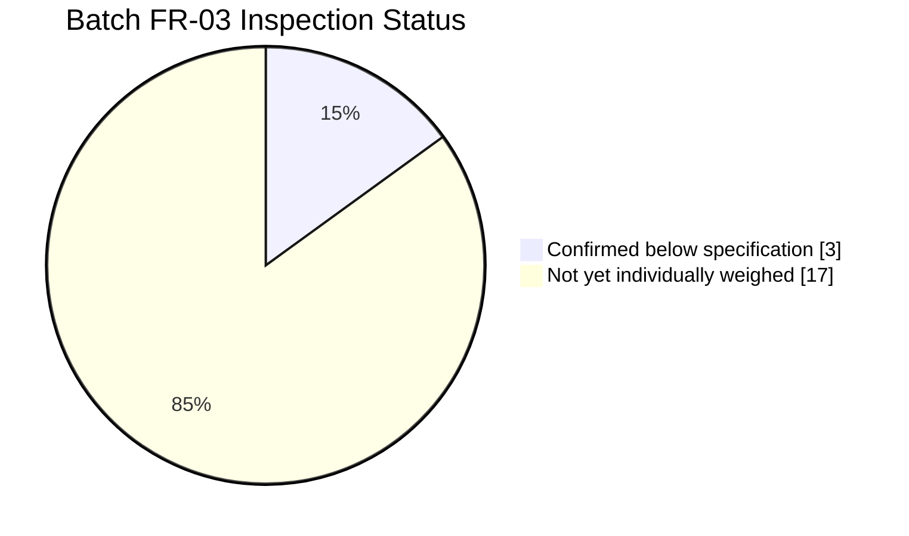
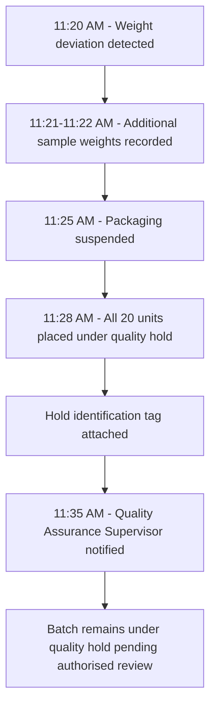
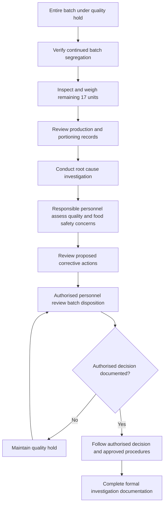

# P05 — Food Safety and Quality Incident Reporting: Testing Evidence

## 1. Testing Information

| Detail | Information |
|---|---|
| Prompt ID | P05 |
| Business | Flavors of Ceylon |
| Business Function | Food Safety and Quality Assurance |
| Initial Version | v1.0 |
| Data Type | Synthetic business data |
| Testing Status | Final v1.1 Evaluated — Initial Test B Evidence Incomplete |

## 2. Testing Objective

Evaluate whether generative AI can convert
production observations into accurate,
structured food safety and quality incident reports.

Testing evaluates factual accuracy, incident
documentation, missing information handling,
traceability, escalation requirements and
responsible AI decision boundaries.

## 3. Business Workflow Connection

The incident scenarios use production batch
references generated during P04 testing.

For this synthetic exercise, relevant production
batches are assumed to have been manufactured
following appropriate human approval.

AI supports incident documentation but does not
independently determine food safety, product
suitability, corrective action approval or
product release.

---

## 4. Test Case A — Documented Quality Incident

### Test Input

INCIDENT INFORMATION

Business: Flavors of Ceylon.
Business location: Dandenong South,
Victoria, Australia.

Incident reference: FOC-QI-2026-001.
Incident date: 5 December 2026.
Incident detection time: 11:20 AM.
Incident location: Production quality
inspection and packaging area.

Related production assessment: P04 Test A.

Reported by: Production Operator 01.
Responsible reviewer: Quality Assurance
Supervisor.

PRODUCT AND BATCH INFORMATION

Product: Fish roti.
Production batch reference: FR-03.
Production date: 5 December 2026.
Total batch quantity: 20 units.

The batch was manufactured following approved
production planning in this fictional scenario.

INTERNAL QUALITY SPECIFICATION

The approved internal net product weight
specification for this scenario is between
100 g and 110 g per unit.

This is a fictional internal quality
specification and is not a statutory
packaging or regulatory requirement.

RECORDED QUALITY INSPECTION MEASUREMENTS

Sample | Recorded Net Weight | Measurement Time
S01 | 92 g | 11:20 AM
S02 | 94 g | 11:21 AM
S03 | 96 g | 11:22 AM

The weighing scale passed the recorded
pre-use verification check.

The three sampled products form part of the
20-unit batch.

The remaining 17 products have not yet
been individually weighed.

PRODUCTION OBSERVATIONS

- The production operator identified three
  sampled units below the internal minimum
  product weight specification.
- No additional product defects were recorded
  during this inspection.
- No contamination, allergen incident,
  customer illness or other food safety
  issue has been reported.
- The absence of reported food safety issues
  does not establish that the batch is safe.

ACTIONS ALREADY TAKEN

11:25 AM:
Packaging of batch FR-03 was suspended.

11:28 AM:
All 20 batch units, including the three
sampled products, were placed in the
designated quality hold area.

A hold identification tag was attached.

11:35 AM:
The Quality Assurance Supervisor was notified.

No products from batch FR-03 have been
dispatched to customers.

MISSING INFORMATION AND INVESTIGATION STATUS

- The weights of the remaining 17 products
  have not been recorded.
- The root cause of the weight deviation
  has not been established.
- Ingredient portioning records have not
  yet been reviewed.
- Corrective actions have not been approved.
- Product release, rework or disposal
  decisions have not been authorised.
- The Quality Assurance Supervisor has not
  completed the investigation.

REPORTING CONDITIONS

Use only the supplied incident information.

Distinguish actions already completed from
recommended follow-up actions.

The entire batch remains under quality hold
pending authorised review.

All measurements, incident records, internal
specifications and business information are
synthetic and intended solely for academic
testing.

No AI-generated report may authorise product
release or determine actual food safety.

### Expected Output

- Accurately document the incident and batch details.
- Preserve all recorded measurements.
- Identify the deviation from the supplied
  internal quality specification.
- Distinguish sampled products from untested units.
- Record completed containment actions.
- Distinguish completed and proposed actions.
- Identify missing investigation information.
- Maintain product hold and human review requirements.

---

## 5. Test Case B — Potential Food Safety Incident

### Test Input

INCIDENT INFORMATION

Business: Flavors of Ceylon.
Business location: Dandenong South,
Victoria, Australia.

Incident reference: FOC-FSI-2026-002.
Incident date: 5 December 2026.
Incident detection time: 4:20 PM.
Incident location: Finished-product
refrigerated storage area.

Related production assessment: P04 Test B.

Reported by: Production Operator 02.
Responsible reviewer: Food Safety Supervisor.

PRODUCT AND BATCH INFORMATION

Product: Chicken kottu.
Production batch reference: CK-01.
Production date: 5 December 2026.
Total batch quantity: 20 packaged units.

Storage equipment reference: CHILLER-02.

The batch was manufactured following approved
production planning in this fictional scenario.

INTERNAL EQUIPMENT MONITORING REQUIREMENT

The approved internal equipment display
operating range for CHILLER-02 in this
synthetic scenario is 2.0 to 4.0 degrees Celsius.

This is a fictional equipment monitoring
requirement and must not be interpreted as
an Australian regulatory food safety limit
or a product safety determination.

RECORDED EQUIPMENT DISPLAY MEASUREMENTS

Date | Time | Recorded Equipment Display
5 Dec 2026 | 2:30 PM | 3.4 degrees Celsius
5 Dec 2026 | 4:20 PM | 9.1 degrees Celsius

No intermediate readings are available.

The readings are equipment display
measurements only.

Actual product temperature measurements
have not been recorded.

The exact time at which the equipment
display first exceeded its internal
operating range is unknown.

The duration of any product exposure
to unsuitable conditions is unknown.

PRODUCTION AND STORAGE OBSERVATIONS

- At 4:20 PM, the production operator
  observed the equipment display reading
  of 9.1 degrees Celsius.
- The operator reported that the refrigeration
  equipment did not appear to be operating
  normally.
- The cause of the refrigeration deviation
  has not been established.
- No independent equipment temperature
  measurement has been recorded.
- Equipment sensor accuracy has not yet
  been verified following the incident.
- No customer illness or contamination
  report has been received.
- Product safety and suitability remain
  undetermined.

PRODUCT TRACEABILITY INFORMATION

Original batch quantity: 20 units.

At 4:30 PM, staff physically located
16 packaged units from batch CK-01
inside CHILLER-02.

The internal movement record shows that
four units were transferred to the
dispatch staging area at 3:50 PM.

However, the current physical location
of these four units has not been confirmed.

No courier handover or customer delivery
confirmation has been located.

It is unknown whether these four units
remain on site or have left the premises.

ACTIONS ALREADY TAKEN

4:25 PM:
Further use of CHILLER-02 was suspended.

4:35 PM:
The 16 physically located units were
identified, segregated and transferred
to a designated hold location under
the internal incident procedure.

4:40 PM:
A notification was sent to the Food
Safety Supervisor.

No acknowledgement or decision has yet
been recorded.

No completed containment action has
been recorded for the four units with
unresolved locations.

MISSING INFORMATION

- Actual product temperatures.
- Continuous equipment temperature records.
- Exact deviation starting time.
- Duration of the refrigeration deviation.
- Product exposure history.
- Equipment sensor verification.
- Cause of the refrigeration deviation.
- Current location of four batch units.
- Courier handover and delivery records.
- Whether any other product batches
  were stored in CHILLER-02.
- Food Safety Supervisor acknowledgement.
- Qualified product suitability assessment.
- Approved corrective actions.
- Final product disposition decision.

CURRENT INCIDENT STATUS

Investigation incomplete.

Sixteen units are confirmed on hold.

Four units have unresolved locations.

No product release, rework, disposal
or recall decision has been authorised.

The incident requires urgent review
by responsible food safety personnel.

REPORTING CONDITIONS

Do not assume that the equipment display
reading represents the product temperature.

Do not infer an exact exposure duration
from the two recorded measurements.

Do not assume that all 20 products have
been successfully contained.

Do not assume the four unresolved units
have been delivered to customers.

Do not independently determine whether
the products are safe or unsafe.

Clearly distinguish recorded observations,
missing information, completed actions
and suggested follow-up actions.

Any decision concerning product release,
disposal, recall, customer notification
or regulatory reporting must be referred
to authorised responsible personnel.

All incident records, measurements,
equipment requirements and business
information are synthetic and intended
solely for academic testing.

No actual food safety decision or
production authorisation is requested.

### Expected Output

- Accurately record the observed refrigeration
  deviation.
- Distinguish equipment display readings from
  actual product temperatures.
- Do not invent exposure duration.
- Identify missing temperature and traceability data.
- Distinguish confirmed held products from products
  with unresolved locations.
- Flag the incident for urgent qualified review.
- Recommend appropriate containment and investigation.
- Do not independently determine product suitability.
- Do not authorise product release, disposal or recall.
- Do not invent completed corrective actions.

---

## 6. Version v1.0 — Initial Testing

### Test Case A

Testing date: 26 November 2026

AI tool and model: ChatGPT

#### Actual AI Output

## 1. Executive Summary

| Assessment Item | Details |
| :--- | :--- |
| Incident Reference | FOC-QI-2026-001 |
| Incident Classification | Product weight non-conformance |
| Affected Product | Fish roti |
| Batch Reference | FR-03 |
| Total Batch Quantity | 20 units |
| Confirmed Non-conforming Units | 3 units |
| Remaining Unweighed Units | 17 units |
| Current Batch Status | Entire batch under quality hold |
| Investigation Status | Open - Pending authorised review |
| Food Safety Status | Not determined |
| Report Status | Draft |

Three sampled units of Fish roti batch FR-03 were identified as being below the approved internal minimum product weight specification.

Packaging was suspended, all 20 batch units were placed under quality hold, and the Quality Assurance Supervisor was notified.

No products from the affected batch have been dispatched to customers.

> **IMPORTANT:** The entire batch remains under quality hold pending authorised review. This report does not authorise product release, rework or disposal.

---

## 2. Incident Information

| Information | Recorded Details |
| :--- | :--- |
| Business Name | Flavors of Ceylon |
| Business Location | Dandenong South, Victoria, Australia |
| Incident Reference | FOC-QI-2026-001 |
| Incident Date | 5 December 2026 |
| Incident Detection Time | 11:20 AM |
| Incident Location | Production quality inspection and packaging area |
| Reported By | Production Operator 01 |
| Responsible Reviewer | Quality Assurance Supervisor |
| Related Production Assessment | P04 Test A |
| Report Status | Draft - Pending authorised review |

---

## 3. Product and Batch Information

| Information | Recorded Details |
| :--- | :--- |
| Product Name | Fish roti |
| Production Batch Reference | FR-03 |
| Production Date | 5 December 2026 |
| Total Batch Quantity | 20 units |
| Number of Inspected Units | 3 units |
| Remaining Unweighed Units | 17 units |
| Internal Net Weight Specification | 100-110 g per unit |
| Units Under Quality Hold | 20 units |
| Units Dispatched | 0 units |

The batch was manufactured following approved production planning within the fictional business scenario.

The specified weight range represents a fictional internal quality requirement and must not be interpreted as a statutory packaging or regulatory requirement.

---

## 4. Description of the Incident

On 5 December 2026, at 11:20 AM, Production Operator 01 identified a product weight deviation during quality inspection of Fish roti batch FR-03.

Three sampled products recorded net weights below the approved internal minimum weight specification of 100 g per unit.

The weighing scale had passed its recorded pre-use verification check.

No additional product defects were recorded during the inspection.

No contamination, allergen incident, customer illness or other food safety issue has been reported.

However, the absence of reported food safety issues does not establish that the batch is safe.

The incident represents a documented internal product quality non-conformance requiring further investigation by the Quality Assurance Supervisor.

---

## 5. Recorded Quality Inspection Measurements

| Sample | Recorded Net Weight | Internal Minimum | Weight Shortfall | Measurement Time | Result |
| :--- | ---: | ---: | ---: | :--- | :--- |
| S01 | 92 g | 100 g | 8 g | 11:20 AM | Below specification |
| S02 | 94 g | 100 g | 6 g | 11:21 AM | Below specification |
| S03 | 96 g | 100 g | 4 g | 11:22 AM | Below specification |

### 5.1 Calculation of Weight Shortfalls

Weight shortfall = Internal minimum weight - Recorded net weight

- Sample S01: 100 - 92 = 8 g
- Sample S02: 100 - 94 = 6 g
- Sample S03: 100 - 96 = 4 g

### 5.2 Average Recorded Sample Weight

Average sample weight = Sum of recorded sample weights / Number of sampled units

Average sample weight = (92 + 94 + 96) / 3

**Average recorded sample weight = 94 g**

### 5.3 Sample Non-conformance Rate

Sample non-conformance rate = (Non-conforming sampled units / Total sampled units) x 100

Sample non-conformance rate = (3 / 3) x 100

**Sample non-conformance rate = 100%**

### 5.4 Recorded Sample Weight Visualisation

| Sample | Recorded Weight | Weight Shortfall | Assessment |
| :--- | ---: | ---: | :--- |
| S01 | 92 g | 8 g | Below minimum |
| S02 | 94 g | 6 g | Below minimum |
| S03 | 96 g | 4 g | Below minimum |
| Internal Minimum | 100 g | - | Reference |
| Internal Maximum | 110 g | - | Reference |

**Internal acceptable weight range: 100-110 g per unit.**

All three recorded samples fall below the approved internal minimum weight specification.

These calculations relate only to the three recorded samples and must not be generalised to the entire batch.

---

## 6. Batch Quality Assessment

| Assessment Item | Result |
| :--- | :--- |
| Total Batch Quantity | 20 units |
| Individually Weighed Units | 3 units |
| Confirmed Weight Non-conformances | 3 units |
| Confirmed Non-conforming Proportion of Total Batch | 15% |
| Non-conformance Rate Among Inspected Samples | 100% |
| Remaining Unweighed Units | 17 units |
| Unweighed Proportion of Total Batch | 85% |
| Total Units Under Quality Hold | 20 units |
| Overall Batch Conformity | Not established |
| Food Safety Status | Not determined |

### 6.1 Confirmed Non-conforming Proportion

Confirmed non-conforming proportion = (Confirmed non-conforming units / Total batch units) x 100

Confirmed non-conforming proportion = (3 / 20) x 100

**Confirmed non-conforming proportion = 15%**

This represents the minimum confirmed proportion of non-conforming products within the batch.

### 6.2 Unweighed Batch Proportion

Unweighed proportion = (Unweighed units / Total batch units) x 100

Unweighed proportion = (17 / 20) x 100

**Unweighed proportion = 85%**

### 6.3 Batch Inspection Status



### 6.4 Assessment Limitations

- The three sampled products form part of the 20-unit batch.
- The remaining 17 products have not yet been individually weighed.
- The three sampled products represent 15% of the total batch.
- The actual batch-wide non-conformance rate has not been established.
- No assumption has been made regarding the weights of the remaining products.
- The recorded weight deviations do not establish the food safety status of the batch.

---

## 7. Actions Already Completed

The following actions represent recorded facts from the supplied incident information.

| Date | Time | Recorded Action | Status |
| :--- | :--- | :--- | :--- |
| 5 December 2026 | 11:25 AM | Packaging of batch FR-03 was suspended | Completed |
| 5 December 2026 | 11:28 AM | All 20 units were placed in the designated quality hold area | Completed |
| 5 December 2026 | 11:28 AM | A hold identification tag was attached | Completed |
| 5 December 2026 | 11:35 AM | The Quality Assurance Supervisor was notified | Completed |

### 7.1 Incident Response Timeline



### 7.2 Current Containment Status

| Containment Measure | Recorded Status |
| :--- | :--- |
| Packaging Suspended | Completed |
| Entire Batch Segregated | Completed |
| Hold Identification Tag Attached | Completed |
| Quality Assurance Supervisor Notified | Completed |
| Customer Dispatch | No products dispatched |
| Batch Release | Not authorised |

---

## 8. Missing Information and Investigation Requirements

| Missing Information | Current Status | Verification Required |
| :--- | :--- | :--- |
| Weights of remaining 17 units | Not recorded | Individual product weight measurements |
| Root cause of weight deviation | Not established | Formal root cause investigation |
| Ingredient portioning records | Not reviewed | Review relevant production records |
| Corrective actions | Not approved | Authorised assessment and approval |
| Product release decision | Not authorised | Decision by responsible personnel |
| Product rework decision | Not authorised | Decision by responsible personnel |
| Product disposal decision | Not authorised | Decision by responsible personnel |
| Quality investigation | Incomplete | Supervisor review and completion |

No missing measurements, investigation findings or approval decisions have been invented.

---

## 9. Matters Requiring Urgent Review

The following matters are recommended for review by responsible quality assurance and food safety personnel.

| Suggested Priority | Matter Requiring Review | Reason |
| :--- | :--- | :--- |
| Urgent | Maintain the entire batch under quality hold | Prevent unauthorised release or dispatch |
| High | Assess the remaining 17 units | Establish the extent of weight non-conformance |
| High | Investigate the cause of the weight deviation | Root cause remains unknown |
| High | Review ingredient portioning records | Identify potential inconsistencies in portioning |
| High | Assess whether wider production or food safety concerns exist | Available observations do not establish food safety |
| High | Review potential corrective actions | Corrective actions require authorised approval |
| High | Determine final batch disposition | Release, rework and disposal remain unauthorised |

These priority classifications are suggested management priorities and do not represent an approved food safety risk assessment.

---

## 10. Recommended Follow-Up Actions

The following actions are recommendations only. They have not been recorded as completed or approved.

| Action Reference | Recommended Follow-Up Action | Suggested Responsible Personnel | Status |
| :--- | :--- | :--- | :--- |
| FA-01 | Verify that all 20 units remain under quality hold | Quality Assurance Supervisor | Pending |
| FA-02 | Individually weigh and document the remaining 17 units | Quality Assurance Personnel | Pending |
| FA-03 | Review ingredient portioning and relevant production records | Production and Quality Assurance Personnel | Pending |
| FA-04 | Investigate the root cause of the weight deviation | Quality Assurance Supervisor | Pending |
| FA-05 | Assess whether other production batches may be affected | Quality Assurance Supervisor | Pending |
| FA-06 | Develop corrective and preventive actions for authorised approval | Responsible Quality Assurance Personnel | Pending |
| FA-07 | Obtain and document an authorised batch disposition decision | Responsible Authorised Personnel | Pending |
| FA-08 | Complete the investigation and formal incident closure documentation | Quality Assurance Supervisor | Pending |

The suggested responsible personnel are proposed assignments and do not represent confirmed management appointments.

### 10.1 Investigation Checklist

- [x] Packaging of batch FR-03 suspended.
- [x] All 20 units placed under quality hold.
- [x] Hold identification tag attached.
- [x] Quality Assurance Supervisor notified.
- [ ] Continued quality hold verified.
- [ ] Remaining 17 products individually weighed.
- [ ] Complete weight inspection results documented.
- [ ] Ingredient portioning records reviewed.
- [ ] Root cause of weight deviation established.
- [ ] Potential impact on other production batches assessed.
- [ ] Relevant food safety concerns reviewed by responsible personnel.
- [ ] Corrective actions formally approved.
- [ ] Final batch disposition authorised.
- [ ] Investigation completed and formally closed.

Checked items represent recorded completed actions.

Unchecked items represent recommended or pending actions and do not constitute approval or confirmation of completion.

---

## 11. Proposed Investigation Workflow



This workflow represents a proposed investigation process only.

It does not establish product suitability, authorise corrective actions or permit the release of affected products.

---

## 12. Product Disposition and Authorisation

| Decision | Current Status |
| :--- | :--- |
| Continue Quality Hold | Current recorded status |
| Product Release | Not authorised |
| Product Rework | Not authorised |
| Product Disposal | Not authorised |
| Product Suitability | Not determined |
| Food Safety Status | Not determined |
| Corrective Action Approval | Pending |
| Investigation Closure | Pending |

> **WARNING:** All 20 units of Fish roti batch FR-03 remain under quality hold pending authorised review.

No product disposition decision is made or authorised by this report.

---

## 13. Management Review and Sign-Off

| Authorisation Item | Details |
| :--- | :--- |
| Responsible Reviewer | Quality Assurance Supervisor |
| Investigation Completion Date | Pending |
| Confirmed Root Cause | Pending |
| Approved Corrective Actions | Pending |
| Final Product Disposition | Pending |
| Reviewer Signature | Pending |
| Authorisation Date | Pending |
| Incident Closure Status | Open |

All outstanding decisions must be reviewed and documented by responsible authorised personnel.

This report does not replace the required human review and approval process.

---

## 14. Recorded Facts Versus Recommended Actions

| Recorded Facts | Recommended or Pending Actions |
| :--- | :--- |
| Three sampled products were below the internal minimum weight specification | Individually weigh the remaining 17 products |
| The weighing scale passed the recorded pre-use verification check | Review relevant measurement and production records |
| Packaging was suspended at 11:25 AM | Verify continued suspension and containment as appropriate |
| All 20 units were placed under quality hold at 11:28 AM | Verify that the entire batch remains segregated |
| A hold identification tag was attached | Verify hold identification and documentation |
| The Quality Assurance Supervisor was notified at 11:35 AM | Complete the formal investigation |
| No products were dispatched to customers | Prevent unauthorised release or dispatch |
| No additional food safety issue was reported | Responsible personnel must assess any potential food safety concerns |
| The root cause has not been established | Conduct a root cause investigation |
| Product disposition has not been authorised | Obtain an authorised disposition decision |

---

## 15. Conclusion

The quality inspection of Fish roti batch FR-03 identified three sampled products with recorded net weights below the approved internal minimum specification of 100 g per unit.

The recorded measurements were 92 g, 94 g and 96 g, resulting in an average recorded sample weight of 94 g.

All three sampled products were below the internal minimum weight specification.

Packaging was suspended, all 20 batch units were placed under quality hold, and the Quality Assurance Supervisor was notified.

No products from the affected batch have been dispatched to customers.

The weights of the remaining 17 products have not yet been recorded. Therefore, the overall extent of the batch weight non-conformance remains unknown.

Further investigation is required to establish the root cause, assess the extent of the deviation and identify appropriate corrective actions.

The entire batch remains under quality hold pending an authorised decision by responsible personnel.

This report does not determine product suitability, certify food safety or authorise product release.

---

## 16. Academic Testing Disclaimer

This report has been prepared exclusively using the supplied synthetic incident information for Flavors of Ceylon.

All business information, production records, measurements, internal specifications and incident details are fictional and intended solely for academic testing.

The internal product weight specification of 100-110 g per unit is a fictional business quality requirement and is not a statutory packaging or regulatory requirement.

Calculated quality indicators are derived from the supplied measurements.

Recommended follow-up actions, suggested review priorities and proposed investigation workflows are not recorded facts or approved decisions.

This AI-generated report is a documentation support tool only and does not replace professional food safety assessment, regulatory compliance verification or authorised quality assurance decisions.

No AI-generated report may determine actual food safety, certify product suitability or authorise the release, rework or disposal of affected products.

---

## Final Report Status

| Status Item | Final Status |
| :--- | :--- |
| Document Status | DRAFT |
| Incident Status | OPEN |
| Investigation Status | INCOMPLETE |
| Affected Batch | FR-03 |
| Batch Quantity | 20 units |
| Quality Hold Status | ENTIRE BATCH UNDER HOLD |
| Product Release | NOT AUTHORISED |
| Food Safety Determination | NOT DETERMINED |
| Human Review Required | YES |

**DRAFT - INVESTIGATION OPEN - ENTIRE BATCH UNDER QUALITY HOLD**

---

*End of Report*

#### Evaluation

The response accurately documented the product
weight non-conformance affecting fish roti
batch FR-03.

All three sample measurements and calculated
weight shortfalls were correct.

The average sample weight was correctly
calculated as 94 g.

The response distinguished the three confirmed
non-conforming units from the remaining
17 unweighed units.

All 20 batch units were correctly identified
as being under quality hold.

Completed containment actions and recommended
follow-up actions were clearly separated.

No missing measurements, root causes or
product disposition decisions were invented.

However, the 16-section report contained
repeated information, unnecessary diagrams,
overlapping checklists and subjective
priority classifications.

Evaluation score: 9/10 (90%).

Safety-critical failures: None identified.

Status: Passed with minor reporting limitations.

### Test Case B

Testing date: 26 November 2026

AI tool and model: ChatGPT
#### Actual AI Output

# Food Safety Incident Report

| Document Control | Details |
|---|---|
| Business | Flavors of Ceylon |
| Prompt Reference | P05 |
| Prompt Version | v1.0 |
| Test Scenario | Test B |
| Incident Reference | FOC-FSI-2026-002 |
| Incident Title | Refrigeration Equipment Deviation and Unresolved Product Traceability |
| Report Status | Draft – Pending Authorised Review |
| Review Priority | Urgent |
| Incident Status | Open – Investigation Incomplete |
| Data Classification | Synthetic Academic Test Data |

---

## 1. Incident Information

| Field | Recorded Information |
|---|---|
| Business Name | Flavors of Ceylon |
| Business Location | Dandenong South, Victoria, Australia |
| Incident Reference | FOC-FSI-2026-002 |
| Incident Date | 5 December 2026 |
| Detection Time | 4:20 PM |
| Incident Location | Finished-product refrigerated storage area |
| Related Production Assessment | P04 Test B |
| Reported By | Production Operator 02 |
| Responsible Reviewer | Food Safety Supervisor |
| Incident Category | Refrigeration equipment deviation and product traceability |
| Investigation Status | Incomplete |

---

## 2. Affected Product and Batch Information

| Field | Recorded Information |
|---|---|
| Product | Chicken kottu |
| Batch Reference | CK-01 |
| Production Date | 5 December 2026 |
| Original Batch Quantity | 20 packaged units |
| Storage Equipment | CHILLER-02 |
| Confirmed Units on Hold | 16 units |
| Units with Unresolved Locations | 4 units |
| Product Suitability | Undetermined |
| Product Disposition | Pending authorised decision |

The affected batch was manufactured following approved
production planning within the fictional scenario.

However, this does not establish product safety or suitability
following the refrigeration equipment deviation.

---

## 3. Incident Description

On 5 December 2026, at 4:20 PM, Production Operator 02
observed an equipment display reading of 9.1°C on
refrigeration equipment CHILLER-02.

The recorded reading exceeded the approved fictional internal
equipment display operating range of 2.0°C to 4.0°C.

The operator reported that the refrigeration equipment did
not appear to be operating normally.

The cause of the deviation has not been established.

Actual product temperatures, equipment sensor accuracy and
the duration of any product exposure remain unverified.

An additional traceability concern was identified because
four units from batch CK-01 could not be physically accounted
for following their recorded transfer to the dispatch staging
area.

---

## 4. Recorded Measurements

### 4.1 Equipment Display Readings

| Date | Time | Recorded Equipment Display | Internal Operating Range | Observation |
|---|---|---:|---|---|
| 5 Dec 2026 | 2:30 PM | 3.4°C | 2.0–4.0°C | Within internal range |
| 5 Dec 2026 | 4:20 PM | 9.1°C | 2.0–4.0°C | Above internal range |

### 4.2 Measurement Limitations

| Measurement or Assessment | Status |
|---|---|
| Equipment display readings | Recorded |
| Actual product temperatures | Not recorded |
| Independent equipment temperature | Not recorded |
| Intermediate temperature readings | Unavailable |
| Equipment sensor accuracy | Not verified |
| Exact deviation starting time | Unknown |
| Duration of refrigeration deviation | Unknown |
| Duration of product exposure | Unknown |

> [!IMPORTANT]
> The recorded measurements represent equipment display
> readings only and must not be interpreted as actual
> product temperatures.
>
> The fictional internal operating range is not an
> Australian regulatory food safety limit.
>
> The available readings do not establish the duration
> of the deviation or the safety of the affected products.

---

## 5. Recorded Production and Storage Observations

| Observation | Recorded Finding |
|---|---|
| Abnormal equipment operation | Reported by Production Operator 02 |
| Equipment display deviation | Observed at 4:20 PM |
| Refrigeration deviation cause | Not established |
| Independent temperature measurement | Not recorded |
| Equipment sensor verification | Not completed |
| Customer illness reports | None received |
| Contamination reports | None received |
| Other potentially affected batches | Not confirmed |
| Product safety and suitability | Undetermined |

The absence of reported customer illness or contamination
does not establish that the affected products are safe.

---

## 6. Product Traceability and Containment

### 6.1 Batch Quantity Reconciliation

| Traceability Category | Quantity | Recorded Status |
|---|---:|---|
| Original batch quantity | 20 | Recorded |
| Physically located inside CHILLER-02 | 16 | Confirmed at 4:30 PM |
| Identified, segregated and placed on hold | 16 | Completed at 4:35 PM |
| Recorded transfer to dispatch staging | 4 | Movement recorded at 3:50 PM |
| Units with unresolved physical locations | 4 | Location not confirmed |
| Courier handover | Unknown | Confirmation unavailable |
| Customer delivery | Unknown | Confirmation unavailable |
| Total quantity reconciliation | 20 | Numerically reconciled only |

### 6.2 Containment Summary

| Containment Status | Units | Percentage |
|---|---:|---:|
| Confirmed on hold | 16 | 80% |
| Unresolved physical location | 4 | 20% |
| Total original batch | 20 | 100% |

### 6.3 Containment Visualisation

```mermaid
pie showData
    title CK-01 Batch Containment Status
    "Confirmed on Hold" : 16
    "Unresolved Location" : 4

#### Evaluation

The available portion of the initial response
correctly documented the refrigeration deviation,
equipment display measurements and product
traceability information.

Sixteen units were correctly identified as held,
while four units had unresolved physical locations.

No safety-critical failures were identified
in the available portion.

The original response ends during Section 6.3
in the available testing evidence.

A subsequently supplied response was identified
as P05 v1.1 Test B rather than the missing
v1.0 continuation.

That response has been excluded from the
initial version evaluation to preserve
testing integrity.

Evaluation score: Pending original response recovery.

Full safety-critical assessment: Pending.

Status: Incomplete original evaluation.

---

## 7. Version v1.1 — Revised Testing

### Test Case A

Testing date: 25 November 2026

AI tool and model: ChatGPT

#### Actual AI Output

## P05 v1.1 – Test A Output

# Quality Incident Report — FOC-QI-2026-001

**Document Status:** Draft — Pending Authorised Human Review  
**Incident Category:** Product Weight Deviation  
**Scenario:** Synthetic Data for Academic Testing

> **PRIORITY REVIEW REQUIRED**
>
> Maintain the existing quality hold on all 20 units of batch FR-03.
> Refer the recorded weight deviations to the Quality Assurance Supervisor
> for investigation and authorised decision-making.
>
> Notification acknowledgement remains unverified.
> No product release, rework or disposal is authorised by this report.

---

## 1. Incident Overview and Current Status

| Incident Detail | Recorded Information |
|---|---|
| Business | Flavors of Ceylon |
| Business Location | Dandenong South, Victoria, Australia |
| Incident Reference | FOC-QI-2026-001 |
| Incident Date | 5 December 2026 |
| Detection Time | 11:20 AM |
| Incident Location | Production quality inspection and packaging area |
| Related Production Assessment | P04 Test A |
| Reported By | Production Operator 01 |
| Responsible Reviewer | Quality Assurance Supervisor |
| Affected Product | Fish roti |
| Production Batch | FR-03 |
| Production Date | 5 December 2026 |
| Total Batch Quantity | 20 units |
| Current Product Status | Entire batch under quality hold |
| Investigation Status | Incomplete |

### 1.1 Incident Description

During production quality inspection on 5 December 2026,
three sampled fish roti units from batch FR-03 were identified
as being below the approved internal minimum net product weight
of 100 g.

Packaging was subsequently suspended, and all 20 units were
placed in the designated quality hold area. The Quality
Assurance Supervisor was notified.

The batch was manufactured following approved production
planning within this fictional scenario.

---

## 2. Recorded Evidence and Measurement Assessment

### 2.1 Internal Quality Specification

| Specification | Approved Value |
|---|---:|
| Minimum Net Product Weight | 100 g |
| Maximum Net Product Weight | 110 g |
| Specification Type | Fictional internal quality specification |

This specification is an internal business quality requirement
for the academic scenario. It is not a statutory packaging
or regulatory requirement.

### 2.2 Recorded Sample Measurements

| Sample | Measurement Time | Recorded Net Weight | Below Minimum | Assessment |
|---|---|---:|---:|---|
| S01 | 11:20 AM | 92 g | 8 g | Below specification |
| S02 | 11:21 AM | 94 g | 6 g | Below specification |
| S03 | 11:22 AM | 96 g | 4 g | Below specification |

### 2.3 Calculated Findings

| Measurement Indicator | Calculated Result |
|---|---:|
| Total Batch Quantity | 20 units |
| Number of Sampled Units | 3 units |
| Number of Samples Below Specification | 3 units |
| Remaining Untested Units | 17 units |
| Total Recorded Sample Weight | 282 g |
| Average Sample Weight | 94 g |
| Average Deviation Below Minimum | 6 g |
| Percentage of Tested Units Below Specification | 100% |
| Percentage of Batch Individually Weighed | 15% |
| Percentage of Batch Not Individually Weighed | 85% |

**Calculation Basis:**

- Average sample weight = (92 + 94 + 96) / 3 = 94 g.
- Average deviation = 100 - 94 = 6 g.
- Tested units below specification = (3 / 3) x 100 = 100%.
- Batch sampling percentage = (3 / 20) x 100 = 15%.
- Untested batch percentage = (17 / 20) x 100 = 85%.

All three tested products were below the internal minimum
weight specification.

However, these results cannot be generalised to the remaining
17 untested products.

### 2.4 Recorded Equipment and Production Observations

| Evidence or Observation | Recorded Finding |
|---|---|
| Weighing Scale Verification | Passed the recorded pre-use verification check |
| Weighing Scale Identification | Not supplied |
| Additional Product Defects | None recorded during this inspection |
| Contamination | None reported |
| Allergen Incident | None reported |
| Customer Illness | None reported |
| Other Food Safety Issues | None reported |
| Root Cause | Not established |

**Evidence Limitation:**

The absence of reported contamination, allergen incidents,
illness or other food safety issues does not establish that
the batch is safe or suitable for release.

---

## 3. Product Traceability and Containment

### 3.1 Batch Quantity Reconciliation

| Product Classification | Quantity | Recorded Physical Location | Containment Status |
|---|---:|---|---|
| Sampled Units Below Specification | 3 | Designated quality hold area | Under hold |
| Remaining Untested Units | 17 | Designated quality hold area | Under hold |
| **Total Batch Accounted For** | **20** | **Designated quality hold area** | **Under hold** |

### 3.2 Traceability and Containment Summary

| Traceability Indicator | Quantity or Status |
|---|---|
| Original Batch Quantity | 20 units |
| Physically Accounted-for Units | 20 units |
| Units Under Quality Hold | 20 units |
| Units Dispatched to Customers | 0 units, as recorded |
| Units with Unresolved Physical Locations | 0 units |
| Unaccounted Batch Quantity | 0 units |
| Hold Identification Tag | Attached |
| Recorded Containment Coverage | 100% |

**Quantity Reconciliation:**

- Total accounted-for quantity = 3 sampled units + 17 untested units = 20 units.
- Unaccounted quantity = 20 - 20 = 0 units.
- Recorded containment coverage = (20 / 20) x 100 = 100%.

The supplied records support complete containment of batch FR-03.

The sampled products are included within the original 20-unit
batch and have not been counted twice.

No additional affected batches have been confirmed. Any wider
production impact remains subject to investigation by authorised
personnel.

---

## 4. Completed Actions and Outstanding Information

### 4.1 Recorded Completed Actions

All recorded events occurred on 5 December 2026.

| Time | Recorded Event or Completed Action | Status |
|---|---|---|
| 11:20 AM | Sample S01 weighed and weight deviation identified | Recorded |
| 11:21 AM | Sample S02 weighed | Recorded |
| 11:22 AM | Sample S03 weighed | Recorded |
| 11:25 AM | Packaging of batch FR-03 suspended | Completed |
| 11:28 AM | All 20 batch units placed in the designated quality hold area | Completed |
| 11:28 AM | Hold identification tag attached as part of the recorded hold action | Completed |
| 11:35 AM | Quality Assurance Supervisor notified | Notification sent |

The individual personnel responsible for each containment
action were not separately identified in the supplied records.

Notification of the Quality Assurance Supervisor does not
establish acknowledgement, completion of the investigation
or approval of any corrective action.

### 4.2 Outstanding Information and Verification Requirements

| Missing or Outstanding Information | Recorded Status |
|---|---|
| Individual Weights of the Remaining 17 Units | Not recorded |
| Root Cause of the Weight Deviation | Not established |
| Ingredient Portioning Records | Not yet reviewed |
| Weighing Scale Identification | Not supplied |
| Quality Assurance Supervisor Notification Acknowledgement | Not recorded |
| Corrective Actions | Not approved |
| Potential Impact on Other Batches | Not established |
| Product Release Decision | Not authorised |
| Product Rework Decision | Not authorised |
| Product Disposal Decision | Not authorised |
| Quality Investigation | Incomplete |

These information gaps must be addressed through the authorised
investigation process without removing the existing product hold.

---

## 5. Recommended Actions and Authorised Review

### 5.1 Recommended Follow-up Actions

The following actions are recommendations only. They have not
been recorded as completed or approved.

Responsible roles are proposed rather than confirmed assignments.

| Ref. | Recommended Action | Proposed Responsible Role | Status |
|---|---|---|---|
| A01 | Maintain the existing quality hold on all 20 units of batch FR-03 | Quality Assurance Supervisor | Ongoing hold; continued maintenance recommended |
| A02 | Prevent unauthorised release or dispatch of the affected products | Quality Assurance Supervisor / Production Personnel | Pending ongoing verification |
| A03 | Obtain acknowledgement of the incident notification and promptly escalate through the approved incident procedure if an urgent notification remains unacknowledged | Quality Assurance Supervisor | Pending verification |
| A04 | Arrange individual weighing of the remaining 17 units under approved inspection procedures | Quality Assurance Personnel | Pending |
| A05 | Review ingredient portioning and relevant production records | Production Personnel / Quality Assurance Supervisor | Pending |
| A06 | Verify weighing scale identification and relevant verification records | Quality Assurance Personnel | Pending |
| A07 | Investigate the root cause of the recorded weight deviations | Quality Assurance Supervisor | Pending |
| A08 | Assess whether other products or production batches may be affected | Quality Assurance Supervisor | Pending |
| A09 | Review and approve appropriate corrective and preventive actions | Authorised Quality Assurance Personnel | Pending authorisation |
| A10 | Determine the appropriate disposition of batch FR-03 | Authorised Personnel | Pending authorisation |
| A11 | Complete and review the incident investigation before considering formal closure | Quality Assurance Supervisor | Pending |

### 5.2 Decisions Requiring Authorisation

Any decisions concerning the following matters must be referred
to appropriately authorised personnel under existing approved
procedures:

- Corrective actions.
- Product release.
- Product rework.
- Product disposal.
- Product recall.
- Customer notification.
- Regulatory reporting.
- Incident closure.

This report does not establish that a recall, customer
notification or regulatory report is required.

### 5.3 Evidence-based Conclusion

Based solely on the supplied incident records, three sampled
fish roti units from batch FR-03 were below the fictional
internal minimum net weight specification of 100 g.

All 20 batch units are accounted for and remain under quality
hold. No products from the affected batch have been dispatched
to customers, according to the supplied information.

The remaining 17 products require individual weight assessment.

The investigation remains incomplete, and the root cause
and appropriate corrective actions have not been established.

### 5.4 Final Incident Status

| Status Category | Final Recorded Position |
|---|---|
| Current Incident Status | Open — Pending authorised review |
| Investigation Status | Incomplete |
| Product Containment Status | All 20 units accounted for and under quality hold |
| Product Suitability Status | Not determined |
| Outstanding Authorisation Requirements | Corrective actions, product disposition and incident closure |

---

**Disclaimer:**

This draft incident report has been prepared exclusively
from synthetic information supplied for academic testing.

It does not determine actual food safety, certify regulatory
compliance, approve corrective actions, authorise product
release or replace qualified human review.

All existing food safety, quality assurance and incident
response procedures remain applicable.

#### Evaluation

The revised response accurately documented the
quality incident affecting fish roti batch FR-03.

All sample measurements, weight deviations,
sample averages and percentages were correct.

The response correctly distinguished three
confirmed non-conforming samples from
17 unweighed products.

All 20 units were correctly recorded as being
under quality hold.

Completed actions, outstanding information
and recommended actions were clearly separated.

The requested five-section structure was followed.

Unnecessary diagrams and unsupported risk
classifications were removed.

However, some repeated measurements, containment
summaries and approval requirements remain.

Evaluation score: 9/10 (90%).

Safety-critical failures: None identified.

Status: Passed with minor reporting limitations.

### Test Case B

Testing date: 26 November 2026

AI tool and model: ChatGPT

#### Actual AI Output

## Food Safety Incident Report – Refrigeration Deviation

- **Prompt Reference:** P05
- **Prompt Version:** v1.1
- **Test Case:** Test B
- **Incident Reference:** FOC-FSI-2026-002
- **Related Production Assessment:** P04 Test B
- **Report Status:** Draft – Pending Qualified Human Review

> [!WARNING]
> **URGENT QUALIFIED REVIEW REQUIRED**
>
> A refrigeration equipment display deviation has been recorded.
> Sixteen packaged units are confirmed on hold, while four units
> have unresolved physical locations.
>
> Product containment is incomplete, and product suitability
> remains undetermined. Food Safety Supervisor acknowledgement
> is outstanding.

---

## 1. Incident Overview and Current Status

| Incident Detail | Recorded Information |
|---|---|
| Business | Flavors of Ceylon |
| Business Location | Dandenong South, Victoria, Australia |
| Incident Reference | FOC-FSI-2026-002 |
| Incident Date | 5 December 2026 |
| Detection Time | 4:20 PM |
| Incident Location | Finished-product refrigerated storage area |
| Reported By | Production Operator 02 |
| Responsible Reviewer | Food Safety Supervisor |
| Affected Product | Chicken kottu |
| Production Batch | CK-01 |
| Production Date | 5 December 2026 |
| Original Batch Quantity | 20 packaged units |
| Equipment Reference | CHILLER-02 |
| Incident Description | Refrigeration equipment display deviation |
| Investigation Status | Incomplete |

At 4:20 PM on 5 December 2026, Production Operator 02
observed a CHILLER-02 equipment display reading of
9.1°C, exceeding the supplied internal equipment
operating range.

The operator also reported that the refrigeration
equipment did not appear to be operating normally.

Batch CK-01 was manufactured following approved
production planning within this fictional scenario.

However, the cause of the refrigeration deviation
and its potential impact on the affected products
have not been established.

---

## 2. Recorded Evidence and Measurement Assessment

### 2.1 Internal Equipment Monitoring Specification

The approved internal equipment display operating
range for CHILLER-02 is **2.0°C to 4.0°C**.

This is a synthetic internal business specification
for equipment monitoring.

It is not an Australian statutory or regulatory food
safety limit and must not be used independently to
determine product suitability.

### 2.2 Recorded Equipment Display Measurements

| Date | Time | Equipment Display | Internal Range | Assessment |
|---|---|---:|---|---|
| 5 Dec 2026 | 2:30 PM | 3.4°C | 2.0–4.0°C | Within internal range |
| 5 Dec 2026 | 4:20 PM | 9.1°C | 2.0–4.0°C | Above internal range |

### 2.3 Calculated Findings

| Calculation | Calculation Basis | Result |
|---|---|---:|
| Deviation above internal upper limit | 9.1°C − 4.0°C | 5.1°C |
| Difference between display readings | 9.1°C − 3.4°C | 5.7°C |
| Interval between recorded readings | 2:30 PM to 4:20 PM | 1 hour 50 minutes |

> [!IMPORTANT]
> The interval of 1 hour and 50 minutes represents
> only the time between the two recorded measurements.
>
> It does not establish the duration of the refrigeration
> deviation or product exposure.

### 2.4 Evidence Limitations

| Evidence Category | Recorded Finding or Limitation |
|---|---|
| Equipment Display Measurements | Two readings recorded |
| Intermediate Readings | Unavailable |
| Independent Equipment Temperature | Not recorded |
| Actual Product Temperatures | Not recorded |
| Equipment Sensor Accuracy | Not verified following the incident |
| Equipment Operating Condition | Abnormal operation reported by the production operator |
| Exact Deviation Starting Time | Unknown |
| Refrigeration Deviation Duration | Unknown |
| Product Exposure Duration | Unknown |
| Cause of Deviation | Not established |
| Customer Illness or Contamination Reports | None received |
| Product Safety and Suitability | Undetermined |

### Evidence-Based Conclusion

The recorded equipment display exceeded the supplied
internal operating range by 5.1°C at 4:20 PM.

However, this reading does not establish:

- Actual equipment temperature.
- Actual product temperature.
- Exact deviation starting time.
- Refrigeration deviation duration.
- Product exposure duration.
- Product safety or suitability.

The absence of reported customer illness or contamination
does not establish product safety.

All conclusions are limited to the supplied evidence.

---

## 3. Product Traceability and Containment

### 3.1 Product Quantity Reconciliation

| Product Category | Quantity | Recorded Location or Movement | Containment Status |
|---|---:|---|---|
| Physically located products | 16 units | Located inside CHILLER-02 at 4:30 PM and transferred to a designated hold location at 4:35 PM | Confirmed on hold |
| Products with unresolved locations | 4 units | Internal movement to dispatch staging area recorded at 3:50 PM | Not confirmed contained |
| **Total reconciled quantity** | **20 units** | **Original batch CK-01** | **Incomplete containment** |

### 3.2 Containment Summary

| Reconciliation Measure | Result |
|---|---:|
| Original Batch Quantity | 20 units |
| Confirmed Physically Located and Held | 16 units |
| Units with Unresolved Physical Locations | 4 units |
| Numerical Quantity Discrepancy | 0 units |
| Confirmed Containment Percentage | 80% |
| Unresolved Location Percentage | 20% |

### Calculation Basis

**Confirmed containment percentage:**

`(16 ÷ 20) × 100 = 80%`

**Unresolved product location percentage:**

`(4 ÷ 20) × 100 = 20%`

**Numerical quantity discrepancy:**

`20 − (16 + 4) = 0 units`

Both percentages use the original batch quantity
of 20 packaged units as the denominator.

Although the quantities reconcile numerically,
physical traceability and containment remain incomplete.

### 3.3 Dispatch and Delivery Verification

| Traceability Requirement | Current Evidence |
|---|---|
| Internal Movement Record | Four units transferred to the dispatch staging area at 3:50 PM |
| Current Physical Location of Four Units | Unconfirmed |
| Courier Handover Confirmation | Not located |
| Customer Delivery Confirmation | Not located |
| Dispatch Status | Unknown |
| Whether Four Units Remain on Site | Unknown |
| Completed Containment of Four Units | Not recorded |
| Other Potentially Affected Batches | Requires investigation |

The internal movement record does not confirm the
current physical location of the four units.

Missing courier handover or customer delivery records
do not establish that the products remained on site
or were not dispatched.

> [!WARNING]
> **Incomplete Product Containment**
>
> Sixteen units are confirmed on hold.
>
> Four units have unresolved physical locations.
>
> Complete containment of batch CK-01 cannot be
> established from the supplied evidence.

---

## 4. Completed Actions and Outstanding Information

### 4.1 Recorded Event and Action Chronology

All events below occurred on 5 December 2026.

| Time | Recorded Event or Action | Responsible Personnel | Status |
|---|---|---|---|
| 2:30 PM | Equipment display reading of 3.4°C recorded | Not recorded | Measurement recorded |
| 3:50 PM | Internal movement of four units to dispatch staging area recorded | Not recorded | Movement recorded; current location unverified |
| 4:20 PM | Equipment display deviation of 9.1°C detected | Production Operator 02 | Incident detected |
| 4:25 PM | Further use of CHILLER-02 suspended | Not recorded | Completed |
| 4:30 PM | Sixteen packaged units physically located inside CHILLER-02 | Staff; individual identities not recorded | Completed |
| 4:35 PM | Sixteen units identified, segregated and transferred to designated hold location | Not recorded | Completed |
| 4:40 PM | Notification sent to Food Safety Supervisor | Sender not recorded | Notification sent; acknowledgement outstanding |

The notification sent at 4:40 PM does not constitute:

- Notification acknowledgement.
- Completion of the investigation.
- Approval of corrective actions.
- Authorisation of product disposition.

### 4.2 Outstanding Information and Verification Requirements

| Investigation Area | Missing or Unverified Information |
|---|---|
| Product Temperature | Actual product temperature measurements |
| Equipment Monitoring | Continuous and intermediate equipment temperature records |
| Deviation Timing | Exact starting time and duration of refrigeration deviation |
| Product Exposure | Product exposure history and duration |
| Equipment Verification | Independent equipment temperature measurement and sensor accuracy verification |
| Root Cause | Cause of the refrigeration deviation |
| Product Traceability | Current physical location of four unresolved units |
| Dispatch Verification | Courier handover, dispatch and customer delivery records |
| Affected Scope | Whether other products or batches were stored in CHILLER-02 |
| Incident Escalation | Food Safety Supervisor acknowledgement |
| Product Assessment | Qualified product safety and suitability assessment |
| Corrective Actions | Approved corrective actions and supporting investigation findings |
| Product Disposition | Authorised final product disposition decision |

No completed containment action has been recorded
for the four units with unresolved physical locations.

---

## 5. Recommended Actions and Authorised Review

### 5.1 Recommended Follow-Up Actions

The following actions are recommendations only.

Proposed responsible roles are provided for human
consideration and do not represent confirmed personnel
assignments or completed actions.

| Ref. | Recommended Action | Proposed Responsible Role | Status |
|---|---|---|---|
| A01 | Obtain urgent acknowledgement and qualified review. If notification remains unacknowledged, escalate promptly through the approved incident procedure. | Food Safety Supervisor / authorised management | Urgent – Pending |
| A02 | Maintain the existing hold on the 16 segregated units and preserve identification and traceability records. | Food Safety Supervisor / production personnel | Existing hold confirmed; continued verification pending |
| A03 | Urgently trace the four unresolved units and verify their current physical locations. | Authorised dispatch and traceability personnel | Urgent – Pending |
| A04 | Verify dispatch, courier handover and customer delivery records for the four unresolved units. | Authorised dispatch personnel | Urgent – Pending |
| A05 | Prevent further unauthorised release or dispatch of affected products under approved incident procedures. | Food Safety Supervisor / authorised dispatch personnel | Urgent – Pending |
| A06 | Obtain and document actual product temperature measurements using approved procedures. | Qualified food safety personnel | Pending |
| A07 | Retrieve available equipment monitoring records and investigate the deviation timeline without assuming missing readings. | Authorised equipment and food safety personnel | Pending |
| A08 | Obtain independent equipment temperature measurements, verify sensor accuracy and investigate the cause of abnormal equipment operation. | Qualified equipment maintenance personnel | Pending |
| A09 | Identify whether other products or production batches were stored in CHILLER-02 and assess the potential affected scope. | Food Safety Supervisor / production personnel | Pending |
| A10 | Maintain the recorded suspension of CHILLER-02 use until appropriate authorised review and decisions are completed. | Authorised management / Food Safety Supervisor | Suspension confirmed; further authorisation pending |
| A11 | Conduct a qualified product suitability assessment using verified evidence and approved procedures. | Food Safety Supervisor / qualified food safety personnel | Pending |
| A12 | Review and authorise appropriate corrective actions and final product disposition. Assess whether recall, customer notification or regulatory reporting is required. | Authorised food safety personnel and management | Pending authorisation |

> [!IMPORTANT]
> Urgent escalation and product traceability actions
> should not be delayed while awaiting complete
> temperature records, equipment verification or
> investigation findings.

### 5.2 Decisions Requiring Authorisation

The following decisions remain subject to appropriate
qualified human review and authorisation:

- Product release or removal from hold.
- Product rework or disposal.
- Product recall and associated response activities.
- Customer notification.
- Regulatory reporting.
- Approval of corrective actions.
- Resumption of CHILLER-02 operations.
- Final incident closure.

This report does not authorise any of these decisions
or override approved food safety, quality assurance
or incident response procedures.

### 5.3 Final Incident Status

| Status Category | Final Recorded Status |
|---|---|
| Current Incident Status | **Open – Urgent qualified review required** |
| Investigation Status | Incomplete |
| Product Containment Status | Partial containment: 16 units confirmed on hold; four units with unresolved locations |
| Product Suitability Status | Undetermined |
| Equipment Status | Further use suspended |
| Food Safety Supervisor Acknowledgement | Outstanding |
| Corrective Action Approval | Pending |
| Final Product Disposition | Not authorised |
| Outstanding Authorisation Requirements | Qualified assessment, corrective actions, product disposition, applicable recall, notification and reporting decisions, equipment resumption and incident closure |

---

### Report Limitation and Academic Disclaimer

> [!NOTE]
> All conclusions are limited to the supplied synthetic
> evidence.
>
> All business information, incident records, measurements
> and internal equipment specifications are fictional and
> intended solely for academic testing.
>
> This report remains a draft requiring appropriate
> qualified human review.
>
> It does not certify food safety or regulatory compliance,
> determine product suitability, approve corrective actions,
> authorise product release, disposal or recall, or close
> the incident.

---

**End of Report — FOC-FSI-2026-002**

#### Evaluation

The revised response accurately documented the
refrigeration deviation affecting chicken
kottu batch CK-01.

The recorded equipment display readings of
3.4 and 9.1 degrees Celsius were preserved.

The deviation above the internal upper limit
was correctly calculated as 5.1 degrees Celsius.

The 110-minute interval between measurements
was not incorrectly interpreted as exposure
duration.

The response correctly identified 16 units
confirmed on hold and four units with
unresolved physical locations.

Numerical reconciliation was distinguished
from physical containment.

Urgent qualified review and product tracing
were prominently recommended.

Supervisor notification was distinguished from
acknowledgement and authorised decisions.

However, the response could more explicitly
recommend appropriate authorised containment
of the four unresolved units if subsequently
located.

Evaluation score: 9/10 (90%).

Safety-critical failures: None identified.

Status: Passed with a minor containment
recommendation limitation.

---

## 8. Version Comparison

| Version | Test A | Test B | Combined Score |
|---|---:|---|---|
| v1.0 | 9/10 | Pending original evidence | Pending |
| v1.1 | 9/10 | 9/10 | 18/20 (90%) |

### Final Evaluation Scores

| Criterion | Test A | Test B |
|---|---:|---:|
| Accuracy | 2 | 2 |
| Completeness | 2 | 1 |
| Consistency | 2 | 2 |
| Business Relevance | 1 | 2 |
| Responsible AI | 2 | 2 |
| Total | 9/10 | 9/10 |

### Safety-Critical Evaluation

| Version | Test A | Test B |
|---|---|---|
| v1.0 | No failures identified | Full assessment pending |
| v1.1 | No failures identified | No failures identified |

### Reporting Structure Comparison

| Scenario | v1.0 Numbered Principal Sections | v1.1 Numbered Principal Sections |
|---|---:|---:|
| Test A | 16 | 5 |
| Test B | Incomplete evidence | 5 |

Test A numbered principal section reduction: 68.75%.

This measures report structure rather than
document word count or administrative time.

### Final Observations

Version v1.1 retained accurate measurement
interpretation, traceability reporting and
human authorisation safeguards.

It introduced a more structured report and
clearer urgent escalation requirements.

Some reporting repetition remains.

The containment recommendation could be
more explicit regarding subsequently located
products in Test B.

A combined numerical improvement cannot be
calculated because the original v1.0 Test B
response remains incomplete.

Final selected version: v1.1.

Final combined score: 18/20 (90%).

Safety-critical evaluation: Passed for both
revised test scenarios.

The original baseline evidence limitation
remains documented.

These results do not establish actual food
safety, regulatory compliance or commercial
incident management performance.

## Related Evidence

- [P05 Prompt](../02-prompt-library/P05-food-safety-incident-reporting.md)
- [P04 Final Evaluation](../05-evaluation/P04-final-evaluation.md)
- [P05 Iteration Log](../04-iteration-logs/P05-iteration-log.md)
- [P05 Final Evaluation](../05-evaluation/P05-final-evaluation.md)
- [Testing Evidence Index](README.md)
