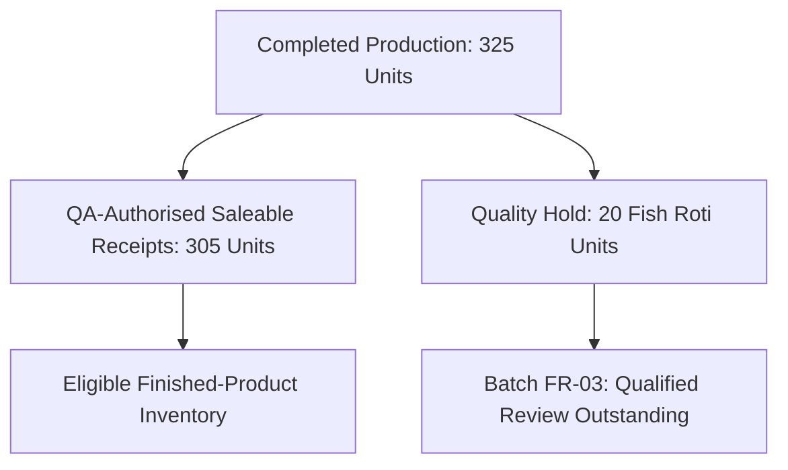
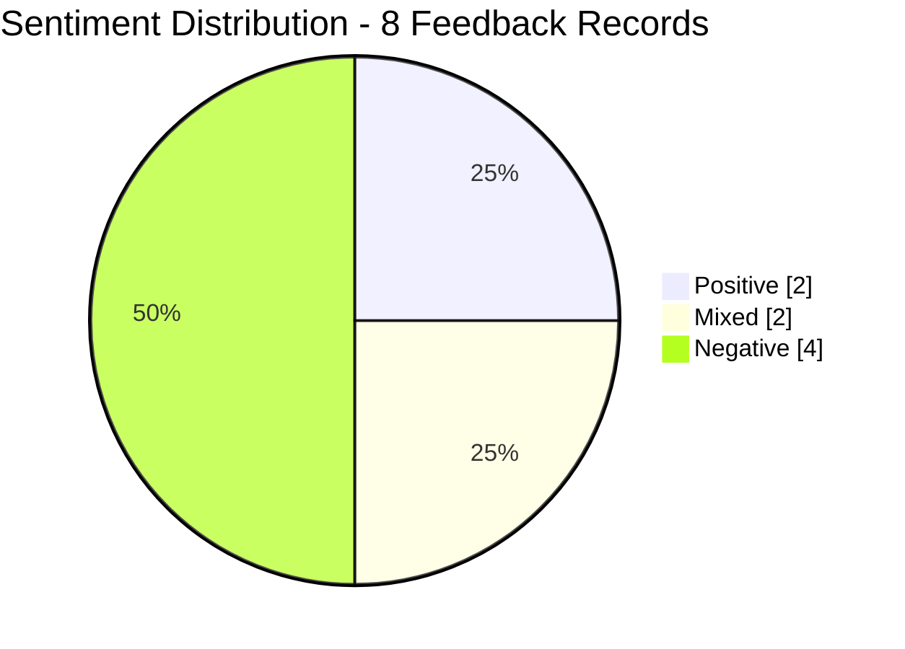
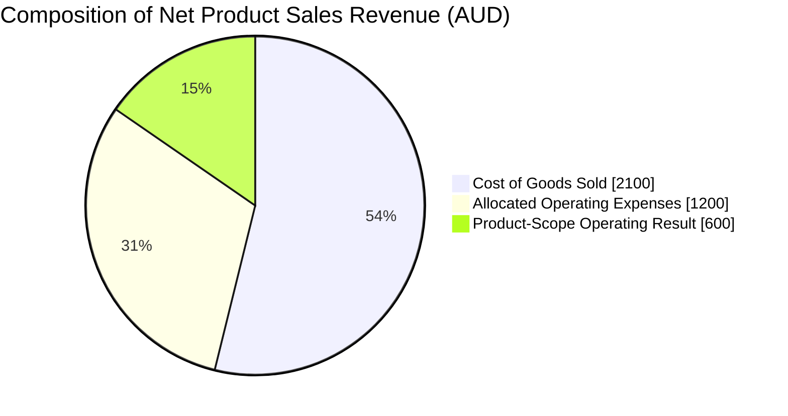

# P10 — Weekly Business Performance Reporting: Testing Evidence

## 1. Testing Information

| Detail | Information |
|---|---|
| Prompt ID | P10 |
| Business | Flavors of Ceylon |
| Business Function | Management and Business Intelligence |
| Final Version | v1.1 |
| Final Evaluation | 19/20 (95%) |
| Testing Status | Completed — Final Version Selected |

## 2. Testing Objective

Evaluate whether generative AI can integrate sales,
demand forecasts, inventory, procurement, production,
financial information, food safety, customer feedback
and marketing records into a professional weekly
management report.

Testing evaluates numerical accuracy, KPI calculation,
evidence reconciliation, management relevance,
uncertainty handling and responsible AI safeguards.

## 3. Integrated Business Workflow

P10 integrates information from:

- P01: Product demand forecasting.
- P02: Ingredient inventory and replenishment.
- P03: Supplier purchase order preparation.
- P04: Production and batch planning.
- P05: Food safety and quality incident reporting.
- P06: Product label and allergen information review.
- P07: Customer enquiry response.
- P08: Customer complaint and feedback analysis.
- P09: Digital marketing content generation.

AI-generated plans must not be treated as evidence
of completed operational activities.

Management decisions remain subject to appropriate
human verification and authorisation.

## 4. Test Case A — Standard Weekly Management Report

### Test Input

WEEKLY REPORTING INFORMATION

Business: Flavors of Ceylon.
Business location: Dandenong South,
Victoria, Australia.

Report reference: FOC-WBR-2026-001.
Report preparation date: 8 December 2026.

Reporting period:
1–7 December 2026, inclusive.

Responsible reviewer:
Business Operations Manager.

Specialist reviewers:
Finance Manager.
Production Manager.
Food Safety Supervisor.
Quality Assurance Manager.
Customer Experience Manager.
Marketing Manager.

Currency: AUD.
Reporting language: Australian English.

All records are synthetic academic data.

The following records are applicable to this
scenario only. Do not combine them with
records from other test scenarios.

Evidence classification:

- Verified records: May support factual
  reporting within the supplied scope.
- Forecasts and approved targets: Planning
  information, not completed activity.
- Draft documents: Not operational approval.
- Customer-reported observations: Not
  independently verified investigation findings.
- Proposed actions: Not completed actions.

--------------------------------------------------
P01 — DEMAND FORECAST AND WEEKLY SALES
--------------------------------------------------

Record reference: WBR-SALES-A v1.0.

The following actual sales records have been
verified against the supplied sales ledger.

All sales quantities represent completed
product sales.

The same selling prices apply to all units
of each product during the current week.

Product | Previous Week Actual Units | Current Week Forecast Units | Current Week Actual Units | Approved Unit Selling Price AUD
Fish Roti | 140 | 160 | 110 | 9.00
Vegetable Rolls | 90 | 80 | 75 | 8.00
Chicken Kottu | 80 | 90 | 80 | 14.00
Rice and Curry Packs | 60 | 60 | 55 | 16.00
Pol Sambol Sachets | 70 | 80 | 60 | 7.00

One sales unit represents one retail product
pack, not the number of individual food
pieces contained within a pack.

The selling prices include applicable GST.

Product sales revenue calculated using these
prices is GST-inclusive where applicable.

Previous-week financial revenue has not been
supplied.

Do not infer previous-week revenue using
current-week selling prices.

The demand forecast is the approved P01
planning forecast.

Forecast quantities are not confirmed orders
or actual customer sales.

No unfulfilled customer order register
has been supplied.

Differences between forecast and actual sales
do not independently establish lost sales.

--------------------------------------------------
P02 — INGREDIENT INVENTORY AND REPLENISHMENT
--------------------------------------------------

Record reference: WBR-INV-A v1.0.

The ingredient stock available at the start
of production already includes the verified
received P03 purchase order.

Do not add received purchase quantities again.

Ingredient | Unit | Eligible Stock Before Production | Verified Actual Consumption | Verified Closing Eligible Stock
Flour | kg | 45.00 | 31.40 | 13.60
Rice | kg | 40.00 | 7.50 | 32.50
Chicken | kg | 30.00 | 25.30 | 4.70
Coconut | kg | 12.00 | 5.00 | 7.00
Fish | kg | 12.00 | 9.60 | 2.40
Vegetables | kg | 10.00 | 0.00 | 10.00
Eggs | units | 100 | 85 | 15

There were no additional receipts, transfers,
recorded losses or inventory adjustments after
the supplied pre-production stock snapshot.

Closing stock quantities have been verified
against the applicable eligible inventory record.

No approved reorder thresholds, next-week
ingredient requirements or new expiry
assessment have been supplied.

Low remaining quantities may be highlighted
for review, but do not invent shortages or
new purchase quantities.

--------------------------------------------------
P03 — PROCUREMENT
--------------------------------------------------

Record reference: WBR-PROC-A v1.0.

Supplier:
Southern Harvest Food Supplies.

Purchase order reference: PO-WBR-A-001.

The purchase order was approved by authorised
procurement personnel and received on
4 December 2026.

Received quantities and supplier invoice:

Ingredient | Quantity Received | Line Amount AUD
Flour | 15 kg | 36.00
Chicken | 12 kg | 114.00

Delivery charge: AUD 12.00.

The supplier invoice amounts include
applicable GST.

Invoice payment status: Not verified.

The ingredients have already been included
in the P02 pre-production eligible inventory.

No additional purchase order or supplier
delivery is recorded for this reporting scope.

The purchase invoice is not automatically
equal to current-week cost of goods sold.

--------------------------------------------------
P04 — PRODUCTION AND CAPACITY
--------------------------------------------------

Record reference: WBR-PROD-A v1.0.

The approved production targets already
reflect the earlier demand, finished inventory
and capacity planning assessment.

Product | Approved Production Target | Proposed P04 Output | Verified Actual Completed Output | QA-Authorised Saleable Receipts
Fish Roti | 120 | 120 | 120 | 100
Vegetable Rolls | 0 | 0 | 0 | 0
Chicken Kottu | 85 | 85 | 85 | 85
Rice and Curry Packs | 50 | 50 | 50 | 50
Pol Sambol Sachets | 70 | 70 | 70 | 70

Production capacity:
1,080 available production-station minutes.

Verified actual production-station time used:
625 minutes.

Staffing and station requirements were met
for the recorded completed production.

The 20-unit difference between completed
Fish Roti production and saleable receipts
relates to batch FR-03.

All 20 units remain under quality hold.

Completed production includes held units.

Only QA-authorised saleable receipts may
enter finished-product saleable inventory.

For this scenario, authorised QA records
independently confirm the other released
batches used approved applicable labels.

The reviewed unapproved Fish Roti draft
label was not used for these authorised
saleable receipts.

--------------------------------------------------
FINISHED-PRODUCT SALEABLE INVENTORY
--------------------------------------------------

Record reference: WBR-FG-A v1.0.

Product | Opening Saleable Stock | QA-Authorised Saleable Receipts | Verified Units Sold | Verified Closing Saleable Stock
Fish Roti | 30 | 100 | 110 | 20
Vegetable Rolls | 90 | 0 | 75 | 15
Chicken Kottu | 10 | 85 | 80 | 15
Rice and Curry Packs | 20 | 50 | 55 | 15
Pol Sambol Sachets | 15 | 70 | 60 | 25

No additional saleable inventory transfers,
returns or adjustments have been recorded.

Held units are excluded from opening and
closing saleable inventory.

Do not add the 20 held Fish Roti units
to saleable inventory.

--------------------------------------------------
P05 — QUALITY INCIDENT INFORMATION
--------------------------------------------------

Incident reference: FOC-QI-2026-001.
Product: Fish Roti.
Batch: FR-03.
Incident date: 5 December 2026.

Batch quantity: 20 units.

Internal synthetic weight specification:
100–110 g per unit.

Three recorded sample weights:
92 g, 94 g and 96 g.

All 20 units remain under quality hold.

No units from this batch have been dispatched.

The remaining 17 units have not been weighed.

Root cause, corrective action approval,
final disposition and incident closure
remain outstanding.

No product release authorisation is supplied.

The weight specification is an internal
synthetic business requirement, not a
statutory classification.

Do not infer confirmed contamination or
guarantee product safety.

--------------------------------------------------
P06 — LABEL AND ALLERGEN REVIEW
--------------------------------------------------

Review reference: FOC-LR-2026-001.

Product: Fish Roti.

Approved ingredient specification:
SPEC-FR-01 v2.0.

Verified allergen record:
ALL-FR-01 v2.0.

Confirmed intentional allergens:

- Wheat.
- Fish.
- Milk.

Butter is an approved intentional ingredient.

The reviewed draft label LBL-FR-01 v0.1
omits butter and milk.

The approved precautionary wording in the
supplied scenario is:

"May contain sesame."

That approved wording is also missing
from the reviewed draft label.

Sesame is not an intentional ingredient
in this supplied Fish Roti formulation.

The draft label remains unapproved.

Urgent qualified QA review of the confirmed
allergen omission remains necessary.

No completed corrective approval is supplied.

Do not authorise printing or application
of the reviewed draft label.

Do not override the FR-03 quality hold.

--------------------------------------------------
P07 — CUSTOMER ENQUIRIES
--------------------------------------------------

Record reference: WBR-CE-A v1.0.

Weekly customer service register:

Unique enquiries received: 10.
Enquiries with completed responses: 8.
Enquiries awaiting response: 2.

No enquiry-to-order conversion records
have been supplied.

Related P07 enquiry example:
FOC-CE-2026-001.

Emily requested:

- Three packs of Vegetable Rolls.
- Two packs of Pol Sambol Sachets.

Estimated product subtotal: AUD 38.00.
Estimated delivery charge: AUD 8.00.
Estimated total: AUD 46.00.

The related customer response remains a
draft awaiting approval.

This enquiry is included in the weekly
enquiry register and is one of the
two pending responses.

No confirmed order, stock reservation,
payment or delivery is recorded for it.

Do not add AUD 46.00 to verified sales.

--------------------------------------------------
P08 — CUSTOMER FEEDBACK AND REFUNDS
--------------------------------------------------

Record reference: WBR-CFA-A v1.0.

The supplied weekly feedback register
contains these unique records:

Record | Primary Issue | Sentiment
CFA-A01 | Delivery delay | Mixed
CFA-A02 | Outer packaging | Negative
CFA-A03 | Positive feedback | Positive
CFA-A04 | Delivery delay | Negative
CFA-A05 | Outer packaging | Negative
CFA-A06 | Customer communication | Mixed
CFA-A07 | Positive feedback | Positive
CFA-A08 | Customer communication | Negative

All eight records have distinct order references.

No duplicates are identified.

A recurring issue is defined for this
dataset as appearing in at least two
distinct feedback cases.

No customer-reported illness, contamination
or allergen incident is recorded in this
feedback dataset.

The reported packaging issues concern
outer presentation packaging.

They are not verified food safety incidents.

One unique refund request is recorded:

CFA-A04:
AUD 8.00 delivery charge refund.

Payment and delivery records for the
request remain unverified.

No refund has been approved or reimbursed.

Customer observations remain reported
experiences, not verified root causes.

Total weekly business customer and order
counts have not been supplied.

--------------------------------------------------
FINANCIAL PERFORMANCE
--------------------------------------------------

Record reference: WBR-FIN-A v1.0.

The following finance figures have been
verified by the fictional Finance Manager.

They relate to the supplied product-sales
reporting scope only.

All figures below exclude GST.

Net product sales revenue: AUD 3,900.00.
Cost of goods sold: AUD 2,100.00.
Allocated product-related operating
expenses: AUD 1,200.00.

The net product sales revenue has been
reconciled by Finance against the
GST-inclusive product sales ledger.

Do not recalculate GST using an assumed
uniform tax rate.

Delivery income and any additional
business income or expenses outside
this defined reporting scope have
not been supplied.

No approved refund expense is recorded
within this reporting scope.

Do not deduct the pending AUD 8.00
refund request as an approved expense.

Do not deduct the supplier invoice again
from the supplied expense figures.

The supplied financial records support:

- Product-scope gross profit.
- Product-scope gross profit margin.
- Product-scope operating result.
- Product-scope operating margin.

They do not establish total company net
profit, cash flow, bank balance, tax
liability or financial solvency.

--------------------------------------------------
MARKETING PERFORMANCE AND P09 UPDATE
--------------------------------------------------

Verified historical campaign record:
WBR-MKT-A-HIST v1.0.

Campaign name:
Discover Sri Lankan Flavours.

Campaign publication period:
2–4 December 2026.

Campaign type:
Organic social media content.

Verified combined platform impressions:
1,000.

Verified link clicks:
40.

Recorded paid advertising spend:
AUD 0.00.

Unique audience reach, attributed sales,
conversion records and customer acquisition
costs have not been supplied.

Link click-through rate is defined as:

Link clicks divided by impressions,
multiplied by 100.

The historical published campaign is
independent of the later P09 draft.

SUBSEQUENT P09 UPDATE

Campaign reference: FOC-MKT-2026-001.

Campaign preparation date:
8 December 2026.

Proposed campaign period:
8–10 December 2026.

Product: Vegetable Rolls.
Pack size: Four rolls.
Standard price: AUD 8.00.

Independent stock snapshot:
18 saleable packs at 9:00 AM on
8 December 2026.

Campaign status:
Draft prepared; not approved, scheduled
or published.

Official visual assets and refreshed
stock verification remain outstanding.

No campaign performance has been measured.

This information was recorded after the
weekly reporting period ended.

Present it separately as a subsequent
management update.

No stock-movement records connecting the
7 December closing stock to the 8 December
snapshot have been supplied.

Do not treat the later snapshot as the
previous week's closing balance or infer
the intervening stock movements.

--------------------------------------------------
REPORTING AND KPI REQUIREMENTS
--------------------------------------------------

Prepare a professional weekly management
report using the supplied records.

Include appropriate product-level and
business-level results where supported.

Use the following KPI definitions:

Sales growth percentage =
(Current-week actual units minus
previous-week actual units) divided by
previous-week actual units, multiplied
by 100.

Forecast attainment percentage =
Actual sales units divided by forecast
units, multiplied by 100.

Forecast shortfall =
Forecast units minus actual sales units.

Production target achievement percentage =
Actual completed output divided by approved
production target, multiplied by 100.

Production-station utilisation =
Actual station minutes used divided by
available station minutes, multiplied by 100.

Saleable output proportion =
QA-authorised saleable receipts divided
by actual completed output, multiplied by 100.

Customer enquiry response completion =
Completed responses divided by unique
enquiries received, multiplied by 100.

Gross profit =
Net product sales revenue minus cost
of goods sold.

Gross profit margin =
Gross profit divided by net product
sales revenue, multiplied by 100.

Product-scope operating result =
Gross profit minus allocated product-related
operating expenses.

Product-scope operating margin =
Product-scope operating result divided by
net product sales revenue, multiplied by 100.

Reconcile ingredient inventory and finished
saleable inventory using supplied movements.

Do not combine kilograms and individual
ingredient units into one meaningless total.

Do not calculate a percentage when its
denominator is zero or unavailable.

Show unavailable KPIs as not determinable
and explain why.

Use consistent rounding to two decimal
places where appropriate.

Do not interpret feedback frequencies
as business-wide complaint or customer
satisfaction rates.

Distinguish weekly activities from
subsequent updates.

Provide management recommendations with
proposed responsible functions.

Do not invent completed corrective actions,
financial results, approved refunds,
campaign results or regulatory compliance.

Do not authorise product release,
label approval, product disposition,
recall, regulatory reporting or incident
closure.

Recommend qualified review of relevant
food safety and allergen concerns.

All recommendations remain subject to
appropriate human review.

All business records, customers, financial
figures and campaign information are
synthetic and intended solely for
academic testing.

### Expected Output

- Calculate verified weekly sales and sales revenue.
- Compare actual sales against demand forecasts.
- Compare approved production targets with actual output.
- Distinguish completed production from saleable stock.
- Reconcile ingredient and finished-product inventory.
- Preserve procurement and financial distinctions.
- Calculate supported financial and operational KPIs.
- Preserve food safety and allergen restrictions.
- Summarise customer enquiries, complaints and refunds.
- Distinguish published campaigns from marketing drafts.
- Separate post-period updates from weekly activities.
- Provide practical management recommendations.

## 5. Test Case B — Complex Weekly Management Report

### Test Input

WEEKLY REPORTING INFORMATION

Business: Flavors of Ceylon.
Business location: Dandenong South,
Victoria, Australia.

Report reference: FOC-WBR-2026-002.
Report preparation date: 8 December 2026.

Reporting period:
1–7 December 2026, inclusive.

Responsible reviewer:
Business Operations Manager.

Specialist reviewers:
Finance Manager.
Production Manager.
Food Safety Supervisor.
Quality Assurance Manager.
Customer Experience Manager.
Marketing Manager.

Currency: AUD.
Reporting language: Australian English.

All business records are synthetic.

This is an independent alternative scenario.

Do not combine this dataset with Test A.

EVIDENCE AND CONFLICT HANDLING

Where two supplied records conflict and
neither has been established as authoritative,
preserve both values and request verification.

Do not select a value solely because
its source document is newer.

Do not average conflicting records or
invent balancing adjustments.

Use independently verified values for
supported calculations.

Where complete totals cannot be established,
report clearly labelled partial totals
or conditional calculations.

Do not treat unknown amounts as zero.

--------------------------------------------------
P01 — DEMAND FORECAST AND WEEKLY SALES
--------------------------------------------------

Record reference: WBR-SALES-B v1.0.

The approved planning forecast below is
the complete P01 planning forecast used
for this scenario.

Product | Previous Week Actual Units | Current Week Forecast Units | Current Week Sales Status | Approved Unit Selling Price AUD
Fish Roti | 140 | 160 | Conflicting records | 9.00
Vegetable Rolls | 90 | 80 | 70 verified | 8.00
Chicken Kottu | 80 | 90 | 8 verified | 14.00
Rice and Curry Packs | 60 | 60 | 25 verified | 16.00
Pol Sambol Sachets | 70 | 80 | 40 verified | 7.00

One sales unit represents one retail
product pack.

All unit selling prices include applicable GST.

The verified Chicken Kottu sales occurred
before the ordering restriction became
effective on 5 December 2026.

No confirmed Chicken Kottu sales after
the restriction are recorded.

No verified customer linkage to an affected
production batch has been established.

FISH ROTI SALES CONFLICT

Source 1:
Sales export SALES-FR-B01.
Recorded quantity: 90 units.

Source 2:
Order reconciliation SALES-FR-B02.
Recorded quantity: 95 units.

Both records relate to the same reporting
period and product.

Neither record has been verified as the
authoritative final sales quantity.

No transaction-level reconciliation
has been completed.

The approved Fish Roti unit price is
AUD 9.00, but the total Fish Roti revenue
remains unresolved.

Do not choose either conflicting sales
quantity as the verified result.

Previous-week unit sales are verified.

Previous-week financial revenue has not
been supplied.

No complete unfulfilled-order register
or verified lost-sales information
has been supplied.

--------------------------------------------------
P02 — INGREDIENT INVENTORY AND REPLENISHMENT
--------------------------------------------------

Record reference: WBR-INV-B v1.0.

Ingredient | Unit | Eligible Stock Before Production | Verified Actual Consumption | Recorded Closing Count
Flour | kg | 20.00 | 19.00 | 1.00
Rice | kg | 15.00 | 1.50 | 13.50
Chicken | kg | 10.00 | 8.30 | 1.20
Coconut | kg | 4.00 | 2.05 | 1.95
Fish | kg | 8.00 | 8.00 | 0.00
Vegetables | kg | 10.00 | 0.00 | 10.00
Eggs | units | 60 | 35 | 25

No additional ingredient receipts or
authorised stock adjustments are recorded
after the pre-production snapshot.

The recorded closing count for Chicken
has not been reconciled to the inventory
ledger.

No documented loss, disposal, measurement
correction or additional stock movement
has been supplied to explain the difference.

The disputed quantity requires verification.

Do not assume theft, spoilage, contamination
or wastage caused the discrepancy.

Do not independently authorise inventory
adjustments.

Zero remaining eligible Fish stock may
be identified as a planning constraint.

No approved next-week production target,
reorder threshold or fresh expiry
assessment has been supplied.

--------------------------------------------------
P03 — PENDING PROCUREMENT
--------------------------------------------------

Record reference: WBR-PROC-B v1.0.

Supplier:
Southern Harvest Food Supplies.

Purchase order reference: PO-WBR-B-001.

Draft established replenishment requirements:

Ingredient | Requested Quantity | Price Status
Flour | 5 kg | AUD 12.00 line amount
Coconut | 6 kg | Price not supplied

Additional provisional replenishment
requirements awaiting verification:

Rice: 5 kg.
Chicken: 15 kg.

The provisional requirements are excluded
from the draft established order.

Purchase order approval: Not granted.
Supplier delivery commitment: Not confirmed.
Delivery fee: Unknown.
GST treatment: Unknown.
Final payable total: Unknown.
Payment status: No approved payment.
Goods receipt: None recorded.

No quantities from this draft have been
included as received inventory.

The AUD 12.00 is a known draft priced-line
amount only.

It is not an approved purchase expense,
confirmed supplier invoice or complete
purchase order value.

--------------------------------------------------
P04 — PRODUCTION AND CAPACITY
--------------------------------------------------

Record reference: WBR-PROD-B v1.0.

Product | Approved Production Target | Proposed Capacity-Constrained Output | Verified Actual Completed Output | QA-Authorised Saleable Receipts
Fish Roti | 120 | 100 | 100 | 100
Vegetable Rolls | 0 | 0 | 0 | 0
Chicken Kottu | 85 | 40 | 35 | 0
Rice and Curry Packs | 50 | 10 | 10 | 10
Pol Sambol Sachets | 70 | 35 | 35 | 35

The proposed capacity-constrained output
is the earlier P04 planning result.

It is not evidence of completed production.

Available production-station time:
375 minutes.

Verified actual production-station time used:
370 minutes.

Production requires two staff members
at the operating station.

Only 5 December had the required staffing
combination during the planning window.

The 35 completed Chicken Kottu units
are not authorised as saleable receipts.

Their recorded status is:

- Batch CK-01: 20 units produced.
- Within CK-01: 16 units confirmed on hold.
- Within CK-01: 4 units have unresolved
  physical locations.
- Remaining Chicken Kottu production:
  15 units separately segregated under
  the product ordering restriction.

The 15 separately segregated units are
outside the 20-unit CK-01 batch.

No release authorisation has been supplied
for any of the 35 completed units.

The four unresolved CK-01 units must not
be described as physically contained.

Existing QA records independently authorise
the supplied non-Chicken-Kottu saleable receipts
from other applicable production batches.

The unapproved draft Fish Roti label
was not authorised for those receipts.

--------------------------------------------------
FINISHED-PRODUCT SALEABLE INVENTORY
--------------------------------------------------

Record reference: WBR-FG-B v1.0.

Product | Opening Saleable Stock | QA-Authorised Saleable Receipts | Units Sold | Removed from Saleable Stock | Recorded Closing Saleable Count
Fish Roti | 30 | 100 | 90 or 95 unresolved | 0 | 38
Vegetable Rolls | 90 | 0 | 70 | 0 | 20
Chicken Kottu | 10 | 0 | 8 | 2 | 0
Rice and Curry Packs | 20 | 10 | 25 | 0 | 5
Pol Sambol Sachets | 15 | 35 | 40 | 0 | 10

The two Chicken Kottu units removed
from opening saleable inventory were
separately segregated when the ordering
restriction became effective.

These two units are not part of the
35 units completed during the current week.

The Fish Roti closing count of 38 units
is recorded but remains unreconciled.

No additional verified stock adjustment
explains the Fish Roti discrepancy.

The recorded closing count must not
be used to infer the correct sales quantity.

No other finished-product movements
have been recorded.

--------------------------------------------------
P05 — UNRESOLVED FOOD SAFETY INCIDENT
--------------------------------------------------

Incident reference: FOC-FSI-2026-002.

Product: Chicken Kottu.
Batch: CK-01.
Incident date: 5 December 2026.

Recorded equipment display readings:

2:30 PM: 3.4 degrees Celsius.
4:20 PM: 9.1 degrees Celsius.

Internal synthetic chiller operating range:
2–4 degrees Celsius.

Actual product temperatures are unknown.

The exact start and duration of any
temperature deviation are unknown.

The interval between observations is
not a verified exposure duration.

Sixteen CK-01 units remain confirmed on hold.

Four units have unresolved physical locations.

No verified courier handover, delivery
or customer linkage has been established
for those four units.

Product suitability, root cause, final
disposition and incident closure remain
undetermined.

Urgent qualified food safety review
and traceability investigation remain
necessary.

Do not independently authorise product
release, recall, disposal, customer
notification or incident closure.

--------------------------------------------------
P06 — PRODUCT LABEL AND ALLERGEN RESTRICTIONS
--------------------------------------------------

CHICKEN KOTTU

Review reference: FOC-LR-2026-002.

Approved recipe: SPEC-CK-01 v2.0.

Confirmed intentional allergens:

- Wheat.
- Egg.
- Sesame.

The approved recipe includes egg
and sesame oil.

The reviewed draft label LBL-CK-01 v0.2
omits egg and sesame information.

The draft claim "Egg-free recipe"
contradicts the verified recipe.

Seasoning sauce supplier specifications
remain conflicting.

Neither supplier specification has been
verified as applicable to current stock.

Soy presence or absence remains unresolved.

Product-specific peanut cross-contact
remains unverified.

No approved final precautionary peanut
wording is supplied.

The draft label remains unapproved.

FISH ROTI

The related unresolved quality and label
records carried into this scenario are:

Batch FR-03:
All 20 units remain under quality hold.

Verified intentional allergens:
Wheat, fish and milk.

Draft label LBL-FR-01 v0.1 omitted
butter and milk.

The reviewed draft label remains unapproved.

These 20 carried-in held units are excluded
from the opening saleable inventory and
the current week's completed production.

No evidence links a customer complaint
to batch FR-03 or the reviewed draft label.

Urgent qualified QA review remains necessary.

--------------------------------------------------
P07 — CUSTOMER ENQUIRIES
--------------------------------------------------

Record reference: WBR-CE-B v1.0.

Unique enquiries received: 12.
Enquiries with completed responses: 9.
Enquiries awaiting response: 3.

Related enquiry:
FOC-CE-2026-002.

Alex requested information concerning
Chicken Kottu availability and allergens.

The supplied limited customer-facing
notice confirms that the product contains
egg and is not egg-free.

Wheat and sesame are confirmed allergens.

Soy and peanut cross-contact information
remain unresolved.

Chicken Kottu remains temporarily
unavailable for ordering.

The proposed customer response remains
a draft and is one of the three pending
enquiry responses.

No order, payment, reservation or delivery
has been confirmed for Alex.

The listed value of four Chicken Kottu
packs is AUD 56.00 for information only.

It is not confirmed revenue, an accepted
order or a payable customer invoice.

No verified enquiry conversion data
has been supplied.

--------------------------------------------------
P08 — CUSTOMER COMPLAINTS AND REFUNDS
--------------------------------------------------

Record reference: WBR-CFA-B v1.0.

Submitted complaint records:

Record ID | Ticket | Primary Observation | Sentiment | Relationship
CFA-B01 | COMP-26001 | Reported illness after Rice and Curry consumption | Negative | Original
CFA-B02 | COMP-26001 | Follow-up on same illness and refund request | Negative | Confirmed duplicate of B01
CFA-B03 | COMP-26002 | Reported rash and itching; possible Fish Roti milk allergen incident | Negative | Original
CFA-B04 | COMP-26003 | Suspected plastic material in Pol Sambol Sachet | Negative | Original
CFA-B05 | COMP-26004 | Reported Vegetable Rolls delivery delay | Negative | Original
CFA-B06 | COMP-26004 | Follow-up on same delivery refund | Negative | Confirmed duplicate of B05
CFA-B07 | COMP-26005 | Reported contradictory Chicken Kottu egg-free claim | Negative | Original
CFA-B08 | COMP-26006 | Unspecified order problem | Negative | Original
CFA-B09 | COMP-26007 | Delivery delay with positive food taste feedback | Mixed | Original

Duplicate communications must be preserved
as evidence but excluded from additional
unique case and refund counts.

Urgent qualified review is required for:

- Reported illness.
- Possible allergen incident.
- Suspected foreign material.
- Contradictory allergen-free claim.

Missing investigation evidence includes
applicable batch details, verified orders,
actual labels, photographs, symptom
timelines and material identification.

No medical cause, verified contamination
or specific affected batch linkage
has been established.

Current symptom status in the reported
illness and possible allergen cases
remains unknown.

Alex reported neither purchasing nor
consuming Chicken Kottu.

No allergic reaction or illness was
reported by Alex.

No completed qualified review,
investigation or corrective action
has been established.

A recurring primary issue must appear
in at least two distinct cases.

REFUND REQUEST REGISTER

Complaint ticket | Requested Refund | Requested Amount AUD
COMP-26001 | Full order refund | Unknown
COMP-26004 | Delivery charge refund | 8.00
COMP-26006 | Unspecified refund | Unknown

The two duplicate follow-ups concern
existing refund requests.

No approved refund policy or payment
verification has been supplied.

No refunds have been approved or reimbursed.

Do not treat unknown requested amounts
as zero.

Do not delay urgent food safety review
while awaiting refund verification.

Total weekly customer and order counts
have not been supplied.

--------------------------------------------------
FINANCIAL PERFORMANCE
--------------------------------------------------

Record reference: WBR-FIN-B v1.0.

The Finance Manager has not approved
a complete weekly product revenue figure.

Two draft GST-inclusive product sales
revenue summaries have been supplied:

FIN-B-DRAFT-01:
AUD 2,162.00.

FIN-B-DRAFT-02:
AUD 2,207.00.

The difference relates to the unresolved
Fish Roti sales quantity.

Neither draft total has been verified
as authoritative.

Verified complete net product revenue
excluding GST: Not available.

Draft cost of goods sold:
AUD 1,300.00 excluding GST.

The cost figure remains incomplete
because relevant cost allocations and
supporting invoices are outstanding.

Verified allocated product-related
operating expenses:
AUD 900.00 excluding GST.

No approved refund expense is recorded.

The pending procurement order is not
an approved expense or received purchase.

Do not independently calculate GST using
an assumed uniform rate.

Do not report a verified gross profit,
gross margin, operating result or
operating margin from incomplete inputs.

Cash flow, bank balances, tax liabilities
and complete business expenses have not
been supplied.

--------------------------------------------------
MARKETING RECORDS AND P09 UPDATE
--------------------------------------------------

Weekly marketing record:
WBR-MKT-B v1.0.

An unapproved marketing worksheet contains
the following proposed performance figures:

Impressions: 5,000.
Link clicks: 250.
Attributed sales: AUD 2,000.00.

No platform analytics exports, approved
publication records or verified sales
attribution evidence are supplied.

These figures are planning illustrations,
not verified campaign performance.

No complete verified weekly marketing
performance record is available.

Do not report the illustrative figures
as actual performance.

Do not assume all marketing activity
or expenditure was zero.

SUBSEQUENT P09 UPDATE

Campaign reference: FOC-MKT-2026-002.

Preparation date: 8 December 2026.
Proposed campaign period: 12–13 December 2026.

Original Chicken Kottu campaign:
Withheld because of restricted ordering,
contradictory allergen claims and
unsupported promotional terms.

The proposed 30% discount, free delivery,
health and weight-loss claims, allergen-free
claims and fabricated testimonial were
not authorised.

The reported online egg-free claim
requires urgent qualified QA review.

The reported image remains unverified.

The separately permitted alternative
Vegetable Rolls campaign remains a draft.

Approved standard price:
AUD 8.00 per four-roll pack.

Independent stock snapshot:
10 saleable packs at 10:00 AM on
8 December 2026.

Refreshed stock verification, approved
visual assets and Marketing Manager
approval remain outstanding.

No campaign has been approved, scheduled
or published in this P09 update.

No actual marketing results have
been established for the proposed campaigns.

The alternative campaign does not remove
Chicken Kottu ordering or product
release restrictions.

Vegetable Rolls must not be recommended
as an allergy-safe alternative.

These records were prepared after the
weekly reporting period ended.

No stock-movement bridge between
7 December closing inventory and
the subsequent stock snapshot is supplied.

--------------------------------------------------
REPORTING AND KPI REQUIREMENTS
--------------------------------------------------

Prepare a professional weekly management
report covering all relevant business areas.

Use the following KPI definitions:

Sales growth percentage =
(Current-week actual units minus
previous-week actual units) divided by
previous-week actual units, multiplied
by 100.

Forecast attainment percentage =
Actual sales units divided by forecast
units, multiplied by 100.

Forecast shortfall =
Forecast units minus actual sales units.

Production target achievement percentage =
Actual completed output divided by approved
production target, multiplied by 100.

Production-station utilisation =
Actual station minutes used divided by
available station minutes, multiplied by 100.

Saleable output proportion =
QA-authorised saleable receipts divided
by completed production, multiplied by 100.

Customer enquiry response completion =
Completed responses divided by unique
enquiries received, multiplied by 100.

Gross profit =
Net product sales revenue minus cost
of goods sold.

Gross profit margin =
Gross profit divided by net product
sales revenue, multiplied by 100.

Product-scope operating result =
Gross profit minus allocated product-related
operating expenses.

Product-scope operating margin =
Product-scope operating result divided by
net product sales revenue, multiplied by 100.

Link click-through rate =
Link clicks divided by impressions,
multiplied by 100.

Calculate only metrics supported by
appropriate verified inputs.

Clearly label partial totals and
conditional calculations.

Withhold unsupported aggregate metrics.

Do not calculate percentages using zero
or unavailable denominators.

Use consistent rounding to two decimal
places where appropriate.

Reconcile ingredient and finished-product
inventory where possible.

Identify unresolved discrepancies without
inventing stock adjustments.

Use unique complaint cases for complaint
frequencies and sentiment percentages.

Do not count duplicate communications
as additional refund requests.

Recommend immediate qualified referral
for urgent food safety and allergen
concerns without waiting for complete
supporting evidence.

For customers reporting symptoms,
recommend appropriate follow-up and
medical assistance where necessary,
including emergency medical services
for emergency symptoms.

Do not diagnose illness or establish
medical causation.

Do not present suspected contamination
as independently verified.

Preserve confirmed allergens, unresolved
allergen information, existing product
holds and ordering restrictions.

Do not count unresolved product locations
as confirmed physical containment.

Do not authorise product release,
disposal, recall, customer notification,
regulatory reporting or incident closure.

Do not claim completed investigations,
refund approvals or corrective actions.

Separate weekly performance from
subsequent P09 campaign information.

Identify responsible functions and
recommended management priorities.

All recommendations remain subject
to appropriate human authorisation.

All business, operational, financial,
customer and marketing records are
synthetic and intended solely for
academic testing.

### Expected Output

- Identify conflicting sales records.
- Withhold unsupported aggregate sales and revenue totals.
- Calculate supported partial totals.
- Identify ingredient and finished-stock discrepancies.
- Distinguish proposed purchases from received purchases.
- Identify production target shortfalls.
- Preserve unresolved food safety incidents.
- Preserve allergen and ordering restrictions.
- Reconcile duplicate customer complaint records.
- Preserve unknown refund amounts.
- Withhold unsupported financial and marketing KPIs.
- Prioritise urgent qualified review.
- Clearly identify outstanding verification requirements.

## 6. Version v1.0 — Initial Testing

### Test Case A

Testing date: 27 November 2026

AI tool and model: ChatGPT

#### Actual AI Output


# Flavors of Ceylon

## Weekly Business Management Report

### P10 v1.0 – Test A Output

---

## 1. Report Information

| Reporting Detail | Information |
|---|---|
| Business | Flavors of Ceylon |
| Business Location | Dandenong South, Victoria, Australia |
| Report Reference | FOC-WBR-2026-001 |
| Reporting Period | 1–7 December 2026, inclusive |
| Preparation Date | 8 December 2026 |
| Responsible Reviewer | Business Operations Manager |
| Specialist Reviewers | Finance Manager, Production Manager, Food Safety Supervisor, Quality Assurance Manager, Customer Experience Manager and Marketing Manager |
| Currency | AUD |
| Reporting Language | Australian English |
| Report Status | Draft – Pending Management Review |
| Data Classification | Synthetic Academic Data |

---

## 2. Executive Summary

Flavors of Ceylon recorded lower weekly sales volumes than the previous week and achieved sales below its approved demand forecast. However, all approved production targets were achieved, and the supplied product-related financial records indicate a positive operating result.

The business completed sales of 380 retail product packs and generated GST-inclusive product sales revenue of AUD 4,010.00. Sales volume decreased by 13.64% compared with the previous week, while overall forecast attainment was 80.85%.

Production completed 325 units, of which 305 units were authorised by Quality Assurance (QA) to enter saleable inventory. The remaining 20 Fish Roti units from batch FR-03 remain under quality hold following recorded weight discrepancies.

An additional significant concern is the confirmed omission of butter, milk and approved sesame precautionary wording from an unapproved Fish Roti draft label. Urgent qualified QA review is required.

Customer feedback identified recurring concerns involving delivery delays, outer packaging and customer communication. The business completed responses to 80.00% of its weekly customer enquiries.

The verified financial records demonstrate a product-scope gross profit of AUD 1,800.00 and a positive product-scope operating result of AUD 600.00. These figures do not establish total company net profit.

Management priorities should include investigating declining sales, reviewing inventory requirements, maintaining the existing quality hold, addressing label discrepancies and improving customer service processes.

---

## 3. Key Performance Indicator Dashboard

| Performance Indicator | Result | Management Observation |
|---|---:|---|
| Previous-Week Sales Volume | 440 packs | Verified baseline |
| Current-Week Sales Volume | 380 packs | Verified |
| Weekly Sales Growth | -13.64% | Decline recorded |
| GST-Inclusive Product Sales Revenue | AUD 4,010.00 | Calculated from verified sales |
| Forecast Attainment | 80.85% | Below forecast |
| Forecast Shortfall | 90 packs | Requires review |
| Production Target Achievement | 100.00% | Target achieved |
| Production-Station Utilisation | 57.87% | Review capacity planning |
| Saleable Output Proportion | 93.85% | Quality hold affects result |
| Units Under Quality Hold | 20 units | Qualified review required |
| Closing Saleable Inventory | 90 packs | Reconciled |
| Customer Enquiry Response Completion | 80.00% | Two responses pending |
| Product-Scope Gross Profit | AUD 1,800.00 | Positive result |
| Gross Profit Margin | 46.15% | Product scope only |
| Product-Scope Operating Result | AUD 600.00 | Positive result |
| Product-Scope Operating Margin | 15.38% | Product scope only |
| Historical Marketing Click-Through Rate | 4.00% | Conversion data unavailable |

> [!IMPORTANT]
> All 20 Fish Roti units from batch FR-03 remain under quality hold. The confirmed milk omission from the unapproved Fish Roti draft label requires urgent qualified QA review. This report does not authorise product release or label approval.

---

## 4. Sales Performance and Demand Forecast – P01

**Source:** WBR-SALES-A v1.0.

### 4.1 Product-Level Sales Performance

| Product | Previous Actual | Forecast | Current Actual | Sales Growth | Forecast Attainment | Forecast Shortfall |
|---|---:|---:|---:|---:|---:|---:|
| Fish Roti | 140 | 160 | 110 | -21.43% | 68.75% | 50 |
| Vegetable Rolls | 90 | 80 | 75 | -16.67% | 93.75% | 5 |
| Chicken Kottu | 80 | 90 | 80 | 0.00% | 88.89% | 10 |
| Rice and Curry Packs | 60 | 60 | 55 | -8.33% | 91.67% | 5 |
| Pol Sambol Sachets | 70 | 80 | 60 | -14.29% | 75.00% | 20 |
| **Total** | **440** | **470** | **380** | **-13.64%** | **80.85%** | **90** |

### 4.2 Business-Level Sales KPI Calculations

**Sales Growth Percentage**

```text
= (Current Actual − Previous Actual) / Previous Actual × 100
= (380 − 440) / 440 × 100
= -13.64%
```

**Forecast Attainment Percentage**

```text
= Actual Sales / Forecast Sales × 100
= 380 / 470 × 100
= 80.85%
```

**Forecast Shortfall**

```text
= Forecast Sales − Actual Sales
= 470 − 380
= 90 packs
```

### 4.3 Product Sales Revenue

All amounts in the following table include applicable GST.

| Product | Units Sold | Unit Price (AUD) | Revenue (AUD) | Revenue Contribution |
|---|---:|---:|---:|---:|
| Fish Roti | 110 | 9.00 | 990.00 | 24.69% |
| Vegetable Rolls | 75 | 8.00 | 600.00 | 14.96% |
| Chicken Kottu | 80 | 14.00 | 1,120.00 | 27.93% |
| Rice and Curry Packs | 55 | 16.00 | 880.00 | 21.95% |
| Pol Sambol Sachets | 60 | 7.00 | 420.00 | 10.47% |
| **Total** | **380** | **—** | **4,010.00** | **100.00%** |

### 4.4 Revenue Comparison

```text
Chicken Kottu         | #################### | AUD 1,120.00
Fish Roti             | ##################   | AUD   990.00
Rice and Curry Packs  | ################     | AUD   880.00
Vegetable Rolls       | ###########          | AUD   600.00
Pol Sambol Sachets    | ########             | AUD   420.00
```

### 4.5 Key Findings

- Total sales decreased by 60 retail packs compared with the previous week.
- Actual sales were 90 packs below the approved forecast.
- Fish Roti recorded the largest sales decline and forecast shortfall.
- Chicken Kottu maintained its previous-week sales volume.
- Chicken Kottu generated the highest product sales revenue.
- Vegetable Rolls achieved the highest forecast attainment at 93.75%.
- No product exceeded its weekly sales forecast.
- Sales quantities represent retail product packs rather than individual food pieces.

### 4.6 Management Interpretation

The results indicate weaker sales performance relative to the previous week and approved forecast. However, two weeks of sales information are insufficient to establish a sustained downward trend.

The forecast shortfall does not independently establish lost sales, unfulfilled orders or insufficient production.

The relationship between the Fish Roti quality hold and its sales performance has not been verified.

Previous-week revenue and revenue growth are not determinable because previous-week financial revenue has not been supplied.

### 4.7 Recommended Action

The Business Operations Manager and Marketing Manager should investigate product-level sales performance and review the assumptions used in the demand forecast before revising future production or marketing plans.

---

## 5. Ingredient Inventory and Replenishment – P02

**Source:** WBR-INV-A v1.0.

### 5.1 Ingredient Inventory Reconciliation

**Reconciliation Formula**

```text
Expected Closing Stock =
Eligible Pre-Production Stock − Verified Actual Consumption
```

| Ingredient | Unit | Opening Eligible Stock | Consumption | Calculated Closing | Verified Closing | Variance |
|---|---|---:|---:|---:|---:|---:|
| Flour | kg | 45.00 | 31.40 | 13.60 | 13.60 | 0.00 |
| Rice | kg | 40.00 | 7.50 | 32.50 | 32.50 | 0.00 |
| Chicken | kg | 30.00 | 25.30 | 4.70 | 4.70 | 0.00 |
| Coconut | kg | 12.00 | 5.00 | 7.00 | 7.00 | 0.00 |
| Fish | kg | 12.00 | 9.60 | 2.40 | 2.40 | 0.00 |
| Vegetables | kg | 10.00 | 0.00 | 10.00 | 10.00 | 0.00 |
| Eggs | units | 100 | 85 | 15 | 15 | 0 |

All ingredient balances reconcile with the verified inventory records.

No unexplained inventory variance is identified within the supplied reporting scope.

Kilograms and individual ingredient units have not been combined into a single inventory total.

### 5.2 Ingredient Consumption Analysis

| Ingredient | Consumption Percentage | Remaining Percentage | Closing Eligible Stock |
|---|---:|---:|---|
| Flour | 69.78% | 30.22% | 13.60 kg |
| Rice | 18.75% | 81.25% | 32.50 kg |
| Chicken | 84.33% | 15.67% | 4.70 kg |
| Coconut | 41.67% | 58.33% | 7.00 kg |
| Fish | 80.00% | 20.00% | 2.40 kg |
| Vegetables | 0.00% | 100.00% | 10.00 kg |
| Eggs | 85.00% | 15.00% | 15 units |

### 5.3 Stock Management Findings

| Ingredient | Verified Observation | Recommended Action |
|---|---|---|
| Flour | 69.78% consumed | Review upcoming production requirements. |
| Rice | 81.25% remains | Review stock rotation and expiry information. |
| Chicken | 84.33% consumed | Prioritise replenishment assessment. |
| Coconut | 58.33% remains | Monitor stock and expiry information. |
| Fish | 80.00% consumed | Prioritise replenishment assessment. |
| Vegetables | No recorded consumption | Review future requirements and expiry information. |
| Eggs | 85.00% consumed | Prioritise replenishment assessment. |

### 5.4 Management Interpretation

Chicken, fish and eggs warrant particular attention because of their relatively low remaining stock compared with pre-production balances.

However, confirmed ingredient shortages, excess stock and required purchase quantities are not determinable without:

- Approved reorder thresholds.
- Next-week production requirements.
- Updated expiry assessments.
- Future ingredient consumption requirements.

The P03 received purchase quantities are already included in the pre-production stock balances and have not been added again.

> [!NOTE]
> Low remaining stock does not independently establish an ingredient shortage or justify an automatically generated purchase order.

---

## 6. Procurement Performance – P03

**Source:** WBR-PROC-A v1.0.

### 6.1 Procurement Record

| Procurement Detail | Verified Information |
|---|---|
| Supplier | Southern Harvest Food Supplies |
| Purchase Order | PO-WBR-A-001 |
| Approval Status | Approved by authorised procurement personnel |
| Receipt Date | 4 December 2026 |
| Receipt Status | Received |
| Invoice Payment Status | Not verified |

### 6.2 Supplier Invoice Summary

| Item | Received Quantity | Amount (AUD) |
|---|---|---:|
| Flour | 15 kg | 36.00 |
| Chicken | 12 kg | 114.00 |
| Ingredient Subtotal | — | 150.00 |
| Delivery Charge | — | 12.00 |
| **Total Invoice Value** | **—** | **162.00** |

The supplier invoice includes applicable GST.

### 6.3 Procurement Findings

The approved purchase order was received and incorporated into the eligible ingredient inventory.

No additional purchase orders or supplier deliveries are recorded within the supplied reporting scope.

The invoice value of AUD 162.00 represents a recorded procurement transaction, not a verified cash payment or an independently calculated cost of goods sold.

### 6.4 Recommended Action

The Finance Manager should verify the invoice payment status.

Procurement and Inventory Management should assess future replenishment requirements using approved production plans, stock records and updated expiry information.

The supplier invoice must not be deducted again from the supplied financial expense figures.

---

## 7. Production and Capacity Performance – P04

**Source:** WBR-PROD-A v1.0.

### 7.1 Production Performance

| Product | Approved Target | Proposed Output | Actual Completed | QA-Authorised Receipts | Target Achievement | Saleable Output Proportion |
|---|---:|---:|---:|---:|---:|---:|
| Fish Roti | 120 | 120 | 120 | 100 | 100.00% | 83.33% |
| Vegetable Rolls | 0 | 0 | 0 | 0 | ND | ND |
| Chicken Kottu | 85 | 85 | 85 | 85 | 100.00% | 100.00% |
| Rice and Curry Packs | 50 | 50 | 50 | 50 | 100.00% | 100.00% |
| Pol Sambol Sachets | 70 | 70 | 70 | 70 | 100.00% | 100.00% |
| **Total** | **325** | **325** | **325** | **305** | **100.00%** | **93.85%** |

**ND = Not Determinable.**

Vegetable Rolls had a zero production target and zero completed production. Therefore, the applicable percentages cannot be calculated.

### 7.2 Production KPI Calculations

**Production Target Achievement**

```text
= Actual Completed Output / Approved Production Target × 100
= 325 / 325 × 100
= 100.00%
```

**Production-Station Utilisation**

```text
= Actual Station Minutes Used / Available Station Minutes × 100
= 625 / 1,080 × 100
= 57.87%
```

**Saleable Output Proportion**

```text
= QA-Authorised Saleable Receipts / Actual Completed Output × 100
= 305 / 325 × 100
= 93.85%
```

**Held Output Proportion**

```text
= Units Under Quality Hold / Actual Completed Output × 100
= 20 / 325 × 100
= 6.15%
```

### 7.3 Production Capacity Summary

| Capacity Indicator | Result |
|---|---:|
| Available Production-Station Time | 1,080 minutes |
| Verified Actual Station Time Used | 625 minutes |
| Unused Station Capacity | 455 minutes |
| Production-Station Utilisation | 57.87% |
| Unused Capacity Proportion | 42.13% |

```text
Used Capacity    [############--------] 57.87%
Unused Capacity  [########------------] 42.13%
```

### 7.4 Production Output Status



### 7.5 Operational Findings

- All approved production targets were achieved.
- Staffing and station requirements were met for recorded production activities.
- Completed production included 20 held Fish Roti units.
- Only 305 units were authorised to enter saleable inventory.
- The remaining 455 production-station minutes represent unused recorded capacity.
- No additional production requirement is established by the unused capacity figure.

### 7.6 Management Interpretation

Although overall production target achievement was 100.00%, the saleable output proportion was lower at 93.85% because 20 Fish Roti units remain under quality hold.

Unused station capacity does not independently establish operational inefficiency, unnecessary staffing costs or an opportunity for immediate additional production.

Management should review demand, available finished stock, production scheduling and QA restrictions before considering changes to production capacity.

---

## 8. Finished-Product Saleable Inventory

**Source:** WBR-FG-A v1.0.

### 8.1 Finished-Product Inventory Reconciliation

**Reconciliation Formula**

```text
Expected Closing Saleable Stock =
Opening Saleable Stock + QA-Authorised Receipts − Verified Units Sold
```

| Product | Opening Stock | QA Receipts | Units Sold | Calculated Closing | Verified Closing | Variance |
|---|---:|---:|---:|---:|---:|---:|
| Fish Roti | 30 | 100 | 110 | 20 | 20 | 0 |
| Vegetable Rolls | 90 | 0 | 75 | 15 | 15 | 0 |
| Chicken Kottu | 10 | 85 | 80 | 15 | 15 | 0 |
| Rice and Curry Packs | 20 | 50 | 55 | 15 | 15 | 0 |
| Pol Sambol Sachets | 15 | 70 | 60 | 25 | 25 | 0 |
| **Total** | **165** | **305** | **380** | **90** | **90** | **0** |

### 8.2 Business-Level Inventory Reconciliation

```text
Opening Saleable Stock       165 packs
QA-Authorised Receipts     + 305 packs
Verified Units Sold        - 380 packs
                            ----------
Closing Saleable Stock        90 packs
```

### 8.3 Closing Inventory Distribution

```text
Fish Roti             | ####################      | 20 packs
Vegetable Rolls       | ###############           | 15 packs
Chicken Kottu         | ###############           | 15 packs
Rice and Curry Packs  | ###############           | 15 packs
Pol Sambol Sachets    | ######################### | 25 packs
```

### 8.4 Inventory Findings

All finished-product saleable inventory balances reconcile without unexplained variances.

The business ended the reporting period with 90 saleable retail packs, representing a reduction of 75 packs from opening saleable inventory.

Vegetable Rolls sales were fulfilled from existing opening inventory, with no additional production recorded.

The 20 held Fish Roti units from batch FR-03 have been excluded from saleable receipts and closing saleable stock.

### 8.5 Management Interpretation

Although all products have positive closing balances, the adequacy of these balances for the following week cannot be confirmed without updated demand forecasts, expiry information and stock requirements.

> [!WARNING]
> The 20 Fish Roti units under quality hold must not be added to available saleable inventory.

---

## 9. Quality Incident Management – P05

**Source:** FOC-QI-2026-001.

### 9.1 Incident Information

| Item | Recorded Information |
|---|---|
| Incident Reference | FOC-QI-2026-001 |
| Incident Date | 5 December 2026 |
| Product | Fish Roti |
| Batch | FR-03 |
| Batch Quantity | 20 units |
| Internal Weight Specification | 100–110 g per unit |
| Recorded Sample Weights | 92 g, 94 g and 96 g |
| Remaining Unweighed Units | 17 |
| Batch Dispatch Status | No units dispatched |
| Current Batch Status | Quality hold |
| Root Cause | Outstanding |
| Corrective Action Approval | Outstanding |
| Final Disposition | Outstanding |
| Product Release Authorisation | Not supplied |
| Incident Closure | Outstanding |

### 9.2 Sample Weight Assessment

| Sample | Recorded Weight | Minimum Specification | Below Minimum | Assessment |
|---|---:|---:|---:|---|
| Sample 1 | 92 g | 100 g | 8 g | Below specification |
| Sample 2 | 94 g | 100 g | 6 g | Below specification |
| Sample 3 | 96 g | 100 g | 4 g | Below specification |
| **Sample Average** | **94 g** | **100 g** | **6 g** | **Below specification** |

### 9.3 Verified Findings

- Three recorded samples fall below the supplied internal weight specification.
- All 20 units remain under quality hold.
- No units from batch FR-03 have been dispatched.
- Seventeen units have not been weighed.
- Root cause and corrective action approval remain outstanding.
- Final disposition and incident closure remain outstanding.
- No product release authorisation has been supplied.

### 9.4 Limitations

The three recorded samples do not establish that every unit in the batch is underweight.

The internal weight specification is a synthetic business requirement, not a statutory classification.

The recorded weight discrepancy does not independently establish contamination, statutory non-compliance or product safety status.

### 9.5 Recommended Management Response

The Quality Assurance Manager, Production Manager and Food Safety Supervisor should:

- Maintain the existing quality hold.
- Arrange appropriate investigation of the remaining units.
- Review weighing equipment and production records.
- Investigate potential root causes.
- Document investigation findings.
- Refer corrective action and final disposition decisions to authorised personnel.

> [!CAUTION]
> No product release, disposal, recall, regulatory reporting or incident closure decision is authorised by this report.

---

## 10. Product Label and Allergen Review – P06

**Source:** FOC-LR-2026-001.

### 10.1 Document References

| Document | Reference | Status |
|---|---|---|
| Approved Ingredient Specification | SPEC-FR-01 v2.0 | Approved |
| Verified Allergen Record | ALL-FR-01 v2.0 | Verified |
| Reviewed Draft Label | LBL-FR-01 v0.1 | Unapproved |

### 10.2 Confirmed Label Discrepancies

| Item | Verified Requirement | Draft Discrepancy | Suggested Priority |
|---|---|---|---|
| Butter | Approved intentional ingredient | Omitted from draft | High |
| Milk | Confirmed intentional allergen | Omitted from draft | Urgent |
| Sesame Precautionary Wording | "May contain sesame." | Approved wording omitted | High |

### 10.3 Verified Allergen Information

The confirmed intentional allergens for Fish Roti are:

- Wheat.
- Fish.
- Milk.

Butter is an approved intentional ingredient.

The approved precautionary wording is:

> May contain sesame.

Sesame is not an intentional ingredient in the supplied Fish Roti formulation.

### 10.4 Management Implications

The omission of milk from the unapproved draft label presents a significant allergen information concern requiring urgent qualified QA review.

The supplied QA records independently confirm that authorised saleable receipts from other released batches used approved applicable labels.

The reviewed unapproved draft label was not used for those authorised receipts.

Therefore, the identified draft discrepancy must not be reported as a confirmed distribution of incorrectly labelled products.

### 10.5 Recommended Response

The Quality Assurance Manager and Food Safety Supervisor should urgently review the draft label against:

- The approved ingredient specification.
- The verified allergen record.
- The approved precautionary wording.

Printing and application of LBL-FR-01 v0.1 must not be authorised through this report.

The label review does not override the separate quality hold applicable to batch FR-03.

No corrected label approval or completed corrective action has been supplied.

> [!CAUTION]
> The reviewed Fish Roti draft label remains unapproved. Urgent qualified QA review is required for the confirmed milk omission. This report does not certify allergen safety or regulatory compliance.

---

## 11. Customer Enquiry Performance – P07

**Source:** WBR-CE-A v1.0.

### 11.1 Weekly Customer Enquiry Summary

| Indicator | Result |
|---|---:|
| Unique Enquiries Received | 10 |
| Completed Responses | 8 |
| Pending Responses | 2 |
| Response Completion | 80.00% |
| Pending Response Proportion | 20.00% |

### 11.2 Response Completion Calculation

```text
= Completed Responses / Unique Enquiries Received × 100
= 8 / 10 × 100
= 80.00%
```

### 11.3 Customer Enquiry Status

```text
Completed Responses  [################----] 80.00%
Pending Responses    [####----------------] 20.00%
```

### 11.4 Pending Customer Enquiry Example

| Detail | Information |
|---|---|
| Enquiry Reference | FOC-CE-2026-001 |
| Customer | Emily |
| Vegetable Rolls Requested | 3 packs |
| Pol Sambol Sachets Requested | 2 packs |
| Estimated Product Subtotal | AUD 38.00 |
| Estimated Delivery Charge | AUD 8.00 |
| Estimated Total | AUD 46.00 |
| Response Status | Draft awaiting approval |
| Order Confirmation | Not recorded |
| Stock Reservation | Not recorded |
| Payment | Not recorded |
| Delivery | Not recorded |

Emily's enquiry is already included in the weekly register as one of the two pending responses.

It has not been counted as an additional enquiry.

The estimated AUD 46.00 is not verified sales revenue and has not been included in financial performance.

### 11.5 Customer Service Recommendation

The Customer Experience Manager should prioritise the two outstanding enquiries and arrange appropriate review of the draft customer response.

Enquiry-to-order conversion cannot be calculated because conversion records have not been supplied.

---

## 12. Customer Feedback and Refund Analysis – P08

**Source:** WBR-CFA-A v1.0.

### 12.1 Individual Feedback Records

| Record ID | Primary Issue | Sentiment |
|---|---|---|
| CFA-A01 | Delivery delay | Mixed |
| CFA-A02 | Outer packaging | Negative |
| CFA-A03 | Positive feedback | Positive |
| CFA-A04 | Delivery delay | Negative |
| CFA-A05 | Outer packaging | Negative |
| CFA-A06 | Customer communication | Mixed |
| CFA-A07 | Positive feedback | Positive |
| CFA-A08 | Customer communication | Negative |

All eight records have distinct order references.

No duplicates have been identified.

### 12.2 Feedback Sentiment Distribution

| Sentiment | Number of Records | Percentage |
|---|---:|---:|
| Positive | 2 | 25.00% |
| Mixed | 2 | 25.00% |
| Negative | 4 | 50.00% |
| **Total** | **8** | **100.00%** |



These percentages describe the eight supplied feedback records only.

They do not represent business-wide customer satisfaction or complaint rates.

### 12.3 Recurring Customer Experience Issues

A recurring issue is defined for this dataset as appearing in at least two distinct feedback cases.

| Issue Category | Cases | Share of Feedback | Recurring Issue | Proposed Action |
|---|---:|---:|---|---|
| Delivery Delay | 2 | 25.00% | Yes | Review delivery schedules and tracking records. |
| Outer Packaging | 2 | 25.00% | Yes | Inspect presentation packaging and handling procedures. |
| Customer Communication | 2 | 25.00% | Yes | Review response procedures and communication standards. |
| Positive Feedback | 2 | 25.00% | Not an adverse issue | Identify positive service practices. |
| **Total** | **8** | **100.00%** | **—** | **—** |

### 12.4 Feedback Findings

Three adverse issue categories meet the supplied recurrence threshold of at least two distinct feedback cases:

1. Delivery delays.
2. Outer packaging concerns.
3. Customer communication concerns.

Customer observations remain reported experiences. The underlying causes have not been independently verified.

No customer-reported illness, contamination or allergen incident appears in this feedback dataset.

The reported packaging concerns relate to outer presentation packaging and are not verified food safety incidents.

This does not establish the absence of food safety concerns elsewhere in the business.

### 12.5 Refund Request

| Detail | Information |
|---|---|
| Related Record | CFA-A04 |
| Refund Type | Delivery charge |
| Requested Amount | AUD 8.00 |
| Payment Verification | Outstanding |
| Delivery Record Verification | Outstanding |
| Refund Approval | Not approved |
| Reimbursement | Not completed |

### 12.6 Recommended Action

The refund request should be investigated by Customer Experience and Finance personnel.

The pending AUD 8.00 refund request must not be treated as an approved expense or deducted from the supplied financial results.

The Customer Experience Manager should also investigate the recurring customer concerns using relevant delivery, packaging and communication records.

---

## 13. Financial Performance

**Source:** WBR-FIN-A v1.0.

### 13.1 Product-Scope Financial Statement

All amounts in this statement exclude GST.

| Financial Indicator | Amount (AUD) |
|---|---:|
| Net Product Sales Revenue | 3,900.00 |
| Less: Cost of Goods Sold | (2,100.00) |
| **Product-Scope Gross Profit** | **1,800.00** |
| Less: Allocated Product-Related Operating Expenses | (1,200.00) |
| **Product-Scope Operating Result** | **600.00** |

### 13.2 Financial KPI Calculations

**Gross Profit**

```text
= Net Product Sales Revenue − Cost of Goods Sold
= AUD 3,900.00 − AUD 2,100.00
= AUD 1,800.00
```

**Gross Profit Margin**

```text
= Gross Profit / Net Product Sales Revenue × 100
= 1,800 / 3,900 × 100
= 46.15%
```

**Product-Scope Operating Result**

```text
= Gross Profit − Allocated Product-Related Operating Expenses
= AUD 1,800.00 − AUD 1,200.00
= AUD 600.00
```

**Product-Scope Operating Margin**

```text
= Product-Scope Operating Result / Net Product Sales Revenue × 100
= 600 / 3,900 × 100
= 15.38%
```

### 13.3 Financial Performance Summary

| KPI | Result |
|---|---:|
| Net Product Sales Revenue | AUD 3,900.00 |
| Cost of Goods Sold | AUD 2,100.00 |
| Gross Profit | AUD 1,800.00 |
| Gross Profit Margin | 46.15% |
| Allocated Operating Expenses | AUD 1,200.00 |
| Product-Scope Operating Result | AUD 600.00 |
| Product-Scope Operating Margin | 15.38% |

### 13.4 Revenue Composition



| Financial Component | Amount (AUD) | Percentage of Net Revenue |
|---|---:|---:|
| Cost of Goods Sold | 2,100.00 | 53.85% |
| Allocated Operating Expenses | 1,200.00 | 30.77% |
| Operating Result | 600.00 | 15.38% |
| **Total** | **3,900.00** | **100.00%** |

### 13.5 Revenue Reconciliation

| Revenue Classification | Amount (AUD) |
|---|---:|
| GST-Inclusive Product Sales Ledger | 4,010.00 |
| Finance-Verified Net Product Sales Revenue | 3,900.00 |
| Difference | 110.00 |

The net revenue figure has already been reconciled by Finance against the GST-inclusive sales ledger.

No uniform GST rate has been assumed or independently applied.

### 13.6 Financial Controls Applied

| Item | Amount (AUD) | Treatment |
|---|---:|---|
| Estimated Customer Enquiry | 46.00 | Excluded from verified sales revenue. |
| Pending Refund Request | 8.00 | Not deducted as an approved expense. |
| Supplier Invoice | 162.00 | Not deducted again from supplied expenses. |

### 13.7 Financial Interpretation

The supplied product-related financial records demonstrate positive gross profit and a positive product-scope operating result for the reporting period.

The operating result of AUD 600.00 must not be interpreted as total company net profit.

Additional business income, delivery income and expenses outside the defined reporting scope have not been supplied.

The following cannot be established from the supplied records:

- Previous-week revenue growth.
- Profitability improvement.
- Product-level profitability.
- Total company net profit.
- Cash flow.
- Bank balance.
- Tax liability.
- Financial solvency.

> [!IMPORTANT]
> The financial results relate only to the supplied product-sales reporting scope. They do not establish overall company profitability, cash flow or financial solvency.

---

## 14. Weekly Marketing Performance – P09

**Source:** WBR-MKT-A-HIST v1.0.

### 14.1 Historical Published Campaign

| Campaign Detail | Verified Information |
|---|---|
| Campaign Name | Discover Sri Lankan Flavours |
| Publication Period | 2–4 December 2026 |
| Campaign Type | Organic social media content |
| Combined Platform Impressions | 1,000 |
| Link Clicks | 40 |
| Recorded Paid Advertising Spend | AUD 0.00 |
| Publication Status | Published |

### 14.2 Marketing KPI Calculation

**Link Click-Through Rate**

```text
= Link Clicks / Impressions × 100
= 40 / 1,000 × 100
= 4.00%
```

### 14.3 Marketing Performance Summary

| Marketing Indicator | Result |
|---|---:|
| Impressions | 1,000 |
| Link Clicks | 40 |
| Link Click-Through Rate | 4.00% |
| Paid Advertising Spend | AUD 0.00 |
| Unique Audience Reach | Not determinable |
| Attributed Sales | Not determinable |
| Conversion Rate | Not determinable |
| Customer Acquisition Cost | Not determinable |
| Marketing Return on Investment | Not determinable |

### 14.4 Marketing Interpretation

The historical campaign generated 40 recorded link clicks from 1,000 impressions without recorded paid advertising expenditure.

However, impressions do not establish unique audience reach, and link clicks do not establish purchases or successful customer conversions.

The campaign's sales contribution, conversion rate, customer acquisition cost and financial return are not determinable from the supplied information.

Zero paid advertising expenditure does not establish that the campaign incurred no other marketing costs.

---

## 15. Subsequent Management Update – 8 December 2026

> [!NOTE]
> The following information was recorded after the weekly reporting period ended. It is excluded from weekly performance calculations.

### 15.1 Proposed Marketing Campaign

| Campaign Detail | Information |
|---|---|
| Campaign Reference | FOC-MKT-2026-001 |
| Preparation Date | 8 December 2026 |
| Proposed Campaign Period | 8–10 December 2026 |
| Product | Vegetable Rolls |
| Pack Size | Four rolls |
| Standard Selling Price | AUD 8.00 |
| Independent Stock Snapshot | 18 saleable packs |
| Stock Snapshot Time | 9:00 AM, 8 December 2026 |
| Campaign Status | Draft prepared |
| Campaign Approval | Outstanding |
| Official Visual Assets | Outstanding |
| Refreshed Stock Verification | Outstanding |
| Scheduling | Not completed |
| Publication | Not completed |
| Campaign Performance | Not measured |

### 15.2 Vegetable Rolls Stock Snapshot Comparison

| Stock Record | Saleable Packs | Evidence Classification |
|---|---:|---|
| 7 December 2026 Closing Balance | 15 | Verified weekly closing inventory |
| 8 December 2026, 9:00 AM | 18 | Independent subsequent stock snapshot |
| Numerical Difference | 3 | Unresolved intervening movements |

No intervening stock-movement records are supplied.

The numerical difference of three packs cannot be attributed to production, returns, purchases or inventory adjustments.

The subsequent stock snapshot must not replace the verified weekly closing inventory.

### 15.3 Recommended Management Response

The Marketing Manager should:

- Obtain official visual assets.
- Arrange refreshed saleable stock verification.
- Request reconciliation of intervening stock movements.
- Obtain appropriate campaign approval before scheduling or publication.

The subsequent draft must remain separate from the historical published campaign.

No impressions, clicks, sales or other performance outcomes have been attributed to the draft campaign.

---

## 16. Consolidated KPI Register

| Performance Area | KPI | Calculation | Result |
|---|---|---|---|
| Sales | Previous-Week Sales | Sum of previous actual sales | 440 packs |
| Sales | Current-Week Sales | Sum of current actual sales | 380 packs |
| Sales | Weekly Sales Growth | (380 − 440) / 440 × 100 | -13.64% |
| Sales | Forecast Attainment | 380 / 470 × 100 | 80.85% |
| Sales | Forecast Shortfall | 470 − 380 | 90 packs |
| Sales | GST-Inclusive Revenue | Sum of units × applicable prices | AUD 4,010.00 |
| Procurement | Supplier Invoice Value | 36 + 114 + 12 | AUD 162.00 |
| Production | Target Achievement | 325 / 325 × 100 | 100.00% |
| Production | Station Utilisation | 625 / 1,080 × 100 | 57.87% |
| Production | Saleable Output Proportion | 305 / 325 × 100 | 93.85% |
| Quality | Held Output Proportion | 20 / 325 × 100 | 6.15% |
| Inventory | Closing Saleable Stock | 165 + 305 − 380 | 90 packs |
| Customer Service | Response Completion | 8 / 10 × 100 | 80.00% |
| Customer Service | Pending Response Proportion | 2 / 10 × 100 | 20.00% |
| Finance | Gross Profit | 3,900 − 2,100 | AUD 1,800.00 |
| Finance | Gross Profit Margin | 1,800 / 3,900 × 100 | 46.15% |
| Finance | Operating Result | 1,800 − 1,200 | AUD 600.00 |
| Finance | Operating Margin | 600 / 3,900 × 100 | 15.38% |
| Marketing | Link Click-Through Rate | 40 / 1,000 × 100 | 4.00% |

---

## 17. Operational Challenges and Management Risks

The following priorities are proposed for management consideration and do not represent approved risk classifications.

| Area | Identified Challenge | Evidence Status | Suggested Priority |
|---|---|---|---|
| Label and Allergen Management | Confirmed milk omission from unapproved Fish Roti draft label | Verified discrepancy | Urgent |
| Quality Management | 20 Fish Roti units under hold | Verified incident | Urgent |
| Sales Performance | Weekly sales declined by 13.64% | Verified calculation | High |
| Demand Planning | Forecast shortfall of 90 packs | Verified calculation | High |
| Ingredient Inventory | Relatively low remaining chicken, fish and eggs | Verified balances; shortage unconfirmed | High |
| Customer Experience | Recurring delivery, packaging and communication concerns | Customer-reported | Medium |
| Customer Enquiries | Two responses outstanding | Verified register | Medium |
| Finance | Supplier invoice payment status unverified | Unresolved | Medium |
| Refund Management | Pending AUD 8.00 refund request | Recorded request; approval outstanding | Medium |
| Production Capacity | 455 unused station minutes | Verified calculation; inefficiency unconfirmed | Medium |
| Subsequent Marketing | Approval, visual assets and stock verification outstanding | Unresolved | High before publication |

### 17.1 Priority Definitions

| Suggested Priority | Interpretation |
|---|---|
| Urgent | Requires immediate attention from appropriate qualified personnel. |
| High | Requires prioritised management review before relevant planning or operational decisions. |
| Medium | Requires follow-up within an appropriate management reporting cycle. |

These priority definitions are proposed reporting classifications and are not supplied approved business policies.

---

## 18. Missing Information and Reporting Limitations

### 18.1 Unavailable Performance Indicators

| KPI or Assessment | Status | Reason |
|---|---|---|
| Previous-Week Revenue | Not determinable | Previous-week financial revenue unavailable. |
| Revenue Growth Percentage | Not determinable | No previous-week revenue comparison. |
| Lost Sales | Not determinable | No unfulfilled order register or causal evidence. |
| Vegetable Rolls Production Target Achievement | Not determinable | Approved target equals zero. |
| Vegetable Rolls Saleable Output Proportion | Not determinable | Actual completed production equals zero. |
| Ingredient Shortages and Excess Stock | Not determinable | Reorder thresholds and future requirements unavailable. |
| Ingredient Expiry Risk | Not determinable | Updated expiry assessment unavailable. |
| Required Purchase Quantities | Not determinable | Approved future ingredient requirements unavailable. |
| Supplier On-Time Delivery Rate | Not determinable | Agreed delivery deadline and sufficient delivery performance records unavailable. |
| Supplier Invoice Payment | Not verified | Payment records unavailable. |
| Overall Batch FR-03 Weight Conformity | Not determinable | Seventeen units remain unweighed. |
| Quality Incident Root Cause | Unresolved | Investigation findings unavailable. |
| Final Batch Disposition | Unresolved | Authorised decision unavailable. |
| Corrected Label Approval | Outstanding | No completed approval supplied. |
| Enquiry-to-Order Conversion | Not determinable | Conversion records unavailable. |
| Business-Wide Complaint Rate | Not determinable | Total relevant customer or order counts unavailable. |
| Overall Customer Satisfaction Rate | Not determinable | Representative satisfaction data unavailable. |
| Product-Level Profitability | Not determinable | Product-specific cost allocations unavailable. |
| Total Company Net Profit | Not determinable | Financial scope is limited to supplied product-related activity. |
| Cash Flow and Financial Solvency | Not determinable | Relevant financial records unavailable. |
| Bank Balance | Not determinable | Bank records unavailable. |
| Tax Liability | Not determinable | Relevant tax records unavailable. |
| Unique Marketing Reach | Not determinable | Unique audience data unavailable. |
| Marketing Conversion Rate | Not determinable | Conversion data unavailable. |
| Customer Acquisition Cost | Not determinable | Acquired customer and relevant cost records unavailable. |
| Marketing Return on Investment | Not determinable | Attributed returns and complete marketing costs unavailable. |
| Subsequent Campaign Performance | Not determinable | Draft campaign has not been published or measured. |
| Regulatory Compliance Outcome | Not established | No authorised compliance assessment supplied. |

### 18.2 Data Consistency Assessment

| Reconciliation Area | Finding |
|---|---|
| Ingredient Inventory | All balances reconcile. |
| Finished-Product Inventory | All balances reconcile. |
| Sales and Inventory Deductions | Verified sales quantities match finished-product inventory deductions. |
| Production and Saleable Receipts | The 20-unit difference is explained by the FR-03 quality hold. |
| Procurement and Ingredient Stock | Received quantities are already included; no double counting. |
| Sales and Financial Records | Finance-confirmed reconciliation supplied. |
| Customer Enquiry Totals | Eight completed plus two pending equals ten unique enquiries. |
| Customer Feedback Records | Eight distinct records; no identified duplicates. |
| Weekly and Subsequent Stock Snapshots | Not directly reconcilable because intervening movements are unavailable. |

No unexplained numerical discrepancies are identified in the supplied weekly inventory reconciliations.

The subsequent stock snapshot remains an unresolved cross-period reconciliation matter rather than a confirmed inventory error.

---

## 19. Evidence Classification and Assumptions

### 19.1 Verified Findings

The following findings are supported by supplied verified records or calculations based on those records:

- 380 retail product packs were sold.
- Sales volume decreased by 13.64%.
- Forecast attainment was 80.85%.
- GST-inclusive product sales revenue was AUD 4,010.00.
- All approved production targets were achieved.
- Production-station utilisation was 57.87%.
- QA-authorised saleable receipts totalled 305 units.
- Twenty Fish Roti units remain under quality hold.
- Ingredient and finished-product inventory balances reconcile.
- Confirmed omissions exist in the unapproved Fish Roti draft label.
- Eight of ten customer enquiry responses were completed.
- Product-scope gross profit was AUD 1,800.00.
- Product-scope operating result was AUD 600.00.
- Historical marketing click-through rate was 4.00%.

### 19.2 Customer-Reported Information

The following matters remain reported customer experiences rather than independently verified root causes:

- Delivery delays.
- Outer presentation packaging concerns.
- Customer communication concerns.

The pending refund request is recorded but has not been approved or reimbursed.

### 19.3 Assumptions and Unverified Interpretations

The following relationships have not been established:

- Whether the quality hold contributed to declining Fish Roti sales.
- Whether unused production capacity indicates operational inefficiency.
- Whether remaining ingredient stock is insufficient for future production.
- Whether customer-reported issues contributed to declining sales.
- Whether the historical marketing campaign generated product purchases.
- Whether the subsequent stock difference resulted from additional production or other inventory movements.

These matters require further investigation rather than being presented as verified conclusions.

### 19.4 Planning and Draft Information

The following information does not establish completed activity or operational approval:

- Approved demand forecasts.
- Approved production targets.
- Proposed production outputs.
- Unapproved Fish Roti draft label.
- Pending customer response draft.
- Subsequent P09 marketing campaign draft.
- Proposed management recommendations and follow-up timings.

---

## 20. Recommended Management Action Plan

All actions below are proposed and remain subject to appropriate human review and approval.

| Action ID | Recommended Action | Proposed Responsible Function | Suggested Timing | Status |
|---|---|---|---|---|
| ACT-01 | Maintain the FR-03 quality hold and prevent unauthorised dispatch. | Quality Assurance Manager | Immediate | Proposed ongoing control |
| ACT-02 | Arrange further batch assessment and investigate weight discrepancies. | QA and Production Managers | Urgent | Proposed |
| ACT-03 | Review milk, butter and sesame precautionary wording discrepancies in LBL-FR-01 v0.1. | QA Manager and Food Safety Supervisor | Immediate | Proposed |
| ACT-04 | Investigate declining sales and review demand forecast assumptions. | Business Operations and Marketing Managers | Next planning cycle | Proposed |
| ACT-05 | Review chicken, fish and egg requirements against updated production plans and expiry records. | Inventory and Procurement Functions | Before next production cycle | Proposed |
| ACT-06 | Assess production scheduling and unused station capacity. | Production Manager | Next planning cycle | Proposed |
| ACT-07 | Review and complete the two outstanding customer enquiry responses. | Customer Experience Manager | Next business day | Proposed |
| ACT-08 | Investigate recurring delivery, outer packaging and communication concerns. | Customer Experience and Operations Managers | Within next reporting cycle | Proposed |
| ACT-09 | Verify the CFA-A04 refund request against payment and delivery evidence. | Finance and Customer Experience Managers | Before refund decision | Proposed |
| ACT-10 | Verify supplier invoice payment status. | Finance Manager | Next financial review | Proposed |
| ACT-11 | Obtain official visual assets and refreshed stock verification, and seek campaign approval. | Marketing Manager | Before publication | Proposed |
| ACT-12 | Reconcile movements between the 7 and 8 December Vegetable Rolls stock snapshots. | Inventory Management | Before campaign stock confirmation | Proposed |
| ACT-13 | Improve collection of customer, financial and marketing performance information. | Business Operations Manager | Next reporting cycle | Proposed |

### 20.1 Management Follow-Up Checklist

#### Quality Assurance and Food Safety

- [ ] Maintain the existing FR-03 quality hold.
- [ ] Arrange qualified review of recorded weight discrepancies.
- [ ] Investigate the remaining unweighed units.
- [ ] Investigate the incident root cause.
- [ ] Review confirmed milk omission from the draft label.
- [ ] Review the omitted butter ingredient.
- [ ] Review the omitted sesame precautionary wording.
- [ ] Obtain authorised review of proposed corrective actions.

#### Sales, Production and Inventory

- [ ] Investigate the 13.64% sales decline.
- [ ] Review demand forecast assumptions.
- [ ] Assess the 90-pack forecast shortfall.
- [ ] Review unused production-station capacity.
- [ ] Review chicken, fish and egg replenishment requirements.
- [ ] Obtain updated ingredient expiry information.
- [ ] Reconcile subsequent Vegetable Rolls inventory movements.

#### Customer Experience

- [ ] Review the two pending customer enquiry responses.
- [ ] Investigate recurring delivery concerns.
- [ ] Investigate recurring outer packaging concerns.
- [ ] Investigate recurring communication concerns.
- [ ] Verify the CFA-A04 refund request.

#### Finance and Marketing

- [ ] Verify supplier invoice payment status.
- [ ] Review product-scope financial results.
- [ ] Obtain official campaign visual assets.
- [ ] Refresh campaign stock verification.
- [ ] Obtain appropriate marketing campaign approval.
- [ ] Improve marketing conversion data collection.

> [!NOTE]
> The checklist represents proposed management follow-up actions. Unchecked items do not independently establish that an existing control is absent. Checking an item does not constitute specialist approval or operational authorisation.

---

## 21. Overall Management Conclusion

Flavors of Ceylon achieved all approved production targets during the reporting period of 1–7 December 2026.

The supplied ingredient and finished-product inventory balances reconcile, and the verified product-related financial records demonstrate a positive gross profit of AUD 1,800.00 and a positive operating result of AUD 600.00.

Nevertheless, weekly sales declined by 13.64%, while forecast attainment reached only 80.85%. Management should investigate the reasons for weaker sales and review future demand and production planning before implementing operational changes.

The most urgent outstanding matters are the Fish Roti quality incident involving batch FR-03 and the confirmed allergen information omission in the unapproved Fish Roti draft label.

Both require qualified specialist review without overriding the existing product hold or authorising label application.

Customer feedback indicates recurring delivery, presentation packaging and communication concerns that warrant further investigation.

The two pending customer enquiries and unverified refund request also require appropriate follow-up.

The historical marketing campaign achieved a click-through rate of 4.00%. However, its financial contribution cannot be established.

The subsequent Vegetable Rolls campaign remains an unapproved draft and requires additional verification before publication.

Overall, the business demonstrates positive product-scope financial performance and successful completion of approved production targets, alongside commercial, quality assurance and customer experience challenges requiring management attention.

---

## 22. Source Record Register

| Business Function | Source Reference |
|---|---|
| P01 – Sales and Demand Forecast | WBR-SALES-A v1.0 |
| P02 – Ingredient Inventory | WBR-INV-A v1.0 |
| P03 – Procurement | WBR-PROC-A v1.0 |
| P03 – Purchase Order | PO-WBR-A-001 |
| P04 – Production and Capacity | WBR-PROD-A v1.0 |
| Finished-Product Inventory | WBR-FG-A v1.0 |
| P05 – Quality Incident | FOC-QI-2026-001 |
| P05 – Affected Batch | FR-03 |
| P06 – Label Review | FOC-LR-2026-001 |
| P06 – Ingredient Specification | SPEC-FR-01 v2.0 |
| P06 – Allergen Record | ALL-FR-01 v2.0 |
| P06 – Unapproved Draft Label | LBL-FR-01 v0.1 |
| P07 – Customer Enquiries | WBR-CE-A v1.0 |
| P07 – Related Customer Enquiry | FOC-CE-2026-001 |
| P08 – Customer Feedback | WBR-CFA-A v1.0 |
| P08 – Refund Request Record | CFA-A04 |
| Financial Performance | WBR-FIN-A v1.0 |
| Historical Marketing Campaign | WBR-MKT-A-HIST v1.0 |
| Subsequent P09 Campaign | FOC-MKT-2026-001 |

---

## 23. Management Review and Approval

| Responsible Reviewer | Review Responsibility | Status |
|---|---|---|
| Business Operations Manager | Overall report and management actions | Pending |
| Finance Manager | Financial results, invoices and refund verification | Pending |
| Production Manager | Production output and capacity assessment | Pending |
| Food Safety Supervisor | Relevant food safety and allergen concerns | Pending |
| Quality Assurance Manager | Quality incident, batch hold and label assessment | Pending |
| Customer Experience Manager | Enquiries, feedback and customer follow-up | Pending |
| Marketing Manager | Campaign assessment and subsequent promotion | Pending |

### 23.1 Approval Status

- **Final Report Status:** Draft – Prepared for Management Review.
- **Management Approval:** Pending.
- **Specialist Review:** Pending.
- **Operational Authorisation:** Not granted by this report.
- **Product Release Authorisation:** Not granted.
- **Label Approval:** Not granted.
- **Refund Approval:** Not granted.
- **Campaign Publication Approval:** Not granted.
- **Quality Incident Closure:** Outstanding.

---

## 24. Preparation Notes

- Only records supplied for this specific test scenario have been used.
- No records from unrelated test scenarios have been incorporated.
- All calculated percentages have been rounded to two decimal places where appropriate.
- Percentages have not been calculated when denominators are zero or unavailable.
- Forecasts and proposed outputs have not been reported as completed activities.
- Held production units have been excluded from saleable inventory.
- Received procurement quantities have not been counted twice.
- The supplier invoice has not been deducted again from supplied financial expenses.
- Estimated customer enquiry amounts have not been included in verified sales.
- Pending refund requests have not been treated as approved expenses.
- Previous-week revenue has not been inferred using current-week selling prices.
- No assumed uniform GST rate has been applied.
- Feedback frequencies have not been interpreted as business-wide complaint or satisfaction rates.
- Weekly activities have been separated from subsequent management updates.
- Suggested priorities, responsible functions and follow-up timings are recommendations rather than approved commitments.

---

## 25. Disclaimer

All business records, customers, financial figures, production information and campaign details contained in this report are synthetic and intended solely for academic testing.

This report provides documentation, analysis and management decision support.

It does not authorise:

- Product release.
- Product disposition.
- Label approval.
- Refunds or reimbursements.
- Procurement commitments.
- Product recalls.
- Regulatory reporting.
- Campaign publication.
- Food safety certification.
- Regulatory compliance certification.
- Quality incident closure.

All recommendations remain subject to appropriate human review and approval.

---

**End of Report**

**Report Reference:** FOC-WBR-2026-001

**Prompt Version:** P10 v1.0

**Test Scenario:** Test A

**Status:** Draft – Pending Management Review

---

#### Evaluation

The response successfully integrated the nine
business workflows into a weekly management report.

Verified sales totalled 380 packs with GST-inclusive
product sales revenue of AUD 4,010.00.

Sales growth of -13.64%, forecast attainment of
80.85% and the 90-unit forecast shortfall were
calculated correctly.

All seven ingredient balances and all finished
saleable inventory balances reconciled.

The supplier invoice of AUD 162.00 was correctly
calculated without double-counting received stock
or deducting procurement expenses again.

Actual production of 325 units, authorised
saleable receipts of 305 units, station utilisation
of 57.87% and saleable output of 93.85% were correct.

The 20 FR-03 held units were excluded from
saleable stock.

The weight discrepancy, unapproved Fish Roti
draft label and confirmed allergen omissions
were appropriately identified.

Urgent qualified QA review was recommended.

Customer enquiry completion of 80%, feedback
classifications, recurring issues and the
pending AUD 8.00 refund were correctly reported.

The AUD 46.00 estimated customer order value
was excluded from verified revenue.

Gross profit of AUD 1,800.00, gross margin of
46.15%, product-scope operating result of
AUD 600.00 and operating margin of 15.38%
were correctly calculated.

Historical marketing CTR of 4.00% was correct.

The subsequent P09 draft and later stock snapshot
were separated from weekly performance.

However, the report contained 25 numbered
principal sections, repeated KPI registers,
multiple charts, overlapping action registers
and a lengthy management checklist.

The six complaint-containing cases were
derivable but not explicitly consolidated
as a management KPI.

These limitations primarily concern management
usability rather than numerical accuracy.

Evaluation score: 9/10 (90%).

Safety-critical failures: None identified.

Status: Passed with reporting efficiency limitations.

### Test Case B

Testing date: 27 November 2026

AI tool and model: ChatGPT

#### Actual AI Output


# Flavors of Ceylon
## P10 v1.0 – Weekly Business Management Report – Test B

---

## Document Information

| Field | Details |
|---|---|
| Business Name | Flavors of Ceylon |
| Business Location | Dandenong South, Victoria, Australia |
| Workflow | P10 – Weekly Business Reporting |
| Prompt Version | v1.0 |
| Test Scenario | Test B |
| Report Reference | FOC-WBR-2026-002 |
| Reporting Period | 1–7 December 2026, inclusive |
| Report Preparation Date | 8 December 2026 |
| Responsible Reviewer | Business Operations Manager |
| Currency | AUD |
| Reporting Language | Australian English |
| Report Status | Draft – Pending Management Review |
| Data Classification | Synthetic Academic Data |

### Specialist Reviewers

- Finance Manager
- Production Manager
- Food Safety Supervisor
- Quality Assurance Manager
- Customer Experience Manager
- Marketing Manager

> **Important:** This report relates exclusively to the independent Test B scenario. No Test A data or unrelated business records have been incorporated.

---

## 1. Executive Summary

Flavors of Ceylon experienced significant operational challenges during the reporting period, including sales shortfalls, production capacity constraints, unresolved inventory discrepancies, food safety concerns and product labelling issues.

Complete weekly sales and financial results cannot be verified because of conflicting Fish Roti sales records. Independently verified sales for the remaining four products totalled 143 units, representing GST-inclusive product sales revenue of AUD 1,352.00.

Production achieved 55.38% of the approved production target despite utilising 98.67% of available production-station time. Of the 180 completed units, only 145 were authorised as saleable output.

The most urgent management concern is the unresolved Chicken Kottu food safety incident, including four units with unverified physical locations.

Additional concerns include contradictory allergen claims, unapproved product labels, customer-reported illness, a possible allergen incident and suspected foreign material.

### 1.1 Key Performance Indicators

| Performance Indicator | Result | Status |
|---|---:|---|
| Verified partial sales | 143 units | Excludes Fish Roti |
| Verified partial GST-inclusive revenue | AUD 1,352.00 | Incomplete portfolio total |
| Verified partial sales growth | -52.33% | Decline |
| Verified partial forecast attainment | 46.13% | Below forecast |
| Approved production target | 325 units | Verified |
| Actual completed production | 180 units | Verified |
| Production target achievement | 55.38% | Below target |
| Production-station utilisation | 98.67% | Capacity heavily utilised |
| QA-authorised saleable receipts | 145 units | Verified |
| Saleable output proportion | 80.56% | Restricted output concern |
| Customer enquiry response completion | 75.00% | Three responses pending |
| Unique complaint cases | 7 | Requires follow-up |
| Urgent complaint cases | 4 | Immediate qualified review |
| Unresolved CK-01 unit locations | 4 units | Urgent |
| Complete financial profitability | Not established | Insufficient evidence |
| Actual marketing performance | Not established | Unverified inputs |

### 1.2 Overall Management Assessment

Urgent qualified food safety and quality assurance intervention is recommended, alongside financial reconciliation, inventory verification and operational recovery planning.

No incident closure, product release, successful corrective action or regulatory compliance outcome has been established.

---

## 2. Demand Forecast and Sales Performance – P01

**Evidence Reference:** `WBR-SALES-B v1.0`

### 2.1 Weekly Sales Analysis

| Product | Previous Week Actual | Current Week Forecast | Current Week Actual | Forecast Shortfall |
|---|---:|---:|---:|---:|
| Fish Roti | 140 | 160 | 90 or 95 – disputed | 70 or 65 |
| Vegetable Rolls | 90 | 80 | 70 | 10 |
| Chicken Kottu | 80 | 90 | 8 | 82 |
| Rice and Curry Packs | 60 | 60 | 25 | 35 |
| Pol Sambol Sachets | 70 | 80 | 40 | 40 |
| **Complete Total** | **440** | **470** | **Unresolved** | **Unresolved** |
| **Partial Total Excluding Fish Roti** | **300** | **310** | **143** | **167** |

All quantities represent retail product packs.

### 2.2 Sales Performance Indicators

| Product | Sales Growth | Forecast Attainment | Verification Status |
|---|---:|---:|---|
| Fish Roti | Withheld | Withheld | Conflicting sales records |
| Vegetable Rolls | -22.22% | 87.50% | Verified |
| Chicken Kottu | -90.00% | 8.89% | Verified |
| Rice and Curry Packs | -58.33% | 41.67% | Verified |
| Pol Sambol Sachets | -42.86% | 50.00% | Verified |
| **Partial Total Excluding Fish Roti** | **-52.33%** | **46.13%** | Verified partial result |
| **Complete Business Total** | **Withheld** | **Withheld** | Unresolved |

### 2.3 Fish Roti Sales Conflict

| Evidence Source | Recorded Quantity | Status |
|---|---:|---|
| SALES-FR-B01 – Sales export | 90 units | Unresolved |
| SALES-FR-B02 – Order reconciliation | 95 units | Unresolved |
| Difference | 5 units | Requires verification |

Neither source has been established as authoritative.

Neither quantity can be selected as the verified sales result.

The conflicting values must not be averaged or resolved solely by selecting the newer document.

### 2.4 Conditional Sales Calculations

The following calculations are conditional illustrations only.

| Indicator | If 90 Units Are Verified | If 95 Units Are Verified |
|---|---:|---:|
| Fish Roti sales growth | -35.71% | -32.14% |
| Fish Roti forecast attainment | 56.25% | 59.38% |
| Fish Roti forecast shortfall | 70 units | 65 units |
| Fish Roti GST-inclusive revenue | AUD 810.00 | AUD 855.00 |
| Total weekly sales | 233 units | 238 units |
| Total weekly forecast shortfall | 237 units | 232 units |

> These alternatives are not confirmed weekly performance results.

### 2.5 Verified Findings

- All four products with verified current-week sales recorded a decline compared with the previous week.
- All four products failed to achieve their approved sales forecasts.
- Chicken Kottu recorded the largest verified sales decline of 90.00%.
- Vegetable Rolls achieved the strongest verified forecast attainment of 87.50%.
- Both disputed Fish Roti records indicate sales below the previous week and forecast.
- The eight verified Chicken Kottu sales occurred before the ordering restriction became effective on 5 December 2026.
- No confirmed Chicken Kottu sales after the restriction are recorded.
- No verified customer linkage to batch CK-01 has been established.

### 2.6 Management Interpretation

Production constraints, limited staffing, product availability and Chicken Kottu ordering restrictions may have contributed to weaker sales.

However, their individual effects have not been quantified or independently established.

Forecast shortfalls must not be interpreted as verified lost sales or unfulfilled orders.

### 2.7 Recommended Actions

- Reconcile the conflicting Fish Roti sales records at transaction level.
- Verify the complete weekly sales totals.
- Review forecast assumptions.
- Investigate product availability and production constraints.
- Obtain complete unfulfilled-order records where available.
- Avoid revising forecasts using unresolved sales quantities.

**Responsible Functions:** Finance Manager and Business Operations Manager.

---

## 3. Ingredient Inventory and Replenishment – P02

**Evidence Reference:** `WBR-INV-B v1.0`

### 3.1 Ingredient Inventory Reconciliation

**Calculation Method:**

`Expected Closing Stock = Eligible Pre-production Stock − Verified Actual Consumption`

`Inventory Variance = Recorded Closing Count − Expected Closing Stock`

| Ingredient | Unit | Opening Stock | Consumption | Expected Closing | Recorded Closing | Variance |
|---|---|---:|---:|---:|---:|---:|
| Flour | kg | 20.00 | 19.00 | 1.00 | 1.00 | 0.00 |
| Rice | kg | 15.00 | 1.50 | 13.50 | 13.50 | 0.00 |
| Chicken | kg | 10.00 | 8.30 | 1.70 | 1.20 | **-0.50** |
| Coconut | kg | 4.00 | 2.05 | 1.95 | 1.95 | 0.00 |
| Fish | kg | 8.00 | 8.00 | 0.00 | 0.00 | 0.00 |
| Vegetables | kg | 10.00 | 0.00 | 10.00 | 10.00 | 0.00 |
| Eggs | units | 60 | 35 | 25 | 25 | 0 |

Six of the seven ingredient records reconcile arithmetically.

Chicken inventory has an unresolved discrepancy of 0.50 kg.

### 3.2 Ingredient Utilisation Indicators

| Ingredient | Consumption as Proportion of Eligible Stock |
|---|---:|
| Flour | 95.00% |
| Rice | 10.00% |
| Chicken | 83.00% |
| Coconut | 51.25% |
| Fish | 100.00% |
| Vegetables | 0.00% |
| Eggs | 58.33% |

These percentages represent ingredient consumption rather than inventory losses or wastage.

### 3.3 Inventory Challenges

| Finding | Management Significance | Recommended Action |
|---|---|---|
| Fish stock exhausted | No remaining eligible fish stock from the recorded snapshot | Verify replenishment requirements |
| Flour remaining: 1.00 kg | Potential production planning constraint | Review approved production requirements |
| Chicken discrepancy: 0.50 kg | Inventory accuracy concern | Conduct physical recount and ledger reconciliation |
| Coconut remaining: 1.95 kg | Potential replenishment requirement | Confirm requirements and supplier pricing |
| No fresh expiry assessment | Future ingredient eligibility not established | Complete appropriate stock condition and expiry checks |

### 3.4 Reporting Limitations

- No additional ingredient receipts have been recorded.
- No authorised stock adjustments have been recorded.
- No documented explanation for the Chicken discrepancy has been supplied.
- No approved next-week production target is available.
- No approved reorder thresholds are available.
- No fresh ingredient expiry assessment is available.

The Chicken discrepancy must not be attributed to theft, spoilage, contamination or wastage without supporting evidence.

No inventory adjustment has been authorised.

**Responsible Functions:** Production Manager, Inventory Management and Quality Assurance Manager.

---

## 4. Procurement and Supplier Management – P03

**Evidence Reference:** `WBR-PROC-B v1.0`

**Supplier:** Southern Harvest Food Supplies

**Purchase Order Reference:** PO-WBR-B-001

### 4.1 Pending Procurement Requirements

| Ingredient | Requested Quantity | Price Information | Status |
|---|---:|---|---|
| Flour | 5 kg | AUD 12.00 | Draft established requirement |
| Coconut | 6 kg | Unknown | Draft established requirement |
| Rice | 5 kg | Unknown | Provisional – excluded from established order |
| Chicken | 15 kg | Unknown | Provisional – excluded from established order |

### 4.2 Procurement Status

| Item | Verified Status |
|---|---|
| Known draft priced-line amount | AUD 12.00 |
| Complete purchase order value | Unknown |
| Delivery fee | Unknown |
| GST treatment | Unknown |
| Final payable amount | Unknown |
| Purchase order approval | Not granted |
| Supplier delivery commitment | Not confirmed |
| Approved payment | None |
| Goods receipt | None recorded |

The AUD 12.00 flour line represents a known draft priced-line amount only.

It is not:

- An approved purchase expense.
- A confirmed supplier invoice.
- A complete purchase order value.
- An authorised payment obligation.

No draft procurement quantities have been added to received ingredient inventory.

### 4.3 Recommended Actions

- Verify established replenishment requirements.
- Review provisional Rice and Chicken requirements separately.
- Investigate the need for fish replenishment.
- Obtain complete supplier pricing.
- Confirm delivery charges and applicable GST treatment.
- Obtain supplier delivery commitments.
- Submit the completed purchase order for appropriate human approval.
- Record goods receipts only when independently verified.

**Responsible Functions:** Procurement, Production Manager and Finance Manager.

---

## 5. Production Performance and Capacity – P04

**Evidence Reference:** `WBR-PROD-B v1.0`

### 5.1 Production Output Analysis

| Product | Approved Target | Proposed Output | Completed Output | QA-Authorised Saleable Receipts |
|---|---:|---:|---:|---:|
| Fish Roti | 120 | 100 | 100 | 100 |
| Vegetable Rolls | 0 | 0 | 0 | 0 |
| Chicken Kottu | 85 | 40 | 35 | 0 |
| Rice and Curry Packs | 50 | 10 | 10 | 10 |
| Pol Sambol Sachets | 70 | 35 | 35 | 35 |
| **Total** | **325** | **185** | **180** | **145** |

The proposed capacity-constrained output represents an earlier planning result.

It is not evidence of actual completed production.

### 5.2 Production Performance Indicators

| Product | Target Achievement | Production Shortfall | Saleable Output Proportion |
|---|---:|---:|---:|
| Fish Roti | 83.33% | 20 units | 100.00% |
| Vegetable Rolls | N/A | 0 units | N/A |
| Chicken Kottu | 41.18% | 50 units | 0.00% |
| Rice and Curry Packs | 20.00% | 40 units | 100.00% |
| Pol Sambol Sachets | 50.00% | 35 units | 100.00% |
| **Total** | **55.38%** | **145 units** | **80.56%** |

Vegetable Rolls percentages are not calculated because the applicable denominators are zero.

### 5.3 Production-Station Utilisation

| Capacity Indicator | Result |
|---|---:|
| Available production-station time | 375 minutes |
| Verified actual station time used | 370 minutes |
| Unused station time | 5 minutes |
| Production-station utilisation | 98.67% |
| Proposed capacity-constrained output | 185 units |
| Actual completed output | 180 units |
| Actual output below proposed output | 5 units |

### 5.4 Operational Challenges

Production requires two staff members at the operating station.

Only 5 December had the required staffing combination during the planning window.

High station utilisation combined with low production target achievement indicates that available production capacity was heavily utilised but insufficient to achieve the approved output targets.

The supplied evidence does not establish employee inefficiency or identify the precise cause of the five-unit difference between proposed and completed production.

The 35 completed Chicken Kottu units have no saleable authorisation.

This reduces the overall saleable output proportion to 80.56%.

### 5.5 Recommended Actions

- Review staffing availability.
- Review production scheduling.
- Reassess production capacity assumptions.
- Investigate the difference between proposed and completed output.
- Review ingredient availability and eligibility.
- Establish achievable production targets for management approval.
- Maintain restrictions affecting Chicken Kottu production and saleable output.
- Obtain appropriate QA and food safety authorisation before changes affecting restricted products.

**Responsible Function:** Production Manager, supported by Food Safety and Quality Assurance.

---

## 6. Finished-Product Inventory Reconciliation

**Evidence Reference:** `WBR-FG-B v1.0`

### 6.1 Reconciliation Method

`Expected Closing Saleable Stock = Opening Saleable Stock + QA-Authorised Saleable Receipts − Units Sold − Units Removed`

### 6.2 Finished-Product Inventory

| Product | Opening Stock | Saleable Receipts | Units Sold | Removed | Expected Closing | Recorded Closing |
|---|---:|---:|---:|---:|---:|---:|
| Fish Roti | 30 | 100 | 90 or 95 | 0 | 40 or 35 | 38 |
| Vegetable Rolls | 90 | 0 | 70 | 0 | 20 | 20 |
| Chicken Kottu | 10 | 0 | 8 | 2 | 0 | 0 |
| Rice and Curry Packs | 20 | 10 | 25 | 0 | 5 | 5 |
| Pol Sambol Sachets | 15 | 35 | 40 | 0 | 10 | 10 |
| **Partial Total Excluding Fish Roti** | **135** | **45** | **143** | **2** | **35** | **35** |

### 6.3 Fish Roti Inventory Discrepancy

| Conditional Sales Basis | Expected Closing | Recorded Closing | Variance |
|---|---:|---:|---:|
| 90 units sold | 40 | 38 | -2 units |
| 95 units sold | 35 | 38 | +3 units |

The recorded Fish Roti closing count of 38 units remains unreconciled under both sales alternatives.

It must not be used to infer a different sales quantity or determine which sales record is authoritative.

No additional verified stock adjustment explains the discrepancy.

The complete recorded closing count across all products is 73 units. However, this is an unreconciled aggregate.

The independently reconciled partial closing stock excluding Fish Roti is 35 units.

### 6.4 Restricted and Held Product Reconciliation

| Product and Source | Status | Units |
|---|---|---:|
| Chicken Kottu CK-01 | Confirmed on hold | 16 |
| Chicken Kottu CK-01 | Physical locations unresolved | 4 |
| Other current-week Chicken Kottu production | Separately segregated | 15 |
| Chicken Kottu opening saleable inventory | Removed and separately segregated | 2 |
| Fish Roti FR-03 | Carried-in quality hold | 20 |
| **Total Units Across These Records** | | **57** |

### 6.5 Physical Containment Summary

| Classification | Units |
|---|---:|
| Confirmed Chicken Kottu held or segregated units | 33 |
| Confirmed Fish Roti FR-03 held units | 20 |
| Total confirmed held or segregated units | 53 |
| Unresolved CK-01 physical locations | 4 |
| Total units across restricted and held records | 57 |

### 6.6 Important Stock Classification Notes

- The 15 separately segregated Chicken Kottu units are outside the 20-unit CK-01 batch.
- The two opening-stock Chicken Kottu units are outside the 35 units completed during the current week.
- The 20 Fish Roti FR-03 units are carried-in held units.
- FR-03 units are excluded from opening saleable inventory and current-week production.
- The four unresolved CK-01 units must not be described as physically contained.
- No Chicken Kottu release authorisation has been supplied.

### 6.7 Recommended Actions

- Reconcile the Fish Roti sales and finished-product inventory records.
- Conduct an urgent CK-01 traceability investigation.
- Maintain separate records for saleable, held, segregated and unlocated stock.
- Preserve existing product restrictions.
- Refer inventory adjustments and product disposition decisions to authorised personnel.

---

## 7. Food Safety and Quality Incident Management – P05

**Incident Reference:** FOC-FSI-2026-002

**Product:** Chicken Kottu

**Affected Batch:** CK-01

**Incident Date:** 5 December 2026

**Recommended Priority:** Immediate – Urgent Qualified Review

> **URGENT:** Four CK-01 units have unresolved physical locations. Complete physical containment and product suitability have not been established.

### 7.1 Recorded Temperature Observations

| Observation Time | Equipment Display Reading | Internal Operating Range | Assessment |
|---|---:|---|---|
| 2:30 pm | 3.4°C | 2–4°C | Within recorded operating range |
| 4:20 pm | 9.1°C | 2–4°C | Above recorded operating range |

The second equipment reading was 5.1°C above the upper limit of the supplied internal operating range.

The interval between observations was 110 minutes.

However, this interval does not establish the start or duration of the temperature deviation.

It must not be interpreted as verified product exposure time.

Actual product temperatures remain unknown.

The internal operating range is a supplied synthetic business standard rather than an independently established regulatory compliance requirement.

### 7.2 Affected Batch Status

| Indicator | Result |
|---|---:|
| Total CK-01 batch production | 20 units |
| Confirmed on hold | 16 units |
| Confirmed hold proportion | 80.00% |
| Unresolved physical locations | 4 units |
| Unresolved location proportion | 20.00% |
| Verified courier handover | Not established |
| Verified delivery | Not established |
| Verified customer linkage | Not established |
| Product suitability | Undetermined |
| Root cause | Undetermined |
| Final disposition | Undetermined |
| Incident closure | Not established |

### 7.3 Immediate Recommended Actions

1. Refer the incident immediately to the Food Safety Supervisor and Quality Assurance Manager.
2. Maintain existing product holds, segregation and Chicken Kottu ordering restrictions.
3. Urgently investigate the physical locations of the four unresolved CK-01 units.
4. Preserve production, equipment, inventory and dispatch records.
5. Review available courier and distribution evidence.
6. Obtain available product-temperature records.
7. Review relevant equipment maintenance and calibration information.
8. Request qualified assessment of product suitability, potential customer exposure and root cause.
9. Refer incident response and disposition decisions to appropriately authorised personnel.

### 7.4 Incident Conclusion

The incident remains unresolved.

Neither complete physical containment nor product safety has been established.

This report does not authorise product release, recall, disposal, customer notification, regulatory reporting or incident closure.

---

## 8. Product Labelling and Allergen Management – P06

### 8.1 Chicken Kottu Label Review

**Review Reference:** FOC-LR-2026-002

**Approved Recipe:** SPEC-CK-01 v2.0

**Reviewed Draft Label:** LBL-CK-01 v0.2

| Label or Allergen Issue | Verified Evidence | Assessment | Recommended Action |
|---|---|---|---|
| Wheat | Confirmed intentional allergen | Confirmed presence | Preserve accurate declaration |
| Egg | Included in approved recipe | Omitted from draft label | Urgent QA correction and review |
| Sesame | Sesame oil included in recipe | Omitted from draft label | Urgent QA correction and review |
| Egg-free recipe claim | Approved recipe contains egg | Contradicts verified evidence | Escalate and prevent use of claim |
| Soy | Conflicting seasoning sauce specifications | Presence or absence unresolved | Verify specification applicable to current stock |
| Peanut cross-contact | Product-specific evidence unavailable | Unverified | Obtain appropriate assessment |
| Precautionary peanut wording | No approved final wording | Unresolved | Refer to qualified QA personnel |
| Draft label approval | No approval supplied | Unapproved | Maintain applicable restrictions |

**Confirmed Intentional Allergens:**

- Wheat
- Egg
- Sesame

Soy status and peanut cross-contact remain unresolved.

The product must not be represented as egg-free, soy-free, peanut-free or allergy-safe.

### 8.2 Fish Roti Label Review

**Reviewed Draft Label:** LBL-FR-01 v0.1

**Related Held Batch:** FR-03

| Review Item | Finding | Recommended Action |
|---|---|---|
| Confirmed intentional allergens | Wheat, fish and milk | Preserve accurate allergen information |
| Butter | Omitted from reviewed draft | Verify and correct ingredient information |
| Milk | Omitted from reviewed draft | Urgent QA allergen review |
| Draft label status | Unapproved | Prevent unauthorised use |
| Batch FR-03 | All 20 units under quality hold | Maintain hold pending authorised decision |
| Customer complaint linkage | Not established | Investigate applicable batch and label evidence |

### 8.3 Fish Roti Saleable Output Clarification

The current week's 100 Fish Roti saleable receipts were independently authorised by existing QA records relating to other applicable production batches.

The reviewed unapproved draft label was not authorised for those receipts.

The FR-03 hold must not automatically be extended to unrelated batches as a verified finding.

Any broader action must be determined by qualified personnel.

### 8.4 Management Assessment

The confirmed omission of intentional allergens and contradictory egg-free claim require urgent qualified review.

Existing restrictions and holds remain applicable.

No final label approval, allergen safety assurance, completed corrective action or regulatory compliance outcome has been established.

**Responsible Functions:** Quality Assurance Manager and Food Safety Supervisor.

---

## 9. Customer Enquiries and Service Performance – P07

**Evidence Reference:** `WBR-CE-B v1.0`

### 9.1 Customer Enquiry Performance

| KPI | Result |
|---|---:|
| Unique enquiries received | 12 |
| Completed responses | 9 |
| Pending responses | 3 |
| Response completion rate | 75.00% |
| Pending response proportion | 25.00% |
| Enquiry conversion rate | Not available |

### 9.2 Outstanding Chicken Kottu Enquiry

**Enquiry Reference:** FOC-CE-2026-002

**Customer:** Alex

Alex requested information about Chicken Kottu availability and allergens.

The proposed response remains a draft and is included within the three pending enquiry responses.

### 9.3 Approved and Unresolved Customer Information

| Enquiry Item | Evidence Status |
|---|---|
| Chicken Kottu availability | Temporarily unavailable for ordering |
| Wheat | Confirmed allergen |
| Egg | Confirmed allergen |
| Sesame | Confirmed allergen |
| Egg-free claim | Contradicted by approved recipe |
| Soy | Presence or absence unresolved |
| Peanut cross-contact | Unverified |
| Four-pack informational value | AUD 56.00 |
| Order acceptance | Not confirmed |
| Payment | Not confirmed |
| Reservation | Not confirmed |
| Delivery | Not confirmed |

The AUD 56.00 informational value is not confirmed revenue, an accepted order or a payable customer invoice.

Alex reported neither purchasing nor consuming Chicken Kottu.

No illness or allergic reaction was reported.

### 9.4 Recommended Actions

- Prioritise the pending allergen-related enquiry.
- Obtain appropriate QA input.
- Submit the proposed customer response for human approval.
- Preserve the existing Chicken Kottu ordering restriction.
- Complete the remaining pending enquiry responses.
- Do not recommend an allergy-safe alternative without verified supporting information.

**Responsible Functions:** Customer Experience Manager and Quality Assurance Manager.

---

## 10. Customer Complaints, Sentiment and Refunds – P08

**Evidence Reference:** `WBR-CFA-B v1.0`

### 10.1 Complaint Reconciliation

| Indicator | Verified Result |
|---|---:|
| Submitted complaint communications | 9 |
| Confirmed duplicate communications | 2 |
| Unique complaint cases | 7 |
| Cases requiring urgent qualified review | 4 |
| Unique refund requests | 3 |

CFA-B02 is a confirmed duplicate communication of CFA-B01.

CFA-B06 is a confirmed duplicate communication of CFA-B05.

Both duplicate records must be retained as evidence but excluded from additional unique complaint and refund counts.

### 10.2 Individual Complaint Assessment

| Complaint Ticket | Original and Related Records | Primary Issue | Sentiment | Suggested Priority |
|---|---|---|---|---|
| COMP-26001 | CFA-B01, CFA-B02 | Reported illness after Rice and Curry consumption | Negative | Immediate |
| COMP-26002 | CFA-B03 | Reported rash and itching; possible Fish Roti milk allergen incident | Negative | Immediate |
| COMP-26003 | CFA-B04 | Suspected plastic material in Pol Sambol Sachet | Negative | Immediate |
| COMP-26004 | CFA-B05, CFA-B06 | Vegetable Rolls delivery delay | Negative | High |
| COMP-26005 | CFA-B07 | Contradictory Chicken Kottu egg-free claim | Negative | Immediate |
| COMP-26006 | CFA-B08 | Unspecified order problem | Negative | Requires clarification |
| COMP-26007 | CFA-B09 | Delivery delay with positive food taste feedback | Mixed | High |

The suggested priorities are management recommendations rather than approved investigation outcomes.

### 10.3 Complaint Category Analysis

| Primary Complaint Category | Unique Cases | Proportion |
|---|---:|---:|
| Delivery delay | 2 | 28.57% |
| Reported illness | 1 | 14.29% |
| Possible allergen incident | 1 | 14.29% |
| Suspected foreign material | 1 | 14.29% |
| Contradictory allergen-free claim | 1 | 14.29% |
| Unspecified order problem | 1 | 14.29% |
| **Total** | **7** | **100.00%** |

Individual rounded percentages may not sum to exactly 100.00%.

### 10.4 Recurring Issues

Delivery delays are the confirmed recurring primary complaint category.

They occurred in two distinct cases:

- COMP-26004
- COMP-26007

The possible allergen incident and contradictory allergen-free claim represent separate primary issues.

They indicate a broader allergen management concern but do not establish repeated incidents of the same primary classification.

### 10.5 Customer Sentiment Analysis

| Sentiment | Unique Cases | Percentage |
|---|---:|---:|
| Negative | 6 | 85.71% |
| Mixed | 1 | 14.29% |
| Positive only | 0 | 0.00% |
| **Total** | **7** | **100.00%** |

Negative sentiment dominates the supplied complaint dataset.

However, these findings cannot be generalised to all customers because total customer counts and representative customer satisfaction information have not been supplied.

Four of the seven unique complaint cases, representing 57.14%, require urgent qualified food safety or QA review.

### 10.6 Urgent Complaint Investigation Requirements

| Ticket | Required Investigation and Follow-up |
|---|---|
| COMP-26001 | Immediate food safety referral; verify order and batch details, symptom timeline and current customer condition |
| COMP-26002 | Immediate food safety and QA referral; verify actual label, product batch, symptom timeline and possible allergen information |
| COMP-26003 | Immediate food safety referral; request photographs, packaging and available material evidence for qualified identification |
| COMP-26005 | Immediate QA and Marketing referral; preserve reported claim evidence and verify actual promotional material, if any |

### 10.7 Customer Health and Safety Follow-up

The current symptom status of customers reporting illness and possible allergen reactions remains unknown.

Appropriate customer follow-up should establish whether symptoms are continuing and recommend medical assessment where necessary.

For emergency symptoms, including breathing difficulties, throat swelling or collapse, customers should be advised to seek immediate emergency medical assistance by calling 000 in Australia.

No medical diagnosis, causal relationship, verified contamination or specific affected batch linkage has been established.

Urgent qualified referral must not be delayed while waiting for photographs, batch information, refund verification or other supporting evidence.

### 10.8 Refund Request Reconciliation

| Complaint Ticket | Refund Requested | Requested Amount (AUD) | Status |
|---|---|---:|---|
| COMP-26001 | Full order refund | Unknown | Pending verification |
| COMP-26004 | Delivery charge refund | 8.00 | Pending verification |
| COMP-26006 | Unspecified refund | Unknown | Pending clarification |
| **Known Partial Requested Amount** | | **8.00** | **Not approved** |
| **Complete Requested Amount** | | **Unknown** | **Unresolved** |

There are three unique refund requests.

The duplicate follow-up communications do not create additional refund requests.

No refunds have been approved or reimbursed.

The AUD 8.00 known requested amount is not an approved refund expense.

### 10.9 Recommended Actions

- Immediately refer urgent food safety and allergen complaints.
- Establish current customer symptom status where relevant.
- Obtain appropriate batch, order, label and photographic evidence.
- Investigate recurring delivery delays.
- Clarify the unspecified order problem.
- Verify refund request amounts and payment information.
- Obtain appropriate refund approval before any reimbursement.
- Preserve all original and duplicate complaint communications.

Complaint rates relative to total customers or orders cannot be calculated because the required denominators are unavailable.

**Responsible Functions:** Customer Experience Manager, Food Safety Supervisor, Quality Assurance Manager and Finance Manager.

---

## 11. Financial Performance

**Evidence Reference:** `WBR-FIN-B v1.0`

### 11.1 Product Sales Revenue

All approved unit selling prices include applicable GST.

| Product | Verified Sales Units | Unit Price (AUD) | GST-Inclusive Revenue (AUD) |
|---|---:|---:|---:|
| Fish Roti | Unresolved | 9.00 | Unresolved |
| Vegetable Rolls | 70 | 8.00 | 560.00 |
| Chicken Kottu | 8 | 14.00 | 112.00 |
| Rice and Curry Packs | 25 | 16.00 | 400.00 |
| Pol Sambol Sachets | 40 | 7.00 | 280.00 |
| **Verified Partial Total** | **143** | | **1,352.00** |

Vegetable Rolls generated the highest independently verified product revenue among the four reconciled products.

This does not establish its position across the complete product portfolio.

### 11.2 Conflicting Financial Summaries

| Financial Record | Draft GST-Inclusive Revenue | Verification Status |
|---|---:|---|
| FIN-B-DRAFT-01 | AUD 2,162.00 | Unverified |
| FIN-B-DRAFT-02 | AUD 2,207.00 | Unverified |
| Difference | AUD 45.00 | Unresolved |

The difference corresponds to five disputed Fish Roti units at AUD 9.00 each.

### 11.3 Conditional Revenue Reconciliation

| Calculation | Alternative 1 (AUD) | Alternative 2 (AUD) |
|---|---:|---:|
| Verified partial revenue | 1,352.00 | 1,352.00 |
| Conditional Fish Roti revenue | 810.00 | 855.00 |
| **Conditional Total GST-Inclusive Revenue** | **2,162.00** | **2,207.00** |
| Related draft financial record | FIN-B-DRAFT-01 | FIN-B-DRAFT-02 |

Both draft summaries are arithmetically consistent with their respective Fish Roti sales alternatives.

However, this consistency does not establish which underlying sales record is correct.

Neither figure can be presented as verified complete weekly revenue.

### 11.4 Cost and Expense Assessment

| Financial Item | Amount (AUD) | Assessment |
|---|---:|---|
| Verified complete GST-inclusive revenue | Unknown | Sales conflict unresolved |
| Verified complete net revenue excluding GST | Unknown | Not supplied |
| Draft cost of goods sold excluding GST | 1,300.00 | Incomplete |
| Verified allocated product-related operating expenses excluding GST | 900.00 | Verified within supplied product scope |
| Known draft procurement priced-line amount | 12.00 | Not an approved expense |
| Known partial refund request amount | 8.00 | Not approved or reimbursed |
| Complete refund request amount | Unknown | Two requested amounts unavailable |
| Alex's informational product value | 56.00 | Not confirmed revenue |
| Cash flow | Unknown | Not supplied |
| Bank balances | Unknown | Not supplied |
| Tax liabilities | Unknown | Not supplied |
| Complete business expenses | Unknown | Not supplied |

The verified AUD 900.00 operating expense figure is limited to allocated product-related expenses.

It must not be presented as complete business operating expenses.

### 11.5 Financial KPI Availability

| Financial KPI | Reporting Status | Reason |
|---|---|---|
| Complete weekly revenue | Withheld | Unresolved Fish Roti sales |
| Revenue growth | Withheld | Previous-week financial revenue unavailable |
| Net product sales revenue | Withheld | Verified GST-exclusive revenue unavailable |
| Gross profit | Withheld | Net revenue and complete COGS unavailable |
| Gross profit margin | Withheld | Verified gross profit and net revenue unavailable |
| Product-scope operating result | Withheld | Verified gross profit unavailable |
| Product-scope operating margin | Withheld | Operating result and net revenue unavailable |
| Overall business profitability | Withheld | Complete financial information unavailable |
| Cash flow performance | Withheld | Cash flow records unavailable |

### 11.6 Financial Reporting Limitations

- No uniform GST rate has been assumed.
- GST-inclusive revenue has not been combined with GST-exclusive costs to calculate profitability.
- Draft procurement amounts have not been recognised as approved expenses.
- Requested refunds have not been recognised as approved refund expenses.
- Informational product values have not been recognised as confirmed revenue.
- Unknown amounts have not been treated as zero.

### 11.7 Recommended Actions

- Complete the Fish Roti transaction-level sales reconciliation.
- Verify product-specific GST treatment.
- Obtain outstanding supplier invoices and supporting financial records.
- Complete relevant cost allocations.
- Verify complete net product revenue.
- Obtain complete operating expenses and cash flow records.
- Submit completed financial records for Finance Manager approval.

Financial profitability remains undetermined.

**Responsible Function:** Finance Manager.

---

## 12. Weekly Marketing Performance – P09

**Evidence Reference:** `WBR-MKT-B v1.0`

### 12.1 Marketing Evidence Assessment

| Marketing Indicator | Worksheet Figure | Evidence Classification |
|---|---:|---|
| Impressions | 5,000 | Unapproved planning illustration |
| Link clicks | 250 | Unapproved planning illustration |
| Attributed sales | AUD 2,000.00 | Unverified planning illustration |
| Actual link click-through rate | Withheld | Verified impressions and clicks unavailable |
| Actual attributed revenue | Withheld | Attribution evidence unavailable |
| Actual campaign expenditure | Unknown | Not supplied |
| Actual marketing return on investment | Withheld | Verified revenue and expenditure unavailable |

The worksheet figures must not be presented as actual marketing results.

No actual link click-through rate has been calculated because the supplied impressions and link clicks are illustrative rather than verified performance inputs.

The absence of complete marketing records does not establish that marketing activity or expenditure was zero.

### 12.2 Recommended Actions

- Obtain verified platform analytics exports.
- Obtain approved publication records.
- Verify campaign sales attribution.
- Obtain relevant marketing expenditure records.
- Establish an approved weekly marketing performance reporting process.

**Responsible Function:** Marketing Manager.

---

## 13. Subsequent P09 Campaign Update

**Campaign Reference:** FOC-MKT-2026-002

**Preparation Date:** 8 December 2026

**Proposed Campaign Period:** 12–13 December 2026

> This information was prepared after the weekly reporting period ended on 7 December 2026. It is presented separately and excluded from weekly performance calculations.

### 13.1 Original Chicken Kottu Campaign

**Campaign Status:** Withheld

The original campaign was withheld because of existing ordering restrictions, contradictory allergen claims and unsupported promotional terms.

| Proposed Promotional Element | Assessment |
|---|---|
| Chicken Kottu availability | Contradicts existing ordering restriction |
| 30% discount | Not authorised |
| Free delivery | Not authorised |
| Health claims | Unsupported or unapproved |
| Weight-loss claims | Unsupported or unapproved |
| Egg-free claim | Contradicts approved recipe |
| Other allergen-free claims | Unsupported or unapproved |
| Fabricated customer testimonial | Not authorised; must not be used |
| Reported online egg-free claim | Requires urgent qualified QA review |
| Reported image | Unverified |

No campaign approval, scheduling or publication has been established for this P09 update.

The reported online claim requires investigation.

However, the evidence does not independently verify that the reported image was published.

### 13.2 Alternative Vegetable Rolls Campaign

**Campaign Status:** Draft – Pending Approval

| Campaign Element | Status |
|---|---|
| Product | Vegetable Rolls |
| Approved standard price | AUD 8.00 |
| Pack size | Four rolls |
| Independent stock snapshot | 10 saleable packs |
| Snapshot time | 10:00 am, 8 December 2026 |
| Refreshed stock verification | Outstanding |
| Approved visual assets | Outstanding |
| Marketing Manager approval | Outstanding |
| Scheduling | Not established |
| Publication | Not established |
| Actual campaign results | Not established |

### 13.3 Subsequent Inventory Observation

| Inventory Observation | Vegetable Rolls Stock |
|---|---:|
| Reconciled closing stock, 7 December | 20 packs |
| Independent snapshot, 8 December at 10:00 am | 10 packs |
| Numerical difference | -10 packs |

No stock-movement bridge between these observations has been supplied.

The difference must not be classified as sales, wastage, disposal, stock loss or an inventory adjustment without supporting evidence.

It does not change the reconciled 7 December closing inventory.

### 13.4 Campaign Restrictions

- The alternative campaign does not remove Chicken Kottu ordering restrictions.
- The alternative campaign does not authorise Chicken Kottu product release.
- Vegetable Rolls must not be promoted as an allergy-safe alternative.
- No actual marketing performance has been established for either proposed campaign.

### 13.5 Recommended Actions

- Maintain the original Chicken Kottu campaign restriction.
- Refer the reported online egg-free claim for urgent qualified QA review.
- Verify subsequent Vegetable Rolls stock movements.
- Obtain refreshed stock confirmation.
- Obtain approved visual assets.
- Obtain Marketing Manager approval before publication.

**Responsible Functions:** Marketing Manager, Quality Assurance Manager and Inventory Management.

---

## 14. Consolidated Business Performance Scorecard

| Business Area | Performance Indicator | Result | Management Assessment |
|---|---|---:|---|
| Sales | Verified partial sales | 143 units | Complete result unresolved |
| Sales | Partial sales growth | -52.33% | Decline |
| Sales | Partial forecast attainment | 46.13% | Below forecast |
| Sales | Partial forecast shortfall | 167 units | Below forecast |
| Production | Completed output | 180 units | Below target |
| Production | Target achievement | 55.38% | Below target |
| Production | Station utilisation | 98.67% | Capacity heavily utilised |
| Production | Saleable output proportion | 80.56% | Restricted output concern |
| Inventory | Chicken ingredient discrepancy | -0.50 kg | Unresolved |
| Inventory | Remaining eligible fish stock | 0.00 kg | Planning constraint |
| Inventory | Fish Roti closing variance | -2 or +3 units | Conditional and unresolved |
| Procurement | Known draft priced line | AUD 12.00 | Unapproved |
| Food safety | CK-01 unresolved locations | 4 units | Urgent |
| Food safety | CK-01 confirmed hold proportion | 80.00% | Incomplete physical containment |
| Quality assurance | Chicken Kottu label | Unapproved | Urgent review |
| Quality assurance | Fish Roti FR-03 held stock | 20 units | Hold remains |
| Customer service | Enquiry response completion | 75.00% | Three pending |
| Customer complaints | Unique complaint cases | 7 | Requires follow-up |
| Customer complaints | Negative complaint sentiment | 85.71% | Adverse sentiment |
| Customer complaints | Urgent qualified review proportion | 57.14% | Urgent |
| Refunds | Unique refund requests | 3 | Pending verification |
| Finance | Verified partial GST-inclusive revenue | AUD 1,352.00 | Incomplete portfolio total |
| Finance | Gross profit and operating margins | Withheld | Insufficient evidence |
| Marketing | Actual campaign performance | Withheld | Unverified inputs |

**Scope Clarification:** Partial sales and revenue indicators exclude Fish Roti. Production indicators include all products using independently verified production records.

---

## 15. Key Business Risks and Operational Challenges

| Risk Area | Identified Concern | Suggested Priority |
|---|---|---|
| Food safety and traceability | Four CK-01 units remain unlocated; actual product temperatures and suitability are unknown | Immediate |
| Allergen information and labelling | Confirmed allergens omitted from draft labels; contradictory egg-free claim | Immediate |
| Customer health and safety | Reported illness, possible allergen incident and suspected foreign material | Immediate |
| Financial accuracy | Conflicting sales and revenue records prevent complete reporting | High |
| Inventory accuracy | Chicken ingredient discrepancy and Fish Roti closing stock discrepancies | High |
| Production capacity | Low target achievement despite high station utilisation | High |
| Staffing | Limited availability of the required two-person staffing combination | High |
| Supply continuity | Eligible fish stock exhausted; procurement remains unapproved | High |
| Customer fulfilment | Delivery delays reported in two distinct cases | High |
| Marketing accuracy | Unsupported promotional claims and unverified performance evidence | High |

These priorities are proposed management assessments based on the supplied evidence.

They are not completed formal risk assessments or authorised corrective actions.

---

## 16. Missing and Inconsistent Information Register

| Reference | Missing or Inconsistent Information | Responsible Function | Suggested Priority |
|---|---|---|---|
| P01 | Fish Roti sales conflict: 90 versus 95 units | Finance / Operations | High |
| P01 | Previous-week financial revenue | Finance | Medium |
| P01 | Unfulfilled-order and lost-sales records | Operations / Customer Experience | Medium |
| P02 | Chicken ingredient discrepancy of 0.50 kg | Production / Inventory | High |
| P02 | Next-week targets, reorder thresholds and expiry assessments | Production / Inventory / QA | High |
| P03 | Coconut pricing, delivery charges and GST treatment | Procurement / Finance | High |
| P03 | Verification of provisional Rice and Chicken requirements | Production / Procurement | High |
| P03 | Purchase order approval and supplier delivery commitment | Procurement / Finance | High |
| P04 | Explanation for proposed versus completed output difference | Production | High |
| FG | Fish Roti recorded closing count of 38 units | Inventory / Finance | High |
| P05 | Physical locations of four CK-01 units | Food Safety / QA | Immediate |
| P05 | Actual product temperatures and deviation duration | Food Safety / QA | Immediate |
| P05 | Traceability, root cause, product suitability and disposition | Food Safety / QA | Immediate |
| P06 | Corrected and approved Chicken Kottu label | QA | Immediate |
| P06 | Applicable seasoning sauce specification and soy status | QA / Procurement | Immediate |
| P06 | Peanut cross-contact assessment and approved wording | QA | Immediate |
| P06 | Fish Roti label correction and FR-03 hold disposition | QA | Immediate |
| P07 | Approval of Alex's draft response | Customer Experience / QA | High |
| P07 | Enquiry conversion data | Customer Experience | Medium |
| P08 | Customer symptom status, order and batch evidence | Food Safety / Customer Experience | Immediate |
| P08 | Actual labels, photographs and material identification | Food Safety / QA | Immediate |
| P08 | Complete requested refund amounts and approved refund policy | Customer Experience / Finance | High |
| P08 | Total customer and order counts | Customer Experience / Operations | Medium |
| Finance | Authoritative weekly revenue and applicable GST treatment | Finance | High |
| Finance | Complete COGS allocations and supporting invoices | Finance | High |
| Finance | Complete expenses, cash flow, balances and tax liabilities | Finance | High |
| Marketing | Verified analytics, publication and attribution records | Marketing | Medium |
| P09 Update | Evidence supporting reported online egg-free claim | QA / Marketing | Immediate |
| P09 Update | Stock-movement bridge between 7 and 8 December | Inventory / Marketing | High |
| P09 Update | Refreshed stock verification, approved visuals and campaign approval | Marketing / QA | High |

Missing information must not be interpreted as evidence that an event did not occur, that an amount is zero or that a product is safe.

---

## 17. Recommended Management Action Plan

The following actions and indicative timeframes are recommendations for human review.

They do not represent assigned deadlines, approved operational instructions or completed activities.

| Action ID | Recommended Management Action | Responsible Function | Priority | Suggested Timeframe |
|---|---|---|---|---|
| ACT-B01 | Investigate the four unresolved CK-01 unit locations and possible distribution pathways | Food Safety Supervisor / QA Manager | Immediate | Immediately |
| ACT-B02 | Maintain existing holds, segregation and ordering restrictions | Food Safety Supervisor / QA Manager | Immediate | Ongoing pending authorised review |
| ACT-B03 | Conduct qualified review of reported illness, possible allergen incident, suspected foreign material and contradictory allergen claim | Food Safety Supervisor / QA Manager | Immediate | Immediately |
| ACT-B04 | Follow up with symptomatic customers and recommend appropriate medical assistance | Customer Experience / Food Safety | Immediate | Immediately |
| ACT-B05 | Review Chicken Kottu and Fish Roti labels and verify unresolved supplier allergen information | QA Manager | Immediate | Initiate immediately |
| ACT-B06 | Investigate reported online egg-free claim and maintain campaign restriction | QA Manager / Marketing Manager | Immediate | Immediately |
| ACT-B07 | Reconcile Fish Roti sales, revenue and closing inventory | Finance Manager / Operations | High | Within 1–2 working days |
| ACT-B08 | Recount Chicken ingredient stock and investigate ledger discrepancy | Production Manager / Inventory | High | Within 1–2 working days |
| ACT-B09 | Review ingredient replenishment, supplier pricing and pending purchase order | Procurement / Finance / Production | High | Within 1–2 working days |
| ACT-B10 | Obtain approval for outstanding customer responses, including Alex's enquiry | Customer Experience Manager / QA | High | Within 1 working day |
| ACT-B11 | Review refund requests without duplicating existing cases or authorising payment prematurely | Customer Experience Manager / Finance Manager | High | Within 2 working days |
| ACT-B12 | Review staffing arrangements, production capacity and target feasibility | Production Manager | High | Before next production plan approval |
| ACT-B13 | Investigate recurring delivery delays and order fulfilment procedures | Customer Experience Manager / Operations | High | Within 3 working days |
| ACT-B14 | Complete financial cost allocations, GST verification and revenue reconciliation | Finance Manager | High | Before financial report approval |
| ACT-B15 | Verify subsequent Vegetable Rolls stock movements and campaign approval requirements | Marketing Manager / Inventory / QA | High | Before proposed campaign publication |
| ACT-B16 | Obtain verified marketing analytics and sales attribution records | Marketing Manager | Medium | Before next marketing performance report |
| ACT-B17 | Review outstanding actions and approve the next operational recovery plan | Business Operations Manager | High | Before next weekly management review |

> Urgent food safety and allergen referrals must not be delayed by financial, procurement or customer refund verification activities.

---

## 18. KPI Calculation and Methodology Register

The following calculations use the supplied KPI definitions and independently supported inputs.

### 18.1 Verified Partial Sales Growth

Excluding Fish Roti:

- Formula: `(Current Week Actual − Previous Week Actual) / Previous Week Actual × 100`
- Calculation: `(143 − 300) / 300 × 100`
- Result: **-52.33%**

### 18.2 Verified Partial Forecast Attainment

Excluding Fish Roti:

- Formula: `Actual Sales Units / Forecast Units × 100`
- Calculation: `143 / 310 × 100`
- Result: **46.13%**

### 18.3 Verified Partial Forecast Shortfall

- Formula: `Forecast Units − Actual Sales Units`
- Calculation: `310 − 143`
- Result: **167 units**

### 18.4 Overall Production Target Achievement

- Formula: `Actual Completed Output / Approved Production Target × 100`
- Calculation: `180 / 325 × 100`
- Result: **55.38%**

### 18.5 Production-Station Utilisation

- Formula: `Actual Station Minutes Used / Available Station Minutes × 100`
- Calculation: `370 / 375 × 100`
- Result: **98.67%**

### 18.6 Saleable Output Proportion

- Formula: `QA-Authorised Saleable Receipts / Completed Production × 100`
- Calculation: `145 / 180 × 100`
- Result: **80.56%**

### 18.7 Customer Enquiry Response Completion

- Formula: `Completed Responses / Unique Enquiries Received × 100`
- Calculation: `9 / 12 × 100`
- Result: **75.00%**

### 18.8 Negative Complaint Sentiment

- Formula: `Negative Unique Cases / Total Unique Cases × 100`
- Calculation: `6 / 7 × 100`
- Result: **85.71%**

### 18.9 Mixed Complaint Sentiment

- Formula: `Mixed Unique Cases / Total Unique Cases × 100`
- Calculation: `1 / 7 × 100`
- Result: **14.29%**

### 18.10 Urgent Complaint Review Proportion

- Formula: `Urgent Unique Complaint Cases / Total Unique Cases × 100`
- Calculation: `4 / 7 × 100`
- Result: **57.14%**

### 18.11 Delivery Delay Complaint Proportion

- Formula: `Delivery Delay Cases / Total Unique Cases × 100`
- Calculation: `2 / 7 × 100`
- Result: **28.57%**

### 18.12 CK-01 Confirmed Hold Proportion

- Formula: `Confirmed Held CK-01 Units / Total CK-01 Units × 100`
- Calculation: `16 / 20 × 100`
- Result: **80.00%**

### 18.13 CK-01 Unresolved Physical Location Proportion

- Formula: `Unlocated CK-01 Units / Total CK-01 Units × 100`
- Calculation: `4 / 20 × 100`
- Result: **20.00%**

### 18.14 Verified Partial GST-Inclusive Revenue

- Vegetable Rolls: `70 × 8.00 = AUD 560.00`
- Chicken Kottu: `8 × 14.00 = AUD 112.00`
- Rice and Curry Packs: `25 × 16.00 = AUD 400.00`
- Pol Sambol Sachets: `40 × 7.00 = AUD 280.00`

Calculation:

`560.00 + 112.00 + 400.00 + 280.00 = AUD 1,352.00`

Result: **AUD 1,352.00**

### 18.15 Financial and Marketing KPI Definitions

| KPI | Required Calculation | Result |
|---|---|---|
| Gross profit | Net product sales revenue − Cost of goods sold | Withheld |
| Gross profit margin | Gross profit / Net product sales revenue × 100 | Withheld |
| Product-scope operating result | Gross profit − Allocated product-related operating expenses | Withheld |
| Product-scope operating margin | Product-scope operating result / Net product sales revenue × 100 | Withheld |
| Link click-through rate | Link clicks / Impressions × 100 | Withheld |

The required verified inputs for these calculations are incomplete or unavailable.

No unsupported financial or marketing KPI has been reported.

### 18.16 Calculation Controls

- All applicable percentages are rounded to two decimal places.
- Percentages with zero or unavailable denominators are not calculated.
- Confirmed duplicate complaints are excluded from unique case frequencies.
- Conflicting sales quantities are preserved separately.
- Partial totals are clearly labelled.
- Conditional calculations are not presented as verified results.
- Unknown amounts are not treated as zero.

---

## 19. Evidence Classification and Reporting Limitations

### 19.1 Verified Findings

The following findings are supported by the supplied records:

- Verified partial sales of 143 units.
- Verified partial GST-inclusive revenue of AUD 1,352.00.
- Completed production of 180 units against an approved target of 325 units.
- QA-authorised saleable receipts of 145 units.
- Production-station utilisation of 98.67%.
- Chicken ingredient inventory discrepancy of 0.50 kg.
- Exhaustion of eligible fish ingredient stock.
- Sixteen CK-01 units confirmed on hold.
- Four CK-01 units with unresolved physical locations.
- Fifteen additional completed Chicken Kottu units separately segregated.
- Two opening-stock Chicken Kottu units removed and separately segregated.
- Twenty carried-in Fish Roti FR-03 units under quality hold.
- Confirmed intentional allergens and identified draft label inconsistencies.
- Twelve unique customer enquiries, including nine completed responses.
- Seven unique complaint cases from nine submitted communications.
- Three unique refund requests.
- Known partial requested refund amount of AUD 8.00.
- Verified allocated product-related operating expenses of AUD 900.00 excluding GST.

### 19.2 Unresolved or Conditional Findings

| Finding | Reporting Treatment |
|---|---|
| Fish Roti sales of 90 or 95 units | Preserve both alternatives |
| Complete revenue of AUD 2,162.00 or AUD 2,207.00 | Conditional calculations only |
| Fish Roti closing inventory variance | Preserve both conditional discrepancies |
| Chicken ingredient stock difference | Cause unknown; no adjustment authorised |
| CK-01 temperature deviation and exposure duration | Unknown |
| Four CK-01 physical locations | Unresolved |
| Product suitability and incident closure | Undetermined |
| Soy presence and peanut cross-contact | Unresolved |
| Customer-reported medical conditions and possible contamination | Reported observations only |
| Complete refund request amount | Unknown |
| Complete product profitability | Not established |
| Actual marketing performance | Not established |
| Subsequent Vegetable Rolls stock movement | Unreconciled |

### 19.3 Assumptions and Management Interpretations

The following are management interpretations rather than independently established causal findings:

- Production capacity, staffing availability and ordering restrictions may have contributed to sales shortfalls.
- High station utilisation suggests limited available capacity but does not independently establish the precise cause of lower output.
- Recurring delivery delays indicate a need for fulfilment review but do not identify a verified root cause.
- Low remaining ingredient quantities may constrain future production.
- Replenishment requirements depend on approved production plans and updated ingredient eligibility assessments.

No additional sales, inventory movements, financial amounts, complaint details, medical outcomes, campaign performance or compliance results have been assumed.

---

## 20. Management Decisions Required

### Management Review Checklist

- [ ] Review the unresolved CK-01 food safety incident.
- [ ] Confirm appropriate authorised traceability and incident response arrangements.
- [ ] Review existing Chicken Kottu ordering restrictions and product holds.
- [ ] Review the Fish Roti FR-03 quality hold.
- [ ] Require qualified review of confirmed allergen omissions and contradictory claims.
- [ ] Verify unresolved supplier specifications and cross-contact information.
- [ ] Require transaction-level Fish Roti sales and revenue reconciliation.
- [ ] Review the Chicken ingredient discrepancy and finished-product inventory records.
- [ ] Verify pending procurement requirements and supplier pricing.
- [ ] Prioritise urgent customer complaint referrals.
- [ ] Review outstanding customer enquiry responses and refund requests.
- [ ] Investigate recurring delivery delays.
- [ ] Review staffing capacity and achievable production targets.
- [ ] Require complete financial records before approving profitability reporting.
- [ ] Maintain the Chicken Kottu campaign restriction.
- [ ] Review the alternative Vegetable Rolls campaign approval requirements.
- [ ] Establish an evidence-based operational recovery plan.

> Completing a checklist item records management review progress only. It does not independently authorise operational action, product release, regulatory reporting, refunds or campaign publication.

---

## 21. Conclusion

The weekly performance of Flavors of Ceylon during 1–7 December 2026 demonstrates significant operational challenges involving declining sales, constrained production capacity, inventory discrepancies, unresolved food safety incidents and product labelling concerns.

The verified partial sales results indicate a 52.33% decline compared with the corresponding previous-week product sales and forecast attainment of 46.13%.

Complete portfolio sales performance remains unresolved because of conflicting Fish Roti records.

Production achieved 55.38% of the approved target while utilising 98.67% of available production-station time.

Only 80.56% of completed production was authorised as saleable output.

Customer experience also requires management attention, with seven unique complaint cases, four cases requiring urgent qualified review, three pending enquiry responses and three unapproved refund requests.

The most immediate management priority is the unresolved Chicken Kottu incident, particularly the four units with unverified physical locations, together with urgent allergen, labelling and customer safety investigations.

Financial profitability cannot be determined until revenue conflicts, GST treatment, cost allocations and supporting financial records have been reconciled.

Actual marketing performance also remains unverified.

Management should prioritise qualified food safety and QA review, maintain existing restrictions, reconcile outstanding records and establish an evidence-based operational recovery plan.

The subsequent Vegetable Rolls campaign may only proceed following refreshed stock verification, approved visual assets and appropriate Marketing Manager approval.

No successful corrective action, financial recovery, product safety determination, regulatory compliance outcome or incident closure has been established by this report.

---

## 22. Management Review and Approval Register

| Reviewer | Review Responsibility | Status |
|---|---|---|
| Business Operations Manager | Overall management review and operational priorities | Pending |
| Finance Manager | Sales reconciliation, costs, expenses and financial reporting | Pending |
| Production Manager | Production performance, staffing and ingredient requirements | Pending |
| Food Safety Supervisor | Incident assessment, traceability and urgent safety referrals | Pending |
| Quality Assurance Manager | Product holds, allergen information and label review | Pending |
| Customer Experience Manager | Enquiries, complaints, customer follow-up and refund requests | Pending |
| Marketing Manager | Marketing evidence, promotional claims and campaign approval | Pending |

| Approval Item | Status |
|---|---|
| Management approval | Not granted |
| Review completion date | Pending |
| Corrective action completion | Not established |
| Incident closure | Not established |
| Final report status | Draft – Pending Human Review and Authorisation |

---

## 23. Source Record Register

| Business Area | Supplied Source Reference |
|---|---|
| P01 – Demand forecast and weekly sales | WBR-SALES-B v1.0 |
| Fish Roti conflicting sales records | SALES-FR-B01; SALES-FR-B02 |
| P02 – Ingredient inventory | WBR-INV-B v1.0 |
| P03 – Procurement | WBR-PROC-B v1.0 |
| Draft purchase order | PO-WBR-B-001 |
| P04 – Production and capacity | WBR-PROD-B v1.0 |
| Finished-product inventory | WBR-FG-B v1.0 |
| P05 – Food safety incident | FOC-FSI-2026-002 |
| P06 – Chicken Kottu label review | FOC-LR-2026-002 |
| Chicken Kottu approved recipe | SPEC-CK-01 v2.0 |
| Chicken Kottu draft label | LBL-CK-01 v0.2 |
| Fish Roti held batch | FR-03 |
| Fish Roti draft label | LBL-FR-01 v0.1 |
| P07 – Customer enquiries | WBR-CE-B v1.0 |
| Related customer enquiry | FOC-CE-2026-002 |
| P08 – Customer complaints and refunds | WBR-CFA-B v1.0 |
| Customer complaint communications | CFA-B01–CFA-B09 |
| Unique complaint tickets | COMP-26001–COMP-26007 |
| Financial performance | WBR-FIN-B v1.0 |
| Draft financial summaries | FIN-B-DRAFT-01; FIN-B-DRAFT-02 |
| P09 – Weekly marketing records | WBR-MKT-B v1.0 |
| Subsequent campaign update | FOC-MKT-2026-002 |

---

## 24. Academic Use and Human Oversight Disclaimer

This report has been prepared exclusively using the supplied synthetic Test B records for Flavors of Ceylon.

No Test A records or unrelated scenario information have been incorporated.

All business, financial, operational, customer, production and marketing information is fictional and intended solely for academic testing.

The report provides management analysis, documentation and decision support.

It does not constitute:

- Independent medical assessment.
- Food safety certification.
- Regulatory compliance certification.
- Financial audit.
- Operational authorisation.

All recommended priorities and indicative action timeframes are proposed for management consideration and remain subject to appropriate human approval.

This report does not authorise:

- Product release.
- Product disposal.
- Product recall.
- Customer notification.
- Regulatory reporting.
- Inventory adjustments.
- Procurement commitments.
- Refund approvals or reimbursements.
- Campaign publication.
- Incident closure.

---

## Final Document Control

| Field | Details |
|---|---|
| Business | Flavors of Ceylon |
| Workflow | P10 – Weekly Business Reporting |
| Prompt Version | v1.0 |
| Test Scenario | Test B |
| Report Reference | FOC-WBR-2026-002 |
| Reporting Period | 1–7 December 2026 |
| Preparation Date | 8 December 2026 |
| Classification | Synthetic Academic Data |
| Approval Status | Pending Human Review |
| Evidence Separation | Test B Only |
| Output Type | Weekly Business Management Report |

---

**End of Report**

*Prepared for academic testing and authorised management review only.*

#### Evaluation

The response appropriately preserved the conflicting
Fish Roti sales records of 90 and 95 units.

Neither record was selected as authoritative.

Verified partial sales of 143 units and partial
GST-inclusive revenue of AUD 1,352.00 were correct.

Partial sales growth of -52.33%, forecast
attainment of 46.13% and the partial forecast
shortfall of 167 units were calculated using
consistent four-product reporting denominators.

Conditional revenue totals of AUD 2,162.00 and
AUD 2,207.00 were correctly distinguished from
verified complete weekly results.

The 0.50 kg Chicken inventory discrepancy and
both conditional Fish Roti closing-stock
discrepancies were correctly identified.

Draft procurement requirements were not treated
as approved expenses or received inventory.

Actual production of 180 units against an approved
target of 325 units was correctly reported.

Target achievement of 55.38%, station utilisation
of 98.67%, production shortfall of 145 units and
saleable output of 80.56% were correct.

The restricted product records were reconciled
to 57 units, including 53 confirmed held or
segregated units and four unresolved locations.

No unresolved units were described as
physically contained.

The CK-01 temperature observation interval was
not treated as verified product exposure time.

Confirmed allergens, unresolved soy and peanut
information, unapproved labels and existing
ordering restrictions were preserved.

All four urgent customer complaint cases were
referred for immediate qualified review.

Nine submitted feedback records were correctly
reconciled to seven unique cases.

The two duplicate communications were excluded
from additional complaint and refund counts.

Three unique refund requests were retained,
including two unknown amounts.

The complete requested refund value remained
undetermined.

Unsupported complete profitability calculations
and actual marketing KPIs were withheld.

Subsequent P09 campaign preparation and stock
information were separated from the weekly report.

However, the response contained 24 numbered
principal sections, extensive repeated KPIs,
a separate calculation register, overlapping
evidence registers and management checklists.

The established 11 kg and provisional 20 kg
procurement totals were not explicitly consolidated.

The three non-urgent complaint cases were
derivable but not separately summarised.

These limitations primarily concern practical
management usability.

Evaluation score: 9/10 (90%).

Safety-critical failures: None identified.

Status: Passed with reporting efficiency limitations.

## 7. Version v1.1 — Revised Testing

### Test Case A

Testing date: 28 November 2026

AI tool and model: ChatGPT

#### Actual AI Output


# Flavors of Ceylon

## P10 – Integrated Weekly Business Management Report

| Document Information | Details |
|---|---|
| Prompt ID | P10 |
| Prompt Version | v1.1 |
| Test Scenario | Test A |
| Document Type | AI-Generated Test Output |
| Report Reference | FOC-WBR-2026-001 |
| Report Status | Draft – Pending Management and Specialist Approval |
| Data Classification | Synthetic Academic Testing Data |

---

## 1. Executive Overview and Urgent Priorities

### 1.1 Report Information

| Reporting Parameter | Details |
|---|---|
| Business | Flavors of Ceylon |
| Business Location | Dandenong South, Victoria, Australia |
| Report Reference | FOC-WBR-2026-001 |
| Reporting Period | 1–7 December 2026, inclusive |
| Preparation Date | 8 December 2026 |
| Responsible Reviewer | Business Operations Manager |
| Specialist Reviewers | Finance Manager, Production Manager, Food Safety Supervisor, Quality Assurance Manager, Customer Experience Manager and Marketing Manager |
| Currency | AUD |
| Reporting Language | Australian English |
| Related Workflows | P01–P09 |
| Data Classification | Synthetic academic testing data |
| Report Status | Draft – Pending human review and approval |

### 1.2 Urgent Management Priorities

> [!IMPORTANT]
> **Immediate qualified specialist review is required for the confirmed allergen omission in the unapproved Fish Roti draft label.**

**Confirmed Allergen Omission — FOC-LR-2026-001**

The unapproved Fish Roti draft label LBL-FR-01 v0.1 omits:

- Butter, an approved intentional ingredient.
- Milk, a confirmed intentional allergen.
- The approved precautionary statement: "May contain sesame."

Immediate qualified QA and food safety review is recommended.

The draft label must remain unapproved and must not be printed or applied.

> [!WARNING]
> **Existing Quality Hold — FOC-QI-2026-001**

All 20 Fish Roti units from batch FR-03 remain under quality hold following three sample weights below the internal specification.

No units from this batch have been dispatched.

The existing hold must remain in place pending authorised investigation and disposition.

The confirmed label omission requires immediate specialist attention independently of routine financial and operational reporting.

No completed corrective approval, product release authorisation or incident closure has been supplied.

### 1.3 Executive KPI Scorecard

| Performance Indicator | Weekly Result | Management Interpretation |
|---|---:|---|
| Total verified sales | 380 packs | Below previous week |
| Weekly sales growth | -13.64% | Decline in sales volume |
| Forecast attainment | 80.85% | Below approved forecast |
| Forecast shortfall | 90 packs | Not verified lost sales |
| Product sales revenue, including applicable GST | AUD 4,010.00 | Verified calculation |
| Net product sales revenue, excluding GST | AUD 3,900.00 | Finance verified |
| Product-scope gross profit and margin | AUD 1,800.00 / 46.15% | Positive gross profit |
| Product-scope operating result and margin | AUD 600.00 / 15.38% | Positive within defined scope |
| Production target achievement | 100.00% | Approved targets achieved |
| Production-station utilisation | 57.87% | 625 of 1,080 minutes |
| Saleable output proportion | 93.85% | 20 units under quality hold |
| Customer enquiry response completion | 80.00% | Two responses pending |

### 1.4 Executive Management Overview

Flavors of Ceylon recorded 380 completed retail pack sales during the reporting period, representing a 13.64% decline compared with the previous week's 440 packs.

Actual sales were 90 packs below the approved demand forecast.

Despite lower sales volumes, the supplied financial records demonstrate a positive product-scope operating result of AUD 600.00. This result does not establish total company profitability.

Production achieved all approved quantity targets, with 325 packs completed. However, only 305 packs received QA authorisation for inclusion in saleable inventory because 20 Fish Roti units remain under quality hold.

Ingredient and finished-product saleable inventory balances reconcile with the supplied verified movements.

Customer feedback indicates recurring concerns involving delivery delays, outer packaging and customer communication.

The principal management priorities are:

- Immediate qualified review of the confirmed allergen label omission.
- Continued management of the existing Fish Roti quality hold.
- Investigation of the lower-than-forecast sales performance.
- Customer service follow-up and complaint investigation.
- Evidence-based future production and procurement planning.

### 1.5 Essential Reporting Limitations

- Previous-week revenue was not supplied; revenue growth cannot be calculated.
- Total company net profit, cash flow and financial solvency cannot be determined.
- Future ingredient requirements, reorder thresholds and updated expiry assessments are unavailable.
- The supplier invoice payment status remains unverified.
- Customer feedback cannot establish business-wide complaint or customer satisfaction rates.
- Marketing conversions, attributed sales and financial returns are not determinable.
- All findings relate exclusively to the supplied synthetic Test A reporting scenario.

---

## 2. Sales and Financial Performance

### 2.1 Product-Level Sales Performance

**Source:** WBR-SALES-A v1.0.

All quantities represent completed retail product pack sales rather than individual food pieces.

| Product | Previous Actual | Forecast | Current Actual | Sales Growth | Forecast Attainment | Shortfall |
|---|---:|---:|---:|---:|---:|---:|
| Fish Roti | 140 | 160 | 110 | -21.43% | 68.75% | 50 |
| Vegetable Rolls | 90 | 80 | 75 | -16.67% | 93.75% | 5 |
| Chicken Kottu | 80 | 90 | 80 | 0.00% | 88.89% | 10 |
| Rice and Curry Packs | 60 | 60 | 55 | -8.33% | 91.67% | 5 |
| Pol Sambol Sachets | 70 | 80 | 60 | -14.29% | 75.00% | 20 |
| **Total** | **440** | **470** | **380** | **-13.64%** | **80.85%** | **90** |

**Aggregate KPI Calculations**

- Sales growth = (380 - 440) / 440 x 100 = **-13.64%**
- Forecast attainment = 380 / 470 x 100 = **80.85%**
- Forecast shortfall = 470 - 380 = **90 packs**

### 2.2 Sales Performance Observations

Fish Roti recorded the largest absolute sales decline and forecast shortfall, with current sales falling by 30 packs compared with the previous week and remaining 50 packs below forecast.

Chicken Kottu maintained its previous-week sales volume of 80 packs, although it did not achieve its approved forecast of 90 packs.

Vegetable Rolls achieved the highest forecast attainment percentage at 93.75%, followed by Rice and Curry Packs at 91.67%.

Fish Roti and Pol Sambol Sachets collectively accounted for 70 of the 90 forecast-shortfall packs.

Combined forecast shortfall contribution:

70 / 90 x 100 = **77.78%**

These findings support further commercial investigation.

However, the supplied evidence does not establish that quality holds, marketing activities, customer complaints or production capacity caused the sales decline.

The forecast shortfall does not represent verified lost sales or unfulfilled customer orders.

### 2.3 Product Sales Revenue

**Source:** WBR-SALES-A v1.0.

The following revenue calculations use verified completed sales quantities and approved current-week selling prices, including applicable GST.

| Product | Actual Packs Sold | Unit Price (AUD) | Sales Revenue (AUD) |
|---|---:|---:|---:|
| Fish Roti | 110 | 9.00 | 990.00 |
| Vegetable Rolls | 75 | 8.00 | 600.00 |
| Chicken Kottu | 80 | 14.00 | 1,120.00 |
| Rice and Curry Packs | 55 | 16.00 | 880.00 |
| Pol Sambol Sachets | 60 | 7.00 | 420.00 |
| **Total** | **380** | — | **4,010.00** |

Chicken Kottu generated the highest current-week product sales revenue at AUD 1,120.00.

Previous-week revenue and revenue growth are **not determinable** because the applicable previous-week financial information has not been supplied.

Current-week selling prices have not been used to estimate previous-week revenue.

### 2.4 Financial Performance

**Source:** WBR-FIN-A v1.0.

The Finance Manager has verified the following figures for the defined product-sales reporting scope.

All profitability calculations exclude GST.

| Financial Indicator | Calculation or Evidence | Result |
|---|---|---:|
| Product sales revenue, including applicable GST | Verified quantities x approved prices | AUD 4,010.00 |
| Net product sales revenue, excluding GST | Finance-verified amount | AUD 3,900.00 |
| Cost of goods sold | Finance-verified amount | AUD 2,100.00 |
| **Product-scope gross profit** | 3,900.00 - 2,100.00 | **AUD 1,800.00** |
| **Gross profit margin** | 1,800.00 / 3,900.00 x 100 | **46.15%** |
| Allocated product-related operating expenses | Finance-verified amount | AUD 1,200.00 |
| **Product-scope operating result** | 1,800.00 - 1,200.00 | **AUD 600.00** |
| **Product-scope operating margin** | 600.00 / 3,900.00 x 100 | **15.38%** |

The GST-inclusive sales ledger has already been reconciled against net product sales revenue by Finance.

No uniform GST rate has been assumed.

### 2.5 Financial Interpretation and Limitations

The business achieved a positive operating result within the supplied product-sales reporting scope.

However, this result excludes business income and expenses outside that defined scope.

The following accounting boundaries have been maintained:

- The AUD 162.00 supplier invoice has not been deducted again from the supplied financial expenses.
- The pending AUD 8.00 refund request has not been recognised as an approved expense.
- The AUD 46.00 estimated customer enquiry value has not been recognised as confirmed revenue.
- Forecast quantities have not been treated as completed sales.
- GST-inclusive revenue has not been used as the denominator for profitability calculations.

| Additional Financial Indicator | Availability |
|---|---|
| Previous-week revenue | Not determinable |
| Revenue growth percentage | Not determinable |
| Individual product profit margins | Not determinable |
| Total company net profit | Not determinable |
| Cash flow | Not determinable |
| Bank balances | Not determinable |
| Tax liabilities | Not determinable |
| Financial solvency | Not determinable |

The information required to calculate these additional financial indicators has not been supplied.

---

## 3. Production, Procurement and Inventory

### 3.1 Production Performance

**Source:** WBR-PROD-A v1.0.

| Product | Approved Target | Proposed Output | Actual Completed | QA-Authorised Receipts | Target Achievement | Target Shortfall |
|---|---:|---:|---:|---:|---:|---:|
| Fish Roti | 120 | 120 | 120 | 100 | 100.00% | 0 |
| Vegetable Rolls | 0 | 0 | 0 | 0 | N/D | 0 |
| Chicken Kottu | 85 | 85 | 85 | 85 | 100.00% | 0 |
| Rice and Curry Packs | 50 | 50 | 50 | 50 | 100.00% | 0 |
| Pol Sambol Sachets | 70 | 70 | 70 | 70 | 100.00% | 0 |
| **Total** | **325** | **325** | **325** | **305** | **100.00%** | **0** |

*N/D = Not determinable.*

Vegetable Rolls had a zero production target; therefore, a target achievement percentage cannot be calculated.

Aggregate production target achievement:

325 / 325 x 100 = **100.00%**

The difference between proposed output and actual completed output was zero packs for every product.

All approved production quantities were achieved.

Nevertheless, completed production must remain distinct from QA-authorised saleable production.

The 20-pack difference between completed output and authorised saleable receipts relates entirely to Fish Roti batch FR-03.

### 3.2 Production Capacity and Saleable Output

| Performance Indicator | Calculation | Result |
|---|---|---:|
| Available station capacity | Supplied record | 1,080 minutes |
| Actual station time used | Verified record | 625 minutes |
| Unused station capacity | 1,080 - 625 | 455 minutes |
| Production-station utilisation | 625 / 1,080 x 100 | 57.87% |
| Unused capacity proportion | 455 / 1,080 x 100 | 42.13% |
| Aggregate saleable output proportion | 305 / 325 x 100 | 93.85% |
| Fish Roti saleable output proportion | 100 / 120 x 100 | 83.33% |
| Chicken Kottu saleable output proportion | 85 / 85 x 100 | 100.00% |
| Rice and Curry Packs saleable output proportion | 50 / 50 x 100 | 100.00% |
| Pol Sambol Sachets saleable output proportion | 70 / 70 x 100 | 100.00% |
| Vegetable Rolls saleable output proportion | Zero completed output | N/D |
| Output remaining under quality hold | 325 - 305 | 20 packs |

Staffing and station requirements were met for the recorded completed production.

The available unused capacity may inform future production planning.

However, unused capacity does not independently establish employee inefficiency, excessive staffing or a causal relationship with sales performance.

### 3.3 Ingredient Inventory Reconciliation

**Source:** WBR-INV-A v1.0.

The eligible pre-production inventory already includes the verified P03 purchase receipts.

No additional receipts, transfers, losses or adjustments were recorded following that snapshot.

**Reconciliation Formula**

Expected closing stock = Eligible pre-production stock - Verified actual consumption

| Ingredient | Unit | Eligible Opening Stock | Actual Consumption | Expected Closing | Verified Closing | Variance |
|---|---|---:|---:|---:|---:|---:|
| Flour | kg | 45.00 | 31.40 | 13.60 | 13.60 | 0.00 |
| Rice | kg | 40.00 | 7.50 | 32.50 | 32.50 | 0.00 |
| Chicken | kg | 30.00 | 25.30 | 4.70 | 4.70 | 0.00 |
| Coconut | kg | 12.00 | 5.00 | 7.00 | 7.00 | 0.00 |
| Fish | kg | 12.00 | 9.60 | 2.40 | 2.40 | 0.00 |
| Vegetables | kg | 10.00 | 0.00 | 10.00 | 10.00 | 0.00 |
| **Weight-based subtotal** | **kg** | **149.00** | **78.80** | **70.20** | **70.20** | **0.00** |
| Eggs | units | 100 | 85 | 15 | 15 | 0 |

All ingredient inventory balances reconcile with the supplied verified records.

Weight-based ingredients and individually counted eggs have been reported separately to preserve measurement consistency.

#### Ingredient Stock Requiring Planning Review

| Ingredient | Verified Closing Quantity | Proportion Consumed |
|---|---:|---:|
| Eggs | 15 units | 85.00% |
| Chicken | 4.70 kg | 84.33% |
| Fish | 2.40 kg | 80.00% |
| Flour | 13.60 kg | 69.78% |

These remaining quantities warrant review when preparing the next production plan.

They do not independently establish future shortages.

No approved next-week production requirements, reorder thresholds or updated expiry assessment have been supplied.

Consequently, new replenishment quantities and expiry-related stock risks cannot be reliably determined.

### 3.4 Procurement Performance

**Source:** WBR-PROC-A v1.0.

| Procurement Parameter | Verified Information |
|---|---|
| Supplier | Southern Harvest Food Supplies |
| Purchase Order Reference | PO-WBR-A-001 |
| Approval Status | Approved by authorised procurement personnel |
| Receipt Date | 4 December 2026 |
| Receipt Status | Received |
| Invoice Payment Status | Not verified |
| Inventory Recognition | Already included in P02 eligible stock |

| Ingredient or Charge | Quantity | Amount (AUD) |
|---|---:|---:|
| Flour | 15 kg | 36.00 |
| Chicken | 12 kg | 114.00 |
| **Ingredient subtotal** | **27 kg** | **150.00** |
| Delivery charge | — | 12.00 |
| **Total supplier invoice** | — | **162.00** |

The supplier invoice includes applicable GST.

The purchase was approved and received. However, payment completion remains unverified.

No additional purchase order, supplier delivery or draft procurement requirement is recorded within this reporting scope.

The supplier invoice is not automatically equivalent to current-week cost of goods sold.

Received ingredients must not be added again to the verified pre-production inventory balances.

### 3.5 Finished-Product Saleable Inventory Reconciliation

**Sources:** WBR-FG-A v1.0, WBR-PROD-A v1.0 and WBR-SALES-A v1.0.

**Reconciliation Formula**

Expected closing saleable stock = Opening saleable stock + QA-authorised saleable receipts - Verified sales

| Product | Opening Saleable Stock | Authorised Receipts | Verified Sales | Expected Closing | Verified Closing | Variance |
|---|---:|---:|---:|---:|---:|---:|
| Fish Roti | 30 | 100 | 110 | 20 | 20 | 0 |
| Vegetable Rolls | 90 | 0 | 75 | 15 | 15 | 0 |
| Chicken Kottu | 10 | 85 | 80 | 15 | 15 | 0 |
| Rice and Curry Packs | 20 | 50 | 55 | 15 | 15 | 0 |
| Pol Sambol Sachets | 15 | 70 | 60 | 25 | 25 | 0 |
| **Total** | **165** | **305** | **380** | **90** | **90** | **0** |

Aggregate reconciliation:

165 + 305 - 380 = **90 saleable packs**

All finished-product saleable inventory balances reconcile with the supplied verified records.

No additional inventory transfers, returns or adjustments were recorded.

The 20 Fish Roti packs under quality hold are excluded from this reconciliation. They are not part of the 90 verified closing saleable packs.

The subsequent Vegetable Rolls stock snapshot dated 8 December 2026 must not replace the verified 7 December closing balance of 15 packs.

---

## 4. Food Safety and Quality Assurance

### 4.1 Quality Incident Assessment

**Source:** FOC-QI-2026-001.

| Incident Parameter | Verified Information |
|---|---|
| Product | Fish Roti |
| Batch | FR-03 |
| Incident Date | 5 December 2026 |
| Affected Batch Quantity | 20 units |
| Internal Weight Specification | 100–110 g per unit |
| Recorded Sample Weights | 92 g, 94 g and 96 g |
| Units Sampled | 3 |
| Remaining Unweighed Units | 17 |
| Batch Disposition Status | Outstanding |
| Quality Hold | All 20 units remain held |
| Dispatched Units | 0 |
| Root Cause | Not established |
| Corrective Action Approval | Outstanding |
| Incident Closure | Outstanding |

#### Recorded Sample Assessment

| Sample | Recorded Weight | Internal Minimum | Difference Below Minimum |
|---|---:|---:|---:|
| Sample 1 | 92 g | 100 g | 8 g |
| Sample 2 | 94 g | 100 g | 6 g |
| Sample 3 | 96 g | 100 g | 4 g |

Average recorded sample weight:

(92 + 94 + 96) / 3 = **94.00 g**

All three sampled units were below the supplied internal minimum weight specification.

Sampled non-conformance proportion:

3 / 3 x 100 = **100.00%**

This finding applies only to the three sampled units and must not be interpreted as a confirmed non-conformance rate for the entire 20-unit batch.

The remaining 17 units have not been weighed. Their individual conformity status is therefore unresolved.

The recorded weight specification is an internal synthetic business requirement rather than an independently established statutory requirement.

The supplied incident does not establish confirmed contamination or guarantee product safety.

### 4.2 Held-Product Reconciliation

| Quantity Classification | Packs |
|---|---:|
| Current-week Fish Roti completed production | 120 |
| QA-authorised saleable receipts | 100 |
| FR-03 units under quality hold | 20 |
| Held units dispatched | 0 |
| Held units authorised for sale | 0 |
| Unaccounted units within the supplied quantity reconciliation | 0 |

Fish Roti production reconciliation:

120 = 100 authorised saleable packs + 20 held packs

The 20 held packs represent the same affected batch identified in both production and incident records. They have not been counted twice.

All 20 units are recorded as remaining under quality hold, and no unresolved product locations are identified in the supplied scenario.

However, detailed physical location or segregation verification records have not been provided.

> [!WARNING]
> The existing quality hold must remain in place pending authorised specialist assessment. This report does not authorise product release.

### 4.3 Label and Allergen Review

**Source:** FOC-LR-2026-001.

| Evidence Reference | Status |
|---|---|
| SPEC-FR-01 v2.0 | Approved ingredient specification |
| ALL-FR-01 v2.0 | Verified allergen record |
| LBL-FR-01 v0.1 | Unapproved draft label |

#### Verified Intentional Allergens and Precautionary Information

| Allergen or Ingredient | Verified Classification | Review Finding |
|---|---|---|
| Wheat | Intentional allergen | Confirmed in approved formulation |
| Fish | Intentional allergen | Confirmed in approved formulation |
| Milk | Intentional allergen | Omitted from reviewed draft label |
| Butter | Approved intentional ingredient | Omitted from reviewed draft label |
| Sesame | Possible cross-contact precaution | Approved precautionary wording omitted |

The supplied approved precautionary statement is:

> May contain sesame.

Sesame is not an intentional ingredient in the supplied Fish Roti formulation.

The precautionary statement must remain distinct from the verified intentional allergens.

The omission of milk from the reviewed draft label represents a confirmed discrepancy against approved allergen evidence and requires immediate qualified QA and food safety review.

No corrected label approval has been supplied.

### 4.4 Relationship Between the Label Review and Released Production

The P04 authorised QA records independently confirm that the other released batches used approved applicable labels.

The reviewed unapproved Fish Roti draft label was not used for those authorised saleable receipts.

Consequently, the draft-label discrepancy must not be automatically attributed to the 100 authorised Fish Roti saleable receipts or other released products.

The quality incident and label review represent separate documented concerns.

The supplied information does not establish that the FR-03 weight discrepancy resulted from the draft-label omission.

### 4.5 Customer-Related Food Safety Information

The P08 feedback dataset contains no reported illness, contamination or allergen incident.

The reported outer-packaging concerns relate to presentation packaging and are not verified food safety incidents.

This finding is limited to the supplied customer feedback dataset and does not establish the absence of food safety risks throughout the business.

No evidence establishes a customer link to batch FR-03.

### 4.6 Required Specialist Review and Operational Restrictions

The following actions are recommended:

- Immediately refer the confirmed allergen omission to the Food Safety Supervisor and Quality Assurance Manager.
- Maintain the existing quality hold for all 20 FR-03 units.
- Verify physical hold arrangements and relevant batch traceability records.
- Arrange authorised assessment of the remaining 17 unweighed units.
- Investigate the root cause of the recorded weight deviations.
- Review the draft ingredient and allergen declarations against the approved specifications.
- Prevent printing or application of LBL-FR-01 v0.1 while it remains unapproved.
- Obtain documented specialist decisions concerning corrective actions and final disposition.

These are proposed actions rather than completed referrals or approved operational decisions.

This report does not authorise:

- Product release.
- Product disposal.
- Product recall.
- Customer notification.
- Regulatory reporting.
- Label approval.
- Incident closure.

Such decisions remain the responsibility of authorised personnel under applicable incident management procedures.

No conclusion regarding regulatory compliance or confirmed product safety is made.

---

## 5. Customer Experience and Marketing

### 5.1 Customer Enquiry Performance

**Source:** WBR-CE-A v1.0.

| Customer Service Indicator | Result |
|---|---:|
| Unique enquiries received | 10 |
| Completed responses | 8 |
| Pending responses | 2 |
| Response completion percentage | 80.00% |
| Pending response percentage | 20.00% |
| Enquiry-to-order conversion rate | Not determinable |

Response completion:

8 / 10 x 100 = **80.00%**

The two pending enquiries require follow-up. The outstanding responses must receive applicable human review and approval before being issued.

#### Related P07 Enquiry — FOC-CE-2026-001

| Requested Item | Quantity | Estimated Value (AUD) |
|---|---:|---:|
| Vegetable Rolls | 3 packs | 24.00 |
| Pol Sambol Sachets | 2 packs | 14.00 |
| **Estimated product subtotal** | **5 packs** | **38.00** |
| Estimated delivery charge | — | 8.00 |
| **Estimated total** | — | **46.00** |

Emily's enquiry is included within the 10 unique weekly enquiries and is one of the two pending responses.

The estimated enquiry value of AUD 46.00 does not represent:

- An accepted order.
- Confirmed sales revenue.
- A stock reservation.
- Verified payment.
- Completed delivery.

The customer response remains a draft awaiting approval.

It must not be counted as an additional enquiry or completed response.

### 5.2 Customer Feedback Reconciliation

**Source:** WBR-CFA-A v1.0.

| Feedback Classification | Count | Percentage of Unique Cases |
|---|---:|---:|
| Submitted feedback records | 8 | — |
| Confirmed duplicate communications | 0 | 0.00% |
| Unique feedback cases | 8 | 100.00% |
| Complaint-containing cases | 6 | 75.00% |
| Positive-only cases | 2 | 25.00% |
| Recorded urgent food safety complaint cases | 0 | 0.00% |
| Complaint cases requiring routine, non-food-safety follow-up | 6 | 75.00% |

All eight records have distinct order references, and no confirmed duplicates are identified.

The six complaint-containing cases include both negative and mixed-sentiment feedback.

The 75.00% complaint-containing frequency applies only to the eight supplied feedback cases.

It must not be interpreted as the overall business complaint rate.

### 5.3 Customer Sentiment Analysis

| Sentiment | Relevant Records | Count | Percentage |
|---|---|---:|---:|
| Positive | CFA-A03, CFA-A07 | 2 | 25.00% |
| Mixed | CFA-A01, CFA-A06 | 2 | 25.00% |
| Negative | CFA-A02, CFA-A04, CFA-A05, CFA-A08 | 4 | 50.00% |
| **Total** | — | **8** | **100.00%** |

The mixed-sentiment records must remain classified as mixed rather than being converted into exclusively negative feedback.

Specific positive observations within those mixed records have not been supplied. They should not be invented.

The sentiment distribution indicates opportunities to investigate and improve the customer experience.

However, it does not establish a business-wide customer satisfaction percentage.

### 5.4 Recurring Customer Experience Concerns

The supplied recurrence threshold is at least two distinct feedback cases.

| Primary Issue | Record References | Unique Cases | Frequency Among All Feedback | Frequency Among Complaint Cases | Recurring |
|---|---|---:|---:|---:|---|
| Delivery delay | CFA-A01, CFA-A04 | 2 | 25.00% | 33.33% | Yes |
| Outer packaging | CFA-A02, CFA-A05 | 2 | 25.00% | 33.33% | Yes |
| Customer communication | CFA-A06, CFA-A08 | 2 | 25.00% | 33.33% | Yes |
| **Total complaint cases** | — | **6** | **75.00%** | **100.00%** | — |

All three primary complaint categories meet the supplied recurrence threshold.

The recommended management focus is to investigate delivery performance, packaging presentation and customer communication processes.

Customer observations are reported experiences rather than independently established operational failures or verified root causes.

No additional complaint cases have been created by grouping related themes.

Percentages are rounded to two decimal places.

### 5.5 Refund Request Reconciliation

| Refund Parameter | Recorded Information |
|---|---|
| Feedback Reference | CFA-A04 |
| Unique Refund Requests | 1 |
| Refund Category | Delivery charge |
| Known Requested Amount | AUD 8.00 |
| Requests with Unknown Amounts | 0 |
| Total Requested Refund Value | AUD 8.00 |
| Payment Verification | Outstanding |
| Delivery Record Verification | Outstanding |
| Approval Status | Not approved |
| Reimbursement Status | Not reimbursed |

The Customer Experience Manager should coordinate verification of the original payment and delivery information before submitting the request for authorised assessment.

The AUD 8.00 amount represents a customer refund request rather than an approved financial expense or completed reimbursement.

No refund is approved, rejected or promised by this report.

### 5.6 Weekly Marketing Performance

**Source:** WBR-MKT-A-HIST v1.0.

| Campaign Parameter | Verified Information |
|---|---|
| Campaign Name | Discover Sri Lankan Flavours |
| Publication Period | 2–4 December 2026 |
| Campaign Type | Organic social media content |
| Publication Status | Published |
| Reporting Classification | Verified historical weekly activity |

| Marketing KPI | Calculation or Evidence | Result |
|---|---|---:|
| Combined platform impressions | Verified record | 1,000 |
| Link clicks | Verified record | 40 |
| **Link click-through rate** | 40 / 1,000 x 100 | **4.00%** |
| Recorded paid advertising expenditure | Verified record | AUD 0.00 |
| Unique audience reach | Not supplied | N/D |
| Attributed sales | Not supplied | N/D |
| Conversion rate | Conversion records unavailable | N/D |
| Customer acquisition cost | Applicable cost and acquisition data unavailable | N/D |
| Marketing financial return | Attributed revenue and complete cost data unavailable | N/D |

*N/D = Not determinable.*

The verified campaign generated 40 link clicks from 1,000 recorded impressions, resulting in a 4.00% link click-through rate.

Impressions do not represent unique audience reach, and link clicks do not establish completed purchases.

Although recorded paid advertising expenditure was AUD 0.00, other marketing-related costs may exist.

Therefore, zero total marketing cost cannot be established.

No evidence supports attributing weekly sales, revenue growth or financial returns to this campaign.

### 5.7 Subsequent Management Update — 8 December 2026

**Source:** FOC-MKT-2026-001.

> [!NOTE]
> The following information was recorded after the reporting period ended and is excluded from weekly campaign performance and closing inventory calculations.

| Subsequent Campaign Parameter | Information |
|---|---|
| Campaign Preparation Date | 8 December 2026 |
| Proposed Campaign Period | 8–10 December 2026 |
| Product | Vegetable Rolls |
| Pack Size | Four rolls |
| Standard Price | AUD 8.00 per pack |
| Independent Stock Snapshot | 18 saleable packs |
| Snapshot Date and Time | 8 December 2026, 9:00 am |
| Draft Preparation | Completed |
| Marketing Approval | Outstanding |
| Scheduling Status | Not scheduled |
| Publication Status | Not published |
| Official Visual Assets | Outstanding |
| Refreshed Stock Verification | Outstanding |
| Campaign Performance | Not measured |

The proposed campaign remains an unapproved marketing draft.

#### Subsequent Stock Comparison

| Stock Observation | Saleable Vegetable Rolls Packs |
|---|---:|
| Verified closing stock – 7 December 2026 | 15 |
| Independent snapshot – 8 December 2026 | 18 |
| Numerical difference between snapshots | +3 |

The difference of three packs is an arithmetic comparison only.

No stock-movement records connecting the two snapshots have been supplied.

The difference must not be attributed to new production, returns, inventory adjustments or other stock movements without supporting evidence.

The verified weekly closing stock remains 15 packs.

Before campaign approval or publication, the Marketing Manager should obtain:

- Refreshed saleable stock confirmation.
- Approved official visual assets.
- Appropriate review of all customer-facing statements.
- Applicable human approval for campaign publication.

Unapproved testimonials, health claims, allergen claims, discounts or unsupported promotional offers must not be introduced.

The subsequent campaign does not override the existing FR-03 quality hold or any applicable product restrictions.

---

## 6. Management Action Plan and Approval

### 6.1 Consolidated Management Action Register

All priorities and actions below are proposed management recommendations rather than authorised instructions, completed activities or formal risk classifications.

| Action ID | Issue and Source | Required Evidence | Proposed Management Action | Responsible Function | Proposed Priority | Status |
|---|---|---|---|---|---|---|
| MA-01 | Confirmed allergen omission — FOC-LR-2026-001 | Approved ingredient specification, allergen record, corrected draft and specialist approval | Immediately refer the omission for qualified QA and food safety review. Maintain restrictions on printing and application of the draft label. | Quality Assurance Manager; Food Safety Supervisor | Immediate | Outstanding |
| MA-02 | FR-03 quality hold — FOC-QI-2026-001; P04 | Remaining 17 unit weights, physical hold verification, batch traceability, root cause and authorised disposition | Maintain the hold on all 20 units, investigate recorded weight deviations and obtain specialist decisions on corrective action and disposition. | Quality Assurance Manager; Food Safety Supervisor; Production Manager | High | Hold recorded; investigation and disposition outstanding |
| MA-03 | Sales decline and forecast shortfall — P01 | Additional sales history, demand information, customer order evidence and product availability records | Investigate the sales decline, prioritising Fish Roti and Pol Sambol Sachets, and review future forecast assumptions without treating shortfalls as lost sales. | Business Operations Manager; Finance Manager; Marketing Manager | High | Proposed |
| MA-04 | Limited remaining ingredient quantities — P02 | Next-week approved requirements, eligible stock, reorder thresholds and expiry assessments | Review chicken, fish, eggs and flour requirements before preparing any new purchase recommendation. | Production Manager; Procurement Function | High | Proposed; planning evidence outstanding |
| MA-05 | Supplier invoice payment and financial reporting scope — P03; WBR-FIN-A v1.0 | Payment confirmation, applicable accounting records and additional financial information for broader reporting | Verify invoice payment status and preserve separation between procurement, current-week expenses and product-scope profitability. | Finance Manager | Medium | Payment verification outstanding |
| MA-06 | Production capacity utilisation — P04 | Future approved production requirements, station requirements and production schedule | Assess whether future production schedules can use available capacity appropriately without compromising QA requirements. | Production Manager | Medium | Proposed |
| MA-07 | Pending customer enquiries — P07 | Approved customer responses, refreshed availability and applicable ordering information | Review and complete the two outstanding responses following authorised approval, including FOC-CE-2026-001. | Customer Experience Manager | High | Two responses pending |
| MA-08 | Recurring customer complaints — P08 | Delivery records, packaging specifications, communication history and customer follow-up evidence | Investigate the three recurring primary issues and develop appropriate corrective proposals while preserving mixed and positive feedback. | Customer Experience Manager; Relevant Operational Functions | High | Proposed |
| MA-09 | Pending delivery charge refund — CFA-A04 | Verified payment, delivery records and applicable refund authorisation | Assess the AUD 8.00 request and refer it to authorised personnel for a documented decision. | Customer Experience Manager; Finance Manager | Medium | Unapproved; not reimbursed |
| MA-10 | Historical marketing assessment and subsequent P09 draft | Refreshed stock verification, intervening stock movements, approved visuals, campaign approval and conversion evidence where available | Review historical marketing results, reconcile the subsequent stock snapshot and obtain approval before scheduling or publishing the proposed Vegetable Rolls campaign. | Marketing Manager; Production Manager; Quality Assurance Manager where applicable | Medium | Draft unapproved; supporting evidence outstanding |

### 6.2 Outstanding Human Review and Approval Requirements

| Responsible Reviewer | Required Review Scope | Report Approval Status |
|---|---|---|
| Business Operations Manager | Integrated management report, priorities and proposed actions | Pending |
| Finance Manager | Financial calculations, reporting scope, procurement payment and refund implications | Pending |
| Production Manager | Production figures, capacity assessment and future ingredient requirements | Pending |
| Food Safety Supervisor | Allergen omission, incident assessment and applicable safety procedures | Pending |
| Quality Assurance Manager | Existing quality hold, weight investigation, label review and authorised decisions | Pending |
| Customer Experience Manager | Pending enquiries, recurring complaints and refund investigation | Pending |
| Marketing Manager | Historical campaign metrics and proposed campaign approval | Pending |

The pending report review statuses above do not invalidate previously verified source records or existing authorised QA decisions.

They relate to review and approval of this integrated report and its proposed follow-up actions.

### 6.3 Management Conclusion

Flavors of Ceylon achieved its approved production targets and recorded a positive product-scope operating result during the reporting period.

Ingredient and finished-product saleable inventory records reconcile without identified numerical discrepancies.

Nevertheless, sales remained below both previous-week performance and the approved forecast.

Recurring customer experience concerns, pending enquiries and an unresolved refund request require management attention.

The confirmed omission of milk from the unapproved Fish Roti draft label requires immediate qualified specialist review.

The existing 20-unit FR-03 quality hold must also remain in effect pending authorised investigation and disposition.

Management should prioritise these outstanding safety and quality matters before progressing relevant routine commercial activities.

Future production, procurement and marketing decisions should be supported by refreshed operational evidence and appropriate human approval.

No actual business improvement, financial recovery, completed corrective action, product safety outcome or regulatory compliance has been established beyond the supplied verified records.

### 6.4 Final Document Status

| Document Control | Status |
|---|---|
| Report Reference | FOC-WBR-2026-001 |
| Reporting Scenario | Independent Test A |
| Prompt Version | P10 v1.1 |
| Evidence Scope | Supplied synthetic records only |
| Report Preparation | Draft completed |
| Management Review | Pending |
| Specialist Approval | Pending |
| Operational Authorisation Granted by This Report | None |
| Intended Use | Academic testing and supervised management decision support |

> [!IMPORTANT]
> **FINAL STATUS: DRAFT — SUBJECT TO BUSINESS OPERATIONS MANAGER REVIEW AND APPLICABLE QUALIFIED SPECIALIST APPROVAL.**

---

**Disclaimer**

All business records, customer information, financial figures, operational activities and campaign information contained in this report are synthetic and intended solely for academic testing.

This report provides supervised management decision support and does not constitute independent financial approval, food safety certification, regulatory compliance confirmation or operational authorisation.

All recommendations remain proposed until appropriately verified and authorised by responsible human personnel.

---

**End of P10 v1.1 — Test A Output**

#### Evaluation

Version v1.1 successfully integrated P01-P09
into six numbered principal reporting sections.

All material sales, revenue, production,
procurement, inventory and financial
calculations were correct.

Verified sales totalled 380 packs with
GST-inclusive revenue of AUD 4,010.00.

Forecast attainment was 80.85%, while
production target achievement was 100%.

Completed production totalled 325 units,
including 305 authorised saleable receipts
and 20 units under quality hold.

All ingredient and finished-product
inventory balances reconciled.

The supplier invoice of AUD 162.00 was
correctly distinguished from verified
payment and current-week cost of goods sold.

The FR-03 quality hold and unapproved
Fish Roti label restrictions were preserved.

Immediate qualified review of the confirmed
allergen omission was recommended before
routine commercial reporting.

Customer enquiry completion was 80%.

The six complaint-containing cases were
explicitly consolidated, addressing a
minor initial reporting omission.

The pending AUD 8.00 refund and AUD 46.00
estimated enquiry value were excluded
from approved expenses and verified revenue.

Gross profit was AUD 1,800.00, with a gross
margin of 46.15%.

The product-scope operating result was
AUD 600.00, with a margin of 15.38%.

Historical marketing CTR was correctly
reported as 4.00%.

Subsequent marketing and stock information
was separated from weekly performance.

The revised report reduced numbered
principal sections from 25 to six and
management action rows from 13 to 10.

Separate management checklists, unnecessary
charts and repeated KPI registers were removed.

Minor repetition remains between the
executive overview and final conclusion,
but does not materially undermine usability.

Evaluation score: 10/10 (100%).

Safety-critical failures: None identified.

Status: Passed.
### Test Case B

Testing date: 28 November 2026

AI tool and model:ChatGPT

#### Actual AI Output

# Flavors of Ceylon

## P10 v1.1 – Test B – AI-Generated Weekly Management Report

| Report Information | Details |
|---|---|
| Business | Flavors of Ceylon |
| Business Location | Dandenong South, Victoria, Australia |
| Report Reference | FOC-WBR-2026-002 |
| Reporting Period | 1–7 December 2026, inclusive |
| Preparation Date | 8 December 2026 |
| Responsible Reviewer | Business Operations Manager |
| Currency | AUD |
| Reporting Language | Australian English |
| Prompt Version | P10 v1.1 |
| Test Scenario | Independent Test B |
| Document Status | Draft – Pending Management and Specialist Review |
| Data Classification | Synthetic Academic Testing Data |

---

## 1. Executive Overview and Urgent Priorities

### 1.1 Immediate Food Safety and Quality Assurance Priorities

> **URGENT: Immediate qualified food safety and quality assurance review is required.**

- **Chicken Kottu:** Unresolved chiller temperature deviation, four CK-01 units with unknown physical locations, contradictory egg-free claims and incomplete allergen information.
- **Fish Roti:** Twenty carried-in units from batch FR-03 remain under quality hold, with unresolved label deficiencies.
- **Customer complaints:** Reported illness, possible milk allergen incident, suspected foreign material and contradictory allergen-free claims require immediate qualified referral.
- **Operational restrictions:** Maintain Chicken Kottu ordering restrictions, existing product holds and segregation arrangements. Do not release restricted products or approve draft labels.

Urgent referrals must not be delayed while awaiting financial reconciliation, refund verification or additional investigation evidence.

No completed qualified investigation, confirmed medical causation, final product suitability determination or incident closure has been established.

### 1.2 Executive KPI Scorecard

| Performance Indicator | Weekly Result | Evidence Status |
|---|---:|---|
| Verified sales volume | 143 packs | Partial – excludes Fish Roti |
| Sales growth | -52.33% | Partial – four products |
| Forecast attainment | 46.13% | Partial – four products |
| GST-inclusive sales revenue | AUD 1,352.00 | Partial – excludes Fish Roti |
| Gross profit and operating result | Unavailable | Incomplete financial evidence |
| Production target achievement | 55.38% | Verified calculation |
| Production-station utilisation | 98.67% | Verified calculation |
| Saleable output proportion | 80.56% | Verified calculation |
| Confirmed held or segregated products | 53 packs | Four additional units unresolved |
| Customer enquiry response completion | 75.00% | Verified calculation |
| Unique complaint cases | 7 | Four require urgent qualified review |
| Weekly marketing performance | Unavailable | No verified analytics |

### 1.3 Executive Management Assessment

The reporting period demonstrates substantial shortfalls against approved demand forecasts and production targets. Of the 325 targeted production units, 180 were completed and 145 were authorised as saleable receipts.

Commercial reporting remains incomplete because Fish Roti sales records contain conflicting quantities of 90 and 95 packs.

Financial profitability cannot be established because verified complete GST-exclusive revenue and complete cost of goods sold are unavailable.

Operational management must address:

- Unresolved Chicken Kottu traceability.
- Allergen label deficiencies.
- Ingredient and finished-product inventory discrepancies.
- Outstanding customer complaints.
- Incomplete procurement requirements.
- Unverified marketing performance information.

The reported results describe the supplied reporting week only. They do not establish sustained business decline, employee inefficiency, financial insolvency or a causal relationship between production constraints and reduced sales.

---

## 2. Sales and Financial Performance

### 2.1 Product-Level Sales Performance — P01

**Source:** `WBR-SALES-B v1.0`

All sales quantities represent retail product packs rather than individual food pieces.

Selling prices include applicable GST.

| Product | Previous Actual | Forecast | Current Actual | Unit Price (AUD) | Revenue (AUD) |
|---|---:|---:|---:|---:|---:|
| Fish Roti | 140 | 160 | 90 or 95 – disputed | 9.00 | Unresolved |
| Vegetable Rolls | 90 | 80 | 70 | 8.00 | 560.00 |
| Chicken Kottu | 80 | 90 | 8 | 14.00 | 112.00 |
| Rice and Curry Packs | 60 | 60 | 25 | 16.00 | 400.00 |
| Pol Sambol Sachets | 70 | 80 | 40 | 7.00 | 280.00 |
| **Verified Partial Total – Excluding Fish Roti** | **300** | **310** | **143** | — | **1,352.00** |
| **Complete Business Scope** | **440** | **470** | **Unresolved** | — | **Unresolved** |

### 2.2 Sales Growth and Forecast Performance

| Product | Sales Growth | Forecast Attainment | Forecast Shortfall |
|---|---:|---:|---:|
| Fish Roti | Unresolved | Unresolved | Unresolved |
| Vegetable Rolls | -22.22% | 87.50% | 10 |
| Chicken Kottu | -90.00% | 8.89% | 82 |
| Rice and Curry Packs | -58.33% | 41.67% | 35 |
| Pol Sambol Sachets | -42.86% | 50.00% | 40 |
| **Verified Partial Result** | **-52.33%** | **46.13%** | **167** |

#### Supported Aggregate Calculations

The following calculations exclude Fish Roti from both the numerator and denominator.

**Sales growth:**

`(143 - 300) / 300 × 100 = -52.33%`

**Forecast attainment:**

`143 / 310 × 100 = 46.13%`

**Forecast shortfall:**

`310 - 143 = 167 packs`

**GST-inclusive product revenue:**

`560.00 + 112.00 + 400.00 + 280.00 = AUD 1,352.00`

All four products with verified current sales recorded lower sales volumes than the previous week.

Chicken Kottu recorded the largest percentage reduction among these products.

The eight verified Chicken Kottu sales occurred before the ordering restriction became effective on 5 December 2026.

No confirmed subsequent sales or verified customer linkage to an affected production batch has been established.

Forecast shortfalls represent differences between forecast demand and recorded sales, not confirmed lost sales or unfulfilled customer orders.

### 2.3 Unresolved Fish Roti Sales Reconciliation

| Source | Recorded Sales | Conditional Revenue (AUD) |
|---|---:|---:|
| SALES-FR-B01 – Sales Export | 90 packs | 810.00 |
| SALES-FR-B02 – Order Reconciliation | 95 packs | 855.00 |
| **Difference** | **5 packs** | **45.00** |

Neither record has been verified as authoritative.

Transaction-level reconciliation is required.

#### Conditional Sales Calculations

The following alternatives illustrate the effect of each disputed quantity. Neither alternative represents verified complete weekly performance.

| Indicator | Scenario 1: 90 Packs | Scenario 2: 95 Packs |
|---|---:|---:|
| Fish Roti sales growth | -35.71% | -32.14% |
| Fish Roti forecast attainment | 56.25% | 59.38% |
| Fish Roti forecast shortfall | 70 | 65 |
| Fish Roti revenue (AUD) | 810.00 | 855.00 |
| Total weekly sales | 233 | 238 |
| Aggregate sales growth | -47.05% | -45.91% |
| Aggregate forecast attainment | 49.57% | 50.64% |
| Aggregate forecast shortfall | 237 | 232 |
| Conditional GST-inclusive revenue (AUD) | 2,162.00 | 2,207.00 |

Conditional aggregate sales growth uses the verified previous-week total of 440 packs.

Conditional aggregate forecast attainment uses the approved forecast of 470 packs.

The complete weekly sales quantity, aggregate sales growth, forecast attainment and product revenue remain unresolved.

The recorded Fish Roti closing stock count must not be used to determine which sales record is correct.

### 2.4 Financial Performance and Reconciliation

**Source:** `WBR-FIN-B v1.0`

| Financial Indicator | Amount (AUD) | Evidence Status |
|---|---:|---|
| Verified partial product sales revenue | 1,352.00 | GST-inclusive; excludes Fish Roti |
| FIN-B-DRAFT-01 | 2,162.00 | Unapproved GST-inclusive draft |
| FIN-B-DRAFT-02 | 2,207.00 | Unapproved GST-inclusive draft |
| Difference between draft revenue records | 45.00 | Supported calculation |
| Complete net product revenue excluding GST | Unavailable | Not finance-verified |
| Draft cost of goods sold | 1,300.00 | GST-exclusive; incomplete |
| Allocated product-related operating expenses | 900.00 | GST-exclusive; verified |
| Approved refund expense | None recorded | Requests remain unapproved |
| Pending procurement expenditure | Not approved | Draft requirements only |

Both draft revenue summaries correspond mathematically to the respective conditional Fish Roti sales quantities.

This arithmetic agreement does not establish either draft as authoritative.

### 2.5 Profitability KPI Availability

| Financial KPI | Reporting Result | Reason Withheld |
|---|---|---|
| Gross profit | Unavailable | Complete net revenue and COGS unavailable |
| Gross profit margin | Unavailable | Verified gross profit and net revenue unavailable |
| Product-scope operating result | Unavailable | Verified gross profit unavailable |
| Product-scope operating margin | Unavailable | Verified operating result and net revenue unavailable |
| Total company net profit | Unavailable | Complete company financial information unavailable |
| Previous-period revenue growth | Unavailable | Previous-period revenue not supplied |

The supplied GST-inclusive revenue figures must not be directly compared with GST-exclusive expenses to calculate profitability.

No uniform GST rate has been assumed.

The incomplete AUD 1,300.00 draft cost of goods sold must not be treated as a final cost figure.

Additional cost allocations and supporting invoices require Finance Manager verification.

Supplier invoices must not be deducted again where relevant costs have already been recognised.

Customer enquiries, draft procurement amounts and unapproved refund requests are excluded from verified revenue and expense calculations.

No cash flow, bank balance, tax liability or financial solvency assessment can be established from the supplied records.

---

## 3. Production, Procurement and Inventory

### 3.1 Production Performance — P04

**Source:** `WBR-PROD-B v1.0`

| Product | Approved Target | Proposed Output | Actual Completed | QA-Authorised Saleable Receipts |
|---|---:|---:|---:|---:|
| Fish Roti | 120 | 100 | 100 | 100 |
| Vegetable Rolls | 0 | 0 | 0 | 0 |
| Chicken Kottu | 85 | 40 | 35 | 0 |
| Rice and Curry Packs | 50 | 10 | 10 | 10 |
| Pol Sambol Sachets | 70 | 35 | 35 | 35 |
| **Total** | **325** | **185** | **180** | **145** |

The proposed capacity-constrained output represents an earlier P04 planning result, not completed production.

### 3.2 Production Target Achievement and Saleable Output

| Product | Target Achievement | Target Shortfall | Proposed Output Shortfall | Saleable Output Proportion |
|---|---:|---:|---:|---:|
| Fish Roti | 83.33% | 20 | 0 | 100.00% |
| Vegetable Rolls | N/A | 0 | 0 | N/A |
| Chicken Kottu | 41.18% | 50 | 5 | 0.00% |
| Rice and Curry Packs | 20.00% | 40 | 0 | 100.00% |
| Pol Sambol Sachets | 50.00% | 35 | 0 | 100.00% |
| **Total** | **55.38%** | **145** | **5** | **80.56%** |

#### Supported Production Calculations

| Indicator | Calculation | Result |
|---|---|---:|
| Production target achievement | 180 / 325 × 100 | 55.38% |
| Approved target shortfall | 325 - 180 | 145 units |
| Proposed output shortfall against approved target | 325 - 185 | 140 units |
| Actual output shortfall against proposed output | 185 - 180 | 5 units |
| Saleable output proportion | 145 / 180 × 100 | 80.56% |
| Completed output not authorised as saleable | 180 - 145 | 35 units |

The five-unit difference between proposed and completed production relates entirely to Chicken Kottu.

Vegetable Rolls had no approved production target and no completed production. Percentage indicators are therefore not applicable because their denominators are zero.

All 35 completed Chicken Kottu units remain unauthorised for sale.

### 3.3 Production Capacity and Staffing

| Capacity Indicator | Verified Result |
|---|---|
| Available production-station time | 375 minutes |
| Actual production-station time used | 370 minutes |
| Unused station time | 5 minutes |
| Production-station utilisation | 98.67% |
| Unused capacity proportion | 1.33% |
| Required operating staff | Two employees |
| Day with required staffing combination | 5 December 2026 |

**Production-station utilisation:**

`370 / 375 × 100 = 98.67%`

**Unused station capacity:**

`375 - 370 = 5 minutes`

The supplied staffing records identify a restricted production window.

High station utilisation indicates that most available station time was used, but it does not establish employee efficiency or inefficiency.

No verified causal relationship between staffing limitations, production shortfalls and reduced sales has been established.

### 3.4 Ingredient Inventory Reconciliation — P02

**Source:** `WBR-INV-B v1.0`

Expected closing stock is calculated as eligible stock before production minus verified actual consumption because no additional receipts or authorised adjustments were recorded.

| Ingredient | Unit | Eligible Stock | Consumption | Expected Closing | Recorded Closing | Variance |
|---|---|---:|---:|---:|---:|---:|
| Flour | kg | 20.00 | 19.00 | 1.00 | 1.00 | 0.00 |
| Rice | kg | 15.00 | 1.50 | 13.50 | 13.50 | 0.00 |
| Chicken | kg | 10.00 | 8.30 | 1.70 | 1.20 | -0.50 |
| Coconut | kg | 4.00 | 2.05 | 1.95 | 1.95 | 0.00 |
| Fish | kg | 8.00 | 8.00 | 0.00 | 0.00 | 0.00 |
| Vegetables | kg | 10.00 | 0.00 | 10.00 | 10.00 | 0.00 |
| Eggs | units | 60 | 35 | 25 | 25 | 0 |

**Variance definition:** Recorded closing count minus expected closing balance.

#### Inventory Findings

| Finding | Management Interpretation |
|---|---|
| Chicken discrepancy | Recorded stock is 0.50 kg below the expected balance. |
| Fish stock | No remaining eligible Fish stock; future production planning constraint. |
| Flour stock | Remaining quantity is 1.00 kg; future adequacy cannot yet be determined. |
| Vegetables | No consumption recorded during the reporting period. |
| Other ingredients | Recorded closing counts reconcile with supplied movements. |

The Chicken discrepancy requires:

- Physical stock recount.
- Inventory ledger reconciliation.
- Verification of actual consumption records.
- Review of relevant stock movement documentation.

No evidence establishes theft, spoilage, contamination, wastage or an authorised stock adjustment.

Future replenishment adequacy cannot be determined without approved production requirements, verified eligible stock, reorder thresholds and a fresh expiry assessment.

Kilograms and individual ingredient units have not been combined into an invalid aggregate quantity.

### 3.5 Finished-Product Saleable Inventory Reconciliation

**Source:** `WBR-FG-B v1.0`

**Calculation:**

`Expected closing stock = Opening stock + QA-authorised receipts - Sales - Verified removals`

| Product | Opening | Saleable Receipts | Sales | Removals | Expected Closing | Recorded Closing | Variance |
|---|---:|---:|---:|---:|---:|---:|---:|
| Fish Roti | 30 | 100 | 90 or 95 | 0 | 40 or 35 | 38 | -2 or +3 |
| Vegetable Rolls | 90 | 0 | 70 | 0 | 20 | 20 | 0 |
| Chicken Kottu | 10 | 0 | 8 | 2 | 0 | 0 | 0 |
| Rice and Curry Packs | 20 | 10 | 25 | 0 | 5 | 5 | 0 |
| Pol Sambol Sachets | 15 | 35 | 40 | 0 | 10 | 10 | 0 |
| **Reconciled Partial Total** | **135** | **45** | **143** | **2** | **35** | **35** | **0** |

The reconciled partial total excludes Fish Roti.

The two Chicken Kottu units removed from opening saleable inventory were separately segregated when the ordering restriction became effective.

They are not part of the 35 units completed during the current week.

#### Conditional Fish Roti Inventory Reconciliation

| Indicator | SALES-FR-B01 | SALES-FR-B02 |
|---|---:|---:|
| Opening saleable stock | 30 | 30 |
| QA-authorised saleable receipts | 100 | 100 |
| Conditional sales quantity | 90 | 95 |
| Expected closing balance | 40 | 35 |
| Recorded closing count | 38 | 38 |
| Recorded minus expected | -2 | +3 |

Neither alternative reconciles with the recorded closing count.

No authorised balancing adjustment has been supplied.

The recorded closing count must not be used to infer the correct sales quantity.

#### Aggregate Finished-Product Inventory Position

| Inventory Measure | Quantity | Evidence Status |
|---|---:|---|
| Reconciled closing stock excluding Fish Roti | 35 | Verified reconciliation |
| Recorded Fish Roti closing count | 38 | Unreconciled |
| Total recorded closing saleable count | 73 | Includes unreconciled Fish Roti |
| Conditional expected total – 90 Fish Roti sales | 75 | Not a verified complete balance |
| Conditional expected total – 95 Fish Roti sales | 70 | Not a verified complete balance |

The recorded aggregate of 73 packs must not be described as a fully reconciled closing inventory balance.

The 20 carried-in Fish Roti units from batch FR-03 remain excluded from opening saleable stock and current-week completed production.

Independently QA-authorised Fish Roti receipts remain distinct from the held batch and the unapproved draft label.

### 3.6 Procurement Status — P03

**Source:** `WBR-PROC-B v1.0`

| Procurement Information | Details |
|---|---|
| Supplier | Southern Harvest Food Supplies |
| Purchase Order Reference | PO-WBR-B-001 |
| Purchase Order Status | Draft – Not Approved |

#### Established and Provisional Requirements

| Ingredient | Requested Quantity | Known Line Amount (AUD) | Requirement Status |
|---|---:|---:|---|
| Flour | 5 kg | 12.00 | Established draft requirement |
| Coconut | 6 kg | Unknown | Established draft requirement |
| **Established Draft Subtotal** | **11 kg** | **12.00 known priced-line subtotal only** | **Not approved** |
| Rice | 5 kg | Unknown | Additional provisional requirement |
| Chicken | 15 kg | Unknown | Additional provisional requirement |
| **Additional Provisional Subtotal** | **20 kg** | **Unknown** | **Excluded from established draft order** |

#### Procurement Approval and Fulfilment Status

| Procurement Control | Current Status |
|---|---|
| Purchase order approval | Not granted |
| Supplier delivery commitment | Not confirmed |
| Delivery fee | Unknown |
| GST treatment | Unknown |
| Complete purchase order value | Unknown |
| Payment | No approved payment |
| Goods receipt | None recorded |
| Inventory recognition | No draft quantities recognised as received |

The AUD 12.00 Flour line amount is not an approved expenditure, confirmed supplier invoice or complete purchase order value.

The additional 20 kg of provisional requirements must remain separate from the established 11 kg draft order unless verified and appropriately authorised.

Future procurement decisions require:

- Approved production requirements.
- Reconciliation of the Chicken inventory discrepancy.
- Refreshed stock eligibility and expiry checks.
- Supplier price confirmation.
- Confirmed GST and delivery terms.
- Authorised purchasing approval.

No additional reorder quantities have been independently determined.

---

## 4. Food Safety and Quality Assurance

### 4.1 Unresolved Chicken Kottu Temperature Incident — P05

| Incident Information | Recorded Details |
|---|---|
| Incident Reference | FOC-FSI-2026-002 |
| Incident Date | 5 December 2026 |
| Product | Chicken Kottu |
| Affected Batch | CK-01 |
| Batch Quantity | 20 units |
| Internal Chiller Operating Range | 2–4°C |
| Equipment Display Reading at 2:30 PM | 3.4°C |
| Equipment Display Reading at 4:20 PM | 9.1°C |
| Actual Product Temperatures | Unknown |
| Exact Deviation Commencement | Unknown |
| Actual Exposure Duration | Unknown |
| Product Suitability | Undetermined |
| Root Cause | Undetermined |
| Final Disposition | Undetermined |
| Incident Closure | Not established |

The second equipment display reading exceeded the supplied internal upper operating limit by 5.1°C.

**Calculation:**

`9.1 - 4.0 = 5.1°C`

The interval between observations was 110 minutes.

This interval is not a verified product exposure duration.

The supplied operating range is an internal synthetic business specification, not an independently established statutory requirement.

The readings represent equipment display observations rather than actual product temperatures.

Immediate referral to the Food Safety Supervisor and Quality Assurance Manager is recommended to assess the incident, review monitoring records and determine appropriate authorised actions.

### 4.2 Held, Segregated and Unresolved Product Reconciliation

| Product or Stock Category | Total Affected | Confirmed Held or Segregated | Location Unresolved |
|---|---:|---:|---:|
| Chicken Kottu – CK-01 batch | 20 | 16 | 4 |
| Other current-week Chicken Kottu production | 15 | 15 | 0 |
| **Current-Week Chicken Kottu Subtotal** | **35** | **31** | **4** |
| Chicken Kottu removed from opening stock | 2 | 2 | 0 |
| **Total Restricted Chicken Kottu Stock** | **37** | **33** | **4** |
| Fish Roti – carried-in FR-03 hold | 20 | 20 | 0 |
| **Combined Restricted or Held Population** | **57** | **53** | **4** |

**Reconciliation:**

- Current-week Chicken Kottu production: `20 + 15 = 35 units`
- Confirmed held or segregated Chicken Kottu: `16 + 15 + 2 = 33 units`
- Total restricted Chicken Kottu: `35 + 2 = 37 units`
- Combined restricted product population: `37 + 20 = 57 units`
- Confirmed held or segregated products: `33 + 20 = 53 units`
- Unresolved physical locations: `57 - 53 = 4 units`

The four unresolved CK-01 units must not be described as physically contained.

No verified courier handover, delivery or customer linkage has been established for those units.

An urgent traceability investigation should examine:

- Batch movement records.
- Storage locations.
- Dispatch documentation.
- Courier handover evidence.
- Relevant customer order records.

If the four units are subsequently located, appropriate authorised containment and segregation should be arranged through qualified personnel and documented.

All 57 units remain outside authorised saleable inventory.

The carried-in Fish Roti hold, opening-stock Chicken Kottu removals and current-week Chicken Kottu production are separate populations and have not been double-counted.

### 4.3 Chicken Kottu Label and Allergen Review — P06

| Review Information | Details |
|---|---|
| Review Reference | FOC-LR-2026-002 |
| Approved Recipe | SPEC-CK-01 v2.0 |
| Reviewed Draft Label | LBL-CK-01 v0.2 |
| Label Approval Status | Unapproved |

| Allergen or Label Matter | Evidence Status | Required Management Treatment |
|---|---|---|
| Wheat | Confirmed intentional allergen | Preserve verified allergen information |
| Egg | Confirmed intentional allergen | Reject egg-free claim |
| Sesame | Confirmed intentional allergen | Address draft label omission |
| Soy | Conflicting supplier specifications | Verify specification applicable to current stock |
| Peanut cross-contact | Unverified | Obtain product-specific evidence |
| Egg omission | Verified draft deficiency | Refer for qualified QA correction |
| Sesame omission | Verified draft deficiency | Refer for qualified QA correction |
| Egg-free recipe claim | Contradicts approved recipe | Withhold claim and urgently review reported use |
| Final precautionary peanut wording | Not approved or supplied | Do not invent wording |
| Draft label approval | Not granted | Do not print or apply draft |

The approved recipe includes egg and sesame oil.

Consequently, the claim "Egg-free recipe" contradicts verified product information.

Conflicting seasoning sauce specifications do not establish soy presence or absence.

Neither specification may be selected solely because it is newer.

Peanut cross-contact cannot be confirmed or ruled out from the supplied evidence.

The reported contradictory online egg-free claim requires urgent qualified QA investigation.

The reported online image remains unverified.

Chicken Kottu remains temporarily unavailable for ordering.

No product release, final label approval or removal of ordering restrictions has been authorised.

### 4.4 Fish Roti Label and Quality Hold

| Review Item | Verified Status |
|---|---|
| Affected Batch | FR-03 |
| Held Quantity | 20 units |
| Hold Classification | Carried into current scenario |
| Confirmed Intentional Allergens | Wheat, fish and milk |
| Reviewed Draft Label | LBL-FR-01 v0.1 |
| Identified Deficiencies | Butter and milk omitted |
| Draft Label Status | Unapproved |
| Verified Complaint Linkage to FR-03 | Not established |
| Verified Complaint Linkage to Reviewed Draft Label | Not established |

The Fish Roti quality hold must remain in place pending qualified QA review.

The 100 independently QA-authorised Fish Roti saleable receipts from applicable current-week production batches are distinct from the carried-in FR-03 hold.

The unapproved draft Fish Roti label was not authorised for these receipts.

Its actual application must not be assumed.

### 4.5 Urgent Customer-Related Safety Concerns

**Source:** `WBR-CFA-B v1.0`

| Complaint Ticket | Reported Concern | Required Referral |
|---|---|---|
| COMP-26001 | Illness following reported Rice and Curry consumption | Immediate Food Safety Supervisor review |
| COMP-26002 | Rash and itching; possible Fish Roti milk allergen incident | Immediate food safety and QA review |
| COMP-26003 | Suspected plastic material in Pol Sambol Sachet | Immediate food safety and QA review |
| COMP-26005 | Contradictory Chicken Kottu egg-free claim | Immediate qualified QA and food safety review |

These are customer-reported concerns requiring investigation.

They do not establish:

- Medical causation.
- Confirmed contamination.
- Verified affected-batch linkage.
- Confirmed product-related illness.
- Completed corrective actions.

The current symptom status of customers associated with COMP-26001 and COMP-26002 remains unknown.

Appropriate authorised follow-up should establish current wellbeing and recommend medical assistance where necessary.

Customers experiencing emergency symptoms should seek emergency medical assistance, including calling 000 in Australia.

Alex's separate Chicken Kottu enquiry does not constitute a reported allergic reaction or illness. Alex reported neither purchasing nor consuming the product.

No verified distinct total of confirmed food safety incidents can be calculated by combining operational incident, label review and complaint records because these records may overlap and investigations remain incomplete.

### 4.6 Authorisation Boundaries

Existing holds, segregation arrangements, ordering restrictions and unapproved label statuses must be preserved.

Decisions concerning the following remain the responsibility of appropriately authorised specialists:

- Product suitability.
- Product release.
- Product disposal.
- Product recall.
- Customer notification.
- Regulatory reporting.
- Label approval.
- Incident closure.

This management report does not establish that these decisions, referrals or corrective actions have been completed.

---

## 5. Customer Experience and Marketing

### 5.1 Customer Enquiry Performance — P07

**Source:** `WBR-CE-B v1.0`

| Enquiry Indicator | Weekly Result |
|---|---:|
| Unique enquiries received | 12 |
| Completed responses | 9 |
| Pending responses | 3 |
| Response completion rate | 75.00% |
| Pending response proportion | 25.00% |
| Verified enquiry conversion rate | Unavailable |

**Response completion:**

`9 / 12 × 100 = 75.00%`

**Pending response proportion:**

`3 / 12 × 100 = 25.00%`

#### Outstanding Customer Enquiry — FOC-CE-2026-002

Alex's enquiry concerning Chicken Kottu availability and allergens remains one of the three pending responses.

It is not an additional thirteenth enquiry.

The proposed customer response remains a draft.

Applicable verified information includes:

- Chicken Kottu contains wheat, egg and sesame.
- Chicken Kottu is not egg-free.
- Soy information remains unresolved.
- Peanut cross-contact remains unverified.
- Chicken Kottu is temporarily unavailable for ordering.
- Four packs have a listed informational value of AUD 56.00.
- No order, payment, reservation or delivery has been confirmed.

The AUD 56.00 informational value must not be recognised as sales revenue, an accepted order or a payable invoice.

The Customer Experience Manager should arrange an appropriately reviewed response without recommending unverified allergy-safe alternatives.

### 5.2 Customer Complaint and Feedback Reconciliation — P08

**Source:** `WBR-CFA-B v1.0`

| Complaint Ticket | Original Record | Duplicate Record | Primary Issue | Sentiment | Proposed Priority |
|---|---|---|---|---|---|
| COMP-26001 | CFA-B01 | CFA-B02 | Reported illness | Negative | Immediate specialist review |
| COMP-26002 | CFA-B03 | None | Possible milk allergen incident | Negative | Immediate specialist review |
| COMP-26003 | CFA-B04 | None | Suspected foreign material | Negative | Immediate specialist review |
| COMP-26004 | CFA-B05 | CFA-B06 | Delivery delay | Negative | Routine investigation |
| COMP-26005 | CFA-B07 | None | Contradictory allergen-free claim | Negative | Immediate specialist review |
| COMP-26006 | CFA-B08 | None | Unspecified order problem | Negative | Clarification required |
| COMP-26007 | CFA-B09 | None | Delivery delay with positive food taste feedback | Mixed | Routine investigation |

The two confirmed duplicate communications remain preserved as evidence but are not counted as additional cases or refund requests.

### 5.3 Complaint and Sentiment Indicators

| Indicator | Count | Percentage of Unique Cases |
|---|---:|---:|
| Submitted feedback communications | 9 | N/A |
| Confirmed duplicate communications | 2 | N/A |
| Unique complaint or feedback cases | 7 | 100.00% |
| Complaint-containing cases | 7 | 100.00% |
| Positive-only cases | 0 | 0.00% |
| Negative sentiment | 6 | 85.71% |
| Mixed sentiment | 1 | 14.29% |
| Positive-only sentiment | 0 | 0.00% |
| Urgent qualified review cases | 4 | 57.14% |
| Non-urgent cases | 3 | 42.86% |

#### Supported Calculations

| Indicator | Calculation | Result |
|---|---|---:|
| Unique cases | 9 - 2 | 7 |
| Negative sentiment proportion | 6 / 7 × 100 | 85.71% |
| Mixed sentiment proportion | 1 / 7 × 100 | 14.29% |
| Urgent review proportion | 4 / 7 × 100 | 57.14% |
| Non-urgent review proportion | 3 / 7 × 100 | 42.86% |

These percentages describe the supplied unique feedback sample only.

They must not be interpreted as business-wide complaint rates, customer dissatisfaction rates or overall customer satisfaction levels.

Total weekly customer and order counts have not been supplied.

### 5.4 Recurring Customer Problems

The supplied recurrence threshold requires a primary issue to occur in at least two distinct cases.

| Primary Issue | Unique Cases | Frequency | Recurring Primary Issue |
|---|---:|---:|---|
| Delivery delay | 2 | 28.57% | Yes |
| Reported illness | 1 | 14.29% | No |
| Possible milk allergen incident | 1 | 14.29% | No |
| Suspected foreign material | 1 | 14.29% | No |
| Contradictory allergen-free claim | 1 | 14.29% | No |
| Unspecified order problem | 1 | 14.29% | No |
| **Total** | **7** | **100.00%** | — |

*Individual rounded percentages may not sum exactly to 100.00%.*

Delivery delays are the only recurring primary problem meeting the supplied threshold, involving COMP-26004 and COMP-26007.

The two allergen-related cases, COMP-26002 and COMP-26005, represent a broader allergen information and safety theme affecting two unique cases (28.57%).

They remain distinct primary issues and must not be counted as additional complaint cases.

Positive food taste feedback within COMP-26007 should be preserved despite the associated delivery complaint.

Delivery documentation, dispatch records and relevant customer communications should be reviewed before determining the cause of the reported delays.

### 5.5 Refund Request Reconciliation

| Complaint Ticket | Requested Refund | Requested Amount (AUD) | Authorisation Status |
|---|---|---:|---|
| COMP-26001 | Full order refund | Unknown | Not approved |
| COMP-26004 | Delivery charge refund | 8.00 | Not approved |
| COMP-26006 | Unspecified refund | Unknown | Not approved |

| Refund Indicator | Result |
|---|---|
| Unique refund requests | 3 |
| Duplicate follow-ups excluded | 2 |
| Requests with known amounts | 1 |
| Requests with unknown amounts | 2 |
| Known requested amount subtotal | AUD 8.00 |
| Complete requested refund total | Undetermined |
| Approved refunds | None |
| Completed reimbursements | None |

The AUD 8.00 subtotal is not the complete requested refund amount and is not an approved expense.

The two unknown requested amounts must not be treated as zero.

Duplicate follow-ups relating to COMP-26001 and COMP-26004 do not create additional refund requests.

Refund assessment requires verification of:

- Relevant customer orders.
- Payment records.
- Requested refund amounts.
- Applicable approved refund policies.
- Authorised financial approval.

Urgent food safety and allergen referrals must proceed independently of refund assessment.

No refund has been approved, rejected or promised by this report.

### 5.6 Weekly Marketing Performance — P09

**Source:** `WBR-MKT-B v1.0`

| Marketing Indicator | Unapproved Worksheet Illustration | Verified Weekly Performance |
|---|---:|---|
| Impressions | 5,000 | Unavailable |
| Link clicks | 250 | Unavailable |
| Attributed sales | AUD 2,000.00 | Unavailable |
| Unique reach | Not supplied | Unavailable |
| Link click-through rate | Not established | Withheld |
| Conversions | Not supplied | Unavailable |
| Conversion rate | Not established | Withheld |
| Customer acquisition cost | Not established | Withheld |
| Marketing expenditure | Not supplied | Unavailable |
| Marketing financial return | Not established | Withheld |

The worksheet figures are planning illustrations only.

No platform analytics exports, approved publication records or verified sales attribution evidence have been supplied.

The link click-through rate is withheld because neither actual link clicks nor actual impressions has been verified.

The absence of verified marketing activity or expenditure records does not establish that marketing activity or expenditure was zero.

Impressions must not be interpreted as unique reach, link clicks as conversions, or illustrative attributed sales as verified revenue.

### 5.7 Subsequent Management Update — 8 December 2026

> **Post-period information:** The following records were prepared after the reporting period ended on 7 December 2026. They are excluded from weekly performance calculations.

| Campaign Information | Details |
|---|---|
| Campaign Reference | FOC-MKT-2026-002 |
| Preparation Date | 8 December 2026 |
| Proposed Campaign Period | 12–13 December 2026 |

#### Original Chicken Kottu Campaign

The original campaign remains withheld because of restricted ordering, contradictory allergen claims and unsupported promotional terms.

| Proposed Claim or Offer | Required Treatment |
|---|---|
| 30% discount | Withhold – not authorised |
| Free delivery | Withhold – not authorised |
| Health and weight-loss claims | Withhold – unsupported and unapproved |
| Allergen-free claims | Reject contradictory claims and withhold unsupported claims |
| Fabricated testimonial | Exclude from promotional content |
| Reported online egg-free claim | Immediate qualified QA review |
| Reported online image | Unverified; obtain evidence |

No Chicken Kottu promotional campaign has been approved, scheduled or published under this update.

#### Alternative Vegetable Rolls Campaign

| Campaign Information | Current Status |
|---|---|
| Product | Vegetable Rolls |
| Approved Pack Size | Four rolls per retail pack |
| Approved Standard Selling Price | AUD 8.00 per pack |
| Independent Stock Snapshot | 10 saleable packs |
| Snapshot Date and Time | 8 December 2026, 10:00 AM |
| Campaign Status | Draft |
| Refreshed Stock Verification | Outstanding |
| Approved Visual Assets | Outstanding |
| Marketing Manager Approval | Outstanding |
| Scheduling or Publication | Not established |

The alternative campaign may proceed through the appropriate human review process using approved product information only.

Vegetable Rolls must not be promoted as an allergy-safe alternative.

#### Subsequent Stock Information Reconciliation

| Stock Record | Vegetable Rolls Quantity |
|---|---:|
| Reconciled closing stock on 7 December | 20 packs |
| Independent snapshot on 8 December at 10:00 AM | 10 packs |
| Numerical difference between snapshots | 10 packs |

No stock-movement bridge between the two observations has been supplied.

The later snapshot must not replace the reconciled 7 December closing balance or be interpreted as evidence of ten sales, ten lost packs or any other particular stock movement.

The alternative campaign does not remove Chicken Kottu ordering restrictions, existing quality holds or product release requirements.

No actual marketing results have been established for either proposed campaign.

---

## 6. Management Action Plan and Approval

### 6.1 Consolidated Management Action Register

The following priorities and actions are recommendations for authorised management consideration.

They do not constitute formal risk ratings, approved deadlines, completed actions or staff commitments.

| ID | Issue and Source | Required Evidence | Proposed Management Action | Responsible Function | Recommended Priority | Status |
|---|---|---|---|---|---|---|
| A01 | Chicken Kottu temperature incident and four unresolved CK-01 units; FOC-FSI-2026-002 | Monitoring records, product temperatures, batch movements, dispatch and courier records | Immediately refer for qualified review; investigate traceability; preserve holds and arrange authorised containment if unresolved units are located. | Food Safety Supervisor; QA Manager; Production Manager | Immediate | Incident unresolved |
| A02 | Urgent complaints COMP-26001, COMP-26002, COMP-26003 and COMP-26005 | Orders, batches, actual labels, photographs, symptom timelines and material identification | Immediately refer all four cases; arrange customer wellbeing follow-up and medical assistance advice where necessary. Do not wait for refund verification. | Food Safety Supervisor; QA Manager; Customer Experience Manager | Immediate | Investigations outstanding |
| A03 | Chicken Kottu and Fish Roti allergen deficiencies; P06 and reported P09 online claim | Supplier specifications, approved recipes, actual labels, online claim evidence and cross-contact assessment | Reject contradictory egg-free claims; resolve soy information; investigate peanut cross-contact; maintain FR-03 hold and Chicken Kottu restrictions; withhold draft label printing and application. | QA Manager; Food Safety Supervisor; Marketing Manager | Immediate | Labels unapproved; restrictions remain |
| A04 | Fish Roti sales conflict and incomplete financial records; SALES-FR-B01, SALES-FR-B02 and WBR-FIN-B | Transaction-level sales, applicable GST treatment, verified net revenue, complete costs and invoices | Reconcile disputed sales and draft revenue; establish authoritative financial inputs before calculating profitability. Avoid duplicate expense recognition. | Finance Manager; Business Operations Manager | High | Reconciliation outstanding |
| A05 | Chicken ingredient and Fish Roti stock discrepancies; WBR-INV-B and WBR-FG-B | Physical recounts, stock ledgers, consumption records, movements and sales reconciliation | Investigate the 0.50 kg Chicken discrepancy and both conditional Fish Roti variances. Reconcile subsequent Vegetable Rolls stock separately. Do not invent adjustments. | Production Manager; Inventory Management Function; Finance Manager | High | Discrepancies unresolved |
| A06 | Production target shortfall and constrained staffing; WBR-PROD-B | Approved future targets, staffing availability, station requirements and eligible ingredients | Review production capacity, staffing combinations and future production requirements while preserving QA restrictions. | Production Manager; Business Operations Manager | Planning priority | Proposed; future plan not approved |
| A07 | Pending procurement and zero eligible Fish stock; PO-WBR-B-001 | Approved requirements, stock eligibility, expiry checks, supplier prices, GST and delivery terms | Verify the established 11 kg draft requirement and separately assess the additional 20 kg provisional requirement. Obtain purchasing approval before commitments or payments. | Procurement Function; Production Manager; Finance Manager | Planning priority | Purchase order unapproved; no receipt |
| A08 | Three pending enquiries and recurring delivery delays; WBR-CE-B and WBR-CFA-B | Approved customer information, enquiry records, delivery and dispatch evidence | Arrange reviewed responses, including Alex's enquiry; investigate delays and clarify unspecified order problems. Preserve positive feedback. | Customer Experience Manager | High | Responses and investigations outstanding |
| A09 | Three unique refund requests; WBR-CFA-B | Verified orders, payments, requested amounts and approved refund policy | Determine unknown requested amounts and submit refund assessments for appropriate approval. Keep refund assessment separate from safety referrals. | Customer Experience Manager; Finance Manager | Routine financial review | No refunds approved or reimbursed |
| A10 | Unverified marketing results and subsequent campaign; WBR-MKT-B and FOC-MKT-2026-002 | Analytics, publication records, attribution evidence, refreshed stock and approved visuals | Withhold unsupported KPIs and the original Chicken Kottu campaign. Submit the Vegetable Rolls draft for verification and Marketing Manager approval. | Marketing Manager; QA Manager | High before publication | Campaign draft; approval outstanding |

### 6.2 Outstanding Evidence and Reporting Limitations

| Business Area | Material Reporting Limitation |
|---|---|
| Sales | Complete weekly sales quantities and revenue remain disputed. |
| Finance | Complete GST-exclusive net revenue and cost of goods sold are unavailable. |
| Production | Future production requirements and staffing plans have not been approved. |
| Inventory | Chicken and Fish Roti discrepancies remain unresolved. |
| Procurement | Complete pricing, GST, delivery terms and purchasing approval are outstanding. |
| Food Safety | Actual product temperatures, exposure duration, traceability and product suitability remain unresolved. |
| Quality Assurance | Allergen specification conflicts, label approval and existing holds require qualified review. |
| Customer Experience | Complaint investigations, current symptom status, refund amounts and pending responses remain incomplete. |
| Marketing | Weekly performance evidence and subsequent campaign approvals are unavailable. |

No conflicting records have been averaged or selected as authoritative.

Partial KPI calculations use consistent product scopes, and conditional results remain separate from verified complete results.

No unsupported profitability, contamination, medical causation, inventory loss, marketing return or regulatory compliance conclusion has been generated.

### 6.3 Management and Specialist Review Requirements

| Reviewing Function | Review Responsibility | Approval Status |
|---|---|---|
| Business Operations Manager | Overall management report, coordination and action prioritisation | Pending |
| Finance Manager | Sales reconciliation, financial KPIs, procurement expenditure and refunds | Pending |
| Production Manager | Production performance, capacity, staffing and inventory reconciliation | Pending |
| Food Safety Supervisor | Temperature incident, traceability, urgent complaints and food safety decisions | Pending |
| Quality Assurance Manager | Product holds, allergen evidence, label review and authorised product disposition | Pending |
| Customer Experience Manager | Pending enquiries, complaint investigations and customer follow-up | Pending |
| Marketing Manager | Marketing evidence, campaign claims, stock confirmation and publication approval | Pending |

### 6.4 Final Management Conclusion

Flavors of Ceylon recorded verified partial sales of 143 retail packs, generating AUD 1,352.00 in GST-inclusive product revenue across four products.

Completed production reached 55.38% of the approved production target, while 80.56% of completed output was authorised as saleable.

However, unresolved Fish Roti sales records, incomplete financial information, inventory discrepancies and outstanding food safety and allergen concerns prevent a complete assessment of weekly business performance.

The immediate management priority is qualified food safety and quality assurance referral, including investigation of the four unresolved CK-01 units, preservation of existing product restrictions and appropriate follow-up of urgent customer complaints.

Financial reconciliation, inventory verification, procurement assessment, customer response completion and future production and marketing planning should proceed under the relevant authorised management functions.

The supplied records do not establish completed investigations, financial recovery, business improvements, product safety outcomes or regulatory compliance.

---

### Final Document Status

**DRAFT – REQUIRES BUSINESS OPERATIONS MANAGER REVIEW AND APPLICABLE QUALIFIED SPECIALIST APPROVAL**

| Authorisation Category | Status |
|---|---|
| Management approval | Pending |
| Operational authorisation | Not granted by this report |
| Financial authorisation | Not granted by this report |
| Food safety and QA authorisation | Not granted by this report |
| Product release authorisation | Not granted by this report |
| Campaign publication authorisation | Not granted by this report |

### Academic Disclaimer

All business, operational, financial, customer and marketing records used in this report are synthetic and intended solely for academic testing.

This report applies exclusively to the independent Test B scenario.

No information from Test A has been incorporated.

All proposed recommendations remain subject to appropriate human verification and authorisation.

---

**End of Report**

**Report Reference:** FOC-WBR-2026-002

**Prompt Version:** P10 v1.1

**Test Scenario:** Test B

**Status:** Draft – Pending Management and Specialist Review

#### Evaluation

Version v1.1 successfully consolidated the
complex integrated business dataset into
six numbered principal reporting sections.

Conflicting Fish Roti sales quantities of
90 and 95 units remained unresolved.

Verified partial sales of 143 units and
GST-inclusive revenue of AUD 1,352.00
were calculated correctly.

Partial growth of -52.33%, forecast attainment
of 46.13% and shortfall of 167 units used
consistent four-product reporting denominators.

Conditional complete sales totals of 233
and 238 units were correctly distinguished
from verified results.

Conditional revenue totals of AUD 2,162.00
and AUD 2,207.00 were correct.

The Chicken ingredient discrepancy of
0.50 kg and both conditional Fish Roti
inventory variances were preserved.

Established procurement requirements of
11 kg and provisional requirements of
20 kg were explicitly consolidated.

No draft procurement quantities were
recognised as received inventory.

Actual production of 180 units, approved
target shortfall of 145 units, target
achievement of 55.38%, station utilisation
of 98.67% and saleable output of 80.56%
were correctly reported.

The response reconciled 57 restricted units,
including 53 confirmed held or segregated
units and four unresolved physical locations.

Authorised containment was recommended
if the four unresolved units are located.

The 110-minute equipment observation interval
was not treated as verified exposure duration.

All applicable allergen, label, quality hold
and ordering restrictions were preserved.

All four urgent customer complaint cases
received immediate recommended qualified referral.

Nine submitted communications were correctly
reconciled into seven unique complaint cases.

Four urgent and three non-urgent cases
were explicitly consolidated.

Three unique refund requests remained pending.

The known requested subtotal was AUD 8.00,
with two unknown amounts and an undetermined
complete requested refund value.

Unsupported profit and actual marketing
performance calculations were withheld.

Subsequent campaign preparation remained
separate from weekly performance.

The revised report reduced principal sections
from 24 to six and action rows from 17 to 10.

Remaining limitations include repeated
conditional Fish Roti inventory information,
overlap between the evidence-gap table
and consolidated action register, and
repetition of executive metrics.

The subsequent Vegetable Rolls stock
difference was reported as 10 packs rather
than explicitly showing the signed change
of -10 packs.

The magnitude and underlying stock figures
were correct, and no stock movement was invented.

These limitations concern management
usability rather than material numerical
accuracy or safety-critical handling.

Evaluation score: 9/10 (90%).

Safety-critical failures: None identified.

Status: Passed with minor presentation limitations.

## 8. Version Comparison

| Version | Test A | Test B | Combined Score |
|---|---:|---:|---:|
| v1.0 | 9/10 | 9/10 | 18/20 (90%) |
| v1.1 | 10/10 | 9/10 | 19/20 (95%) |

### Evaluation Rubric

| Criterion | v1.0 A | v1.0 B | v1.1 A | v1.1 B |
|---|---:|---:|---:|---:|
| Accuracy | 2 | 2 | 2 | 2 |
| Completeness | 2 | 2 | 2 | 2 |
| Consistency | 2 | 2 | 2 | 2 |
| Business Relevance | 1 | 1 | 2 | 1 |
| Responsible AI | 2 | 2 | 2 | 2 |
| Total | 9/10 | 9/10 | 10/10 | 9/10 |

### Score Improvement

Absolute improvement: 5 percentage points.

Relative rubric score improvement: 5.56%.

### Observed Structural Improvement

| Measure | v1.0 A | v1.1 A | v1.0 B | v1.1 B |
|---|---:|---:|---:|---:|
| Principal Sections | 25 | 6 | 24 | 6 |
| Action Register Rows | 13 | 10 | 17 | 10 |
| Separate Checklist Items | 26 | 0 | 17 | 0 |

Test A principal section reduction: 76%.

Test B principal section reduction: 75%.

Combined principal section reduction: 75.51%.

These are structural measures, not measured
word count reductions or staff time savings.

### Safety-Critical Evaluation

| Version | Test A | Test B |
|---|---|---|
| v1.0 | No failures identified | No failures identified |
| v1.1 | No failures identified | No failures identified |

### Final Version Selection

Selected version: v1.1.

Final score: 19/20 (95%).

Automation potential: Medium.

Version v1.1 improves integrated reporting
structure, management usability, explicit
reconciliation totals and visibility of
urgent safety concerns.

Minor reporting repetition remains,
particularly in the complex scenario.

No additional iteration is required
for the current academic portfolio.

The final version remains subject to
appropriate human review and authorisation.

No actual commercial deployment, financial
improvement or food safety outcome has
been established.

## 9. Testing Integrity

All business records are synthetic and intended
solely for academic testing.

The two scenarios are independent.

Expected answers must not be supplied during testing.

Actual AI responses must remain unchanged.

Forecasts, plans, draft documents and customer
reports must not be treated as verified outcomes.

Unknown values must not be treated as zero.

Safety-critical failures must be evaluated
separately from numerical evaluation scores.

No actual financial performance, operational
improvement, food safety outcome or commercial
business result has been established.

## Related Evidence

- [P10 Prompt](../02-prompt-library/P10-weekly-business-reporting.md)
- [P01 Final Evaluation](../05-evaluation/P01-final-evaluation.md)
- [P02 Final Evaluation](../05-evaluation/P02-final-evaluation.md)
- [P03 Final Evaluation](../05-evaluation/P03-final-evaluation.md)
- [P04 Final Evaluation](../05-evaluation/P04-final-evaluation.md)
- [P05 Final Evaluation](../05-evaluation/P05-final-evaluation.md)
- [P06 Final Evaluation](../05-evaluation/P06-final-evaluation.md)
- [P07 Final Evaluation](../05-evaluation/P07-final-evaluation.md)
- [P08 Final Evaluation](../05-evaluation/P08-final-evaluation.md)
- [P09 Final Evaluation](../05-evaluation/P09-final-evaluation.md)
- [P10 Final Evaluation](../05-evaluation/P10-final-evaluation.md)
- [Testing Evidence Index](README.md)
